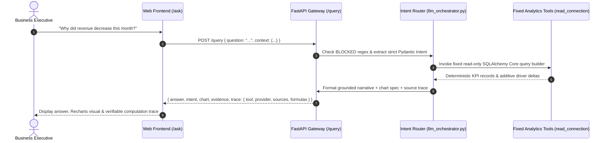
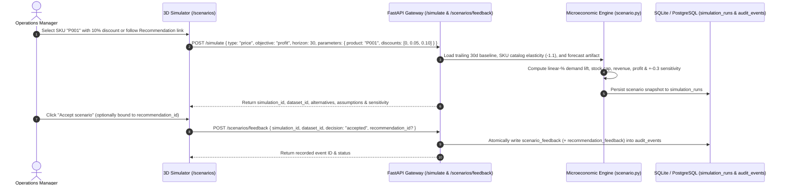
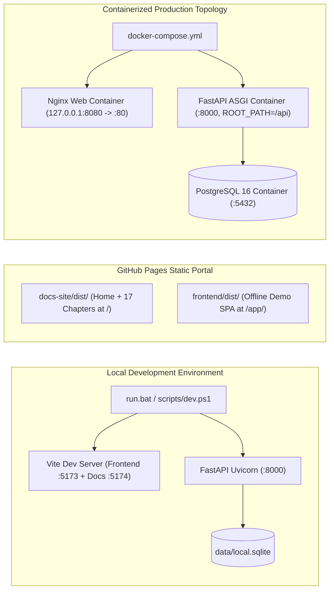

# DecisionPilot AI — Technical System Architecture Specification

> **Status:** Production-Ready MVP  
> **Application Title:** AI-Powered Business Data Analysis, Forecasting and Decision Support System for SMEs  
> **Repository:** [https://github.com/NguyenTriBaoThang/DecisionPilotAI](https://github.com/NguyenTriBaoThang/DecisionPilotAI)  
> **Documentation Portal:** [https://nguyentribaothang.github.io/DecisionPilotAI/](https://nguyentribaothang.github.io/DecisionPilotAI/)

---

## 1. Architecture Overview (Executive Summary)

**DecisionPilot AI** is an enterprise-grade Decision Intelligence system tailored specifically for Small and Medium Enterprises (SMEs). The platform bridges the gap between raw, siloed transaction databases and high-impact managerial choices by combining:

1. **Deterministic Analytics:** Accurate SQL-driven KPI aggregation across sales, marketing, and inventory.
2. **Machine Learning Intelligence:** Isolation Forest for multi-dimensional anomaly detection and LightGBM for lag-based demand forecasting.
3. **Microeconomic What-If Simulation:** A calibrated mathematical response engine modeling price elasticity and advertising response curves.
4. **Spatial 3D Holographic WebGL Interface:** An interactive Three.js control center offering spatial exploration of business scenarios.
5. **Audited Human-in-the-Loop Governance:** Grounded recommendations with confidence scores and tamper-proof decision logging.

### Core Architectural Principle
```text
Business Data (Transactions/Inventory/Ads)
    └──> Analytical Aggregation & Baselining
          └──> Statistical & ML Anomaly Detection (Isolation Forest)
                └──> Machine Learning Demand Forecasting (LightGBM)
                      └──> Microeconomic What-If Simulation Engine
                            └──> Grounded AI Recommendations
                                  └──> Human-in-the-Loop Decision & Audit Trail
```

---

## 2. High-Level 5-Tier Architecture Diagram

```mermaid
flowchart TB
    subgraph Presentation["1. Presentation Layer (React 19 + TypeScript 5.9 + Vite 7.3)"]
        Hero3D["Holographic AI Data Sphere (Three.js WebGL)"]
        Simulator3D["Scenario Simulator 3D (Overview / Focus / Compare)"]
        Landscape3D["3D Scenario Landscape (Platform Height Encoding)"]
        ExecDashboard["Executive KPI Dashboard & Gradient Recharts"]
        AskCopilot["Ask Business Data (Natural Language Copilot)"]
        AnomalyCenter["Anomaly Detection & Root-Cause Center"]
        ForecastCenter["Forecast Center (Confidence Intervals & Drivers)"]
        RecCenter["Recommendation Detail & Human Decision Controls"]
        DocsPortal["Multi-Page Technical Docs Portal (docs-site/ Home + 17 Chapters)"]
    end

    subgraph Gateway["2. API Gateway & Application Layer (FastAPI — Python 3.11–3.13)"]
        CORS["CORS, RBAC Middleware & Security Headers"]
        PydanticGuard["Domain Schema Validation (Pydantic v2 extra='forbid')"]
        AuditMW["Audit Logging & Concurrency Locks"]
        HealthEndpoint["/health & /session — Readiness & Actor Mode"]
        KPIEndpoint["/kpi/summary & /models/quality — Aggregator & Metrics"]
        QueryEndpoint["/query — Constrained Intent Router"]
        AnomalyEndpoint["/anomalies & /anomalies/{alert_id} — Ranked Alerts"]
        ForecastEndpoint["/forecast — Baseline-Gated Point & Interval Estimator"]
        SimulateEndpoint["/simulate & /scenarios/feedback — What-If Engine"]
        RecEndpoint["/recommendations & /recommendations/feedback — Governance"]
    end

    subgraph Intelligence["3. Analytics & Decision Intelligence Layer"]
        AnalyticalCore["Read-Only SQLAlchemy Core Analytics (analytics.py)"]
        AnomalyEngine["Hybrid Isolation Forest & 56d Shifted Z/IQR (anomaly.py)"]
        ForecastEngine["LightGBM + Seasonal Naive / Moving Avg (17 Features)"]
        ScenarioEngine["Price Elasticity, Power-Law Ads & Stock Limits (scenario.py)"]
        LLMOrchestrator["Intent Router & Fixed Analytics Tools (llm_orchestrator.py)"]
    end

    subgraph DataAccess["4. Persistence & Data Access Layer"]
        SQLAlchemyORM["SQLAlchemy 2.0 Core (read_connection / write locks)"]
        AlembicMigrations["Alembic Migrations (0001_initial, 0002_decision_integrity)"]
        SnapshotManager["Snapshot Ingestion & SHA-256 Validator (pipeline.py)"]
    end

    subgraph Storage["5. Physical Storage & Model Registry"]
        RelationalDB[("SQLite (Local Demo) / PostgreSQL 16 (Docker & CI)")]
        ModelArtifacts[("Joblib Model Registry: artifacts/<dataset_id>.joblib (dp-1.1)")]
        AuditStore[("Trigger-Protected Decision History: audit_events & simulation_runs")]
        SyntheticSource[("Synthetic Generator: data/synthetic/*.csv")]
    end

    Presentation --> Gateway
    Gateway --> Intelligence
    Intelligence --> DataAccess
    DataAccess --> Storage
```



---

## 3. Component Inventory & Responsibilities

### 3.1 Presentation Layer (`frontend/` & `docs-site/`)
- **Technology:** React 19.2, TypeScript 5.9, Vite 7.3, Tailwind CSS 4.1, Recharts 3.4, Three.js 0.186, Lucide React.
- **Primary Workspace Components (`frontend/`):**
  - `HolographicAIDataSphere.tsx`: Multi-layered 3D holographic sphere on a tiered glowing pedestal with orbital neon rings, reactive node particles, and dynamic lighting based on active business levers.
  - `ScenarioSimulator3D.tsx`: Coordinator component orchestrating 5 floating holographic glass views and 3 interaction modes (`overview`, `focus`, `compare`).
  - `Scenario3DLandscape.tsx`: 3D bar platform landscape encoding projected revenue and contribution profit into floating physical elevation.
  - `Dashboard.tsx`: Executive command center rendering core financial KPIs with sparklines, anomaly links into `/ask?q=...` via `utils/investigate.ts`, and workflow entrypoints.
  - `WorkspacePages.tsx`: Houses `Ask Copilot` (`/ask`), `Anomaly Center` (`/anomalies`), `Forecast Center` (`/forecast`), and `Recommendations` (`/recommendations`).
- **Multi-Page Documentation Portal (`docs-site/`):**
  - Serves a dedicated **HomePage** (`/DecisionPilotAI/`) introducing the platform, interactive Track 5 workflow cards, and chapter directory, linking to 17 focused single-chapter pages (`/DecisionPilotAI/docs/<chapter>`) with Breadcrumbs, Prev/Next pagination, Ctrl+K `SearchDialog`, and `?tab=ask|analyze|forecast|simulate` deep links, alongside the hosted static demo at `/DecisionPilotAI/app/`.

### 3.2 Application & API Gateway (`backend/app/`)
- **Technology:** FastAPI 0.121+, Uvicorn 0.38 ASGI server, Pydantic v2 strict schemas (`ConfigDict(extra="forbid")`).
- **Key Responsibilities:**
  - Enforces role-based Bearer tokens (`viewer`, `analyst`, `admin`) in `token` mode with constant-time HMAC digests (`hmac.compare_digest`), CORS origins, and `Cache-Control: no-store` / `X-Content-Type-Options: nosniff` headers.
  - Exposes 16 REST endpoints (`main.py`) with advisory locks (`pg_advisory_xact_lock` / SQLite `BEGIN IMMEDIATE`) and transactional scenario-to-recommendation feedback (`recommendation_id`).
  - Proxies local Vite development `/api/*` traffic from port `5173` to `8000` (and Nginx `/api/*` on Docker Compose port `8080`).

### 3.3 AI & Decision Intelligence Service (`ai_service/`)
- **Technology:** LightGBM 4.6, scikit-learn 1.7, NumPy, Pandas, Joblib.
- **Modules:**
  - `features.py`: Computes **17** causal point-in-time features (`lag_1`, `lag_7`, `lag_14`, `lag_28`, rolling `mean_7`/`std_7`/`mean_14`/`std_14`/`mean_28`/`std_28`, `growth_7`, `weekday`, `month`, `quarter`, `weekend`, `holiday`, and `scale = log1p(train_mean)`).
  - `forecasting.py`: Trains global `LGBMRegressor` with chronological 70/15/15 split and promotes LightGBM per target/scope/horizon only when validation MAE beats the better of `moving_average` and `seasonal_naive` by strictly more than `2.0%`.
  - `anomaly.py`: Evaluates a 56-day trailing baseline shifted 7 days (`shift(7).rolling(56, min_periods=28)`) combining `IsolationForest` (`n_estimators=120, contamination=0.065`), IQR, robust Z-scores, 7-day sustained revenue drops, and lead-time stockout risk.
  - `scenario.py`: Solves What-If pricing, marketing, and inventory simulations using linear-% price elasticity, concave power-law ad response (`exponent=0.65`), and warehouse stock limits.
  - `llm_orchestrator.py`: Enforces `BLOCKED` injection/SQL refusal regex, maps bilingual EN/VI queries into a typed `Intent` schema (local rules default; optional OpenAI/Gemini), and invokes fixed SQLAlchemy Core analytics tools with explicit `trace` grounding.

---

## 4. Key Sequence Workflows

### 4.1 Natural Language Query Flow (Fixed Analytics Tools — Zero Model-Written SQL)


### 4.2 3D Interactive Scenario Simulation & Atomic Decision Workflow


---

## 5. Microeconomic & Mathematical Formulations

### 5.1 Price & Discount Elasticity Engine
$$Q_{\text{simulated}} = Q_0 \times \max\left(0,\; 1 + \varepsilon \cdot \frac{\Delta P}{P_0}\right)$$
$$Q_{\text{fulfilled}} = \min\left(Q_{\text{simulated}},\; \text{Stock Capacity}\right)$$
$$\text{Revenue} = Q_{\text{fulfilled}} \times P_{\text{new}}, \quad \text{Gross Profit Delta} = \Delta \text{Revenue} - \Delta \text{COGS} - \text{Additional Cost}$$

*Where catalog $\varepsilon \in [-5.0, 0.0]$ (e.g., `-1.1` for SKU `P001`, overridable in UI/API) models conditional linear-% response and sensitivity runs across $\varepsilon \pm 0.3$.*

### 5.2 Marketing Budget Response Function (Diminishing Marginal Returns)
$$\text{Attributed Revenue}_{\text{sim}} = R_{\text{base}} \times \left(\frac{\text{Spend}_{\text{new}}}{\text{Spend}_{\text{base}}}\right)^{\alpha}$$

*Where exponent $\alpha \in [0.2, 0.95]$ (default $\alpha = 0.65$) models concave diminishing returns.*

---

## 6. Security, AI Safety & Sandboxing Guarantees

1. **Zero Model-Written SQL:** Neither users nor external LLMs ever author SQL queries. Incoming prompts are checked against the `BLOCKED` regex (`DROP TABLE`, `SELECT ... FROM`, prompt overrides) and parsed into a fixed Pydantic `Intent` (`extra="forbid"`), validated against catalog values, and executed exclusively via pre-written SQLAlchemy Core builders (`analytics.py`).
2. **Read-Only Analytical Sessions:** All query and analytics paths run inside `read_connection`: PostgreSQL enforces `REPEATABLE READ, READ ONLY` with `statement_timeout = '8s'`; SQLite enforces `PRAGMA query_only = ON`.
3. **Role-Based Access & Import Hardening:** Protected workspaces (`WORKSPACE_ACCESS_TOKENS`) enforce `viewer`, `analyst`, and `admin` roles with constant-time token comparison (`hmac.compare_digest`). Snapshot replacement (`POST /import`) requires `DEMO_ALLOW_IMPORT=true`, `admin` role, `X-Import-Token`, `expected_dataset_id` conflict match, and `40 MiB` upload cap.
4. **Human-in-the-Loop Safeguard:** Accepted recommendations or scenarios only record an executive decision—the platform never automatically mutates external ad budgets, storefront prices, or ERP purchase orders.
5. **Trigger-Protected Decision Ledger:** Migration `0002_decision_integrity` installs database triggers blocking updates/deletes on `audit_events` and `simulation_runs` (SQLite `RAISE(ABORT, ...)` triggers and PostgreSQL `BEFORE UPDATE OR DELETE OR TRUNCATE` via `protect_decision_history()`).

---

## 7. Deployment & Infrastructure Architecture



