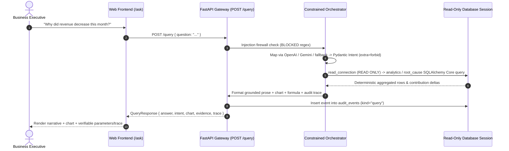
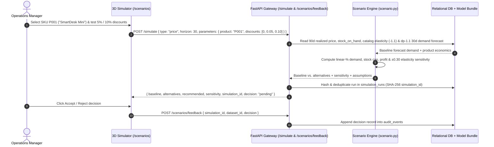
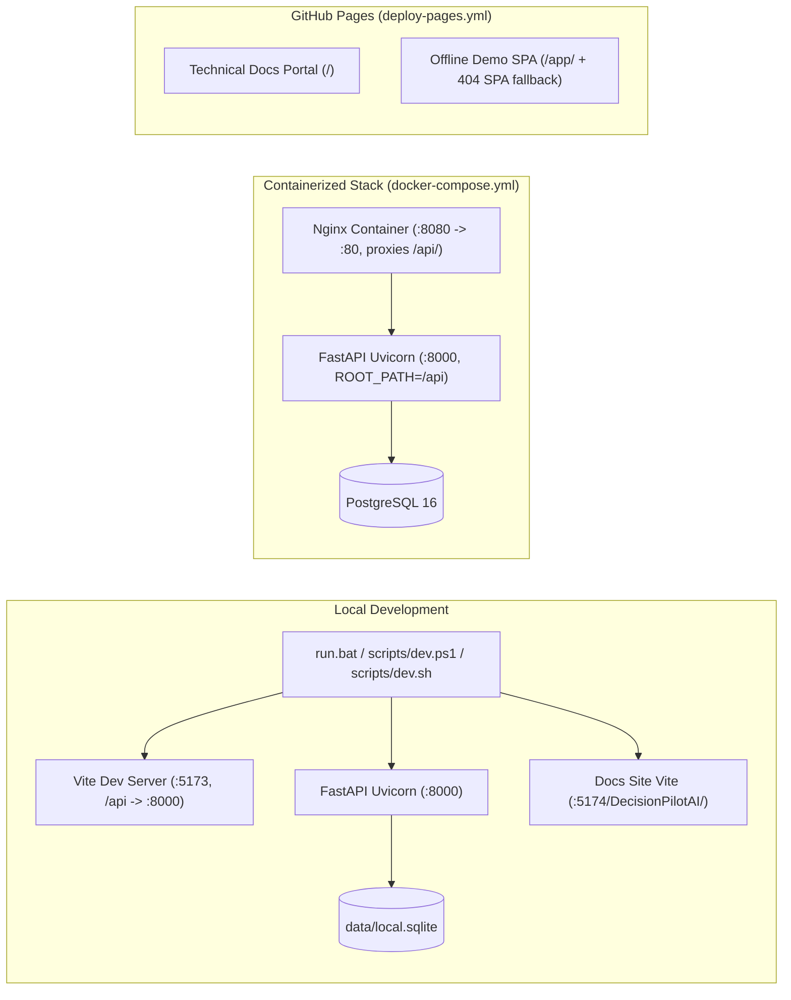

# DecisionPilot AI — Technical System Architecture Specification

> **Status:** Production-Ready MVP (`v1.0.0` / Model Bundle `dp-1.1`)  
> **Application Title:** AI-Powered Business Data Analysis, Forecasting and Decision Support System for SMEs  
> **Repository:** [https://github.com/NguyenTriBaoThang/DecisionPilotAI](https://github.com/NguyenTriBaoThang/DecisionPilotAI)  
> **Live Portal:** [Docs Site](https://nguyentribaothang.github.io/DecisionPilotAI/) • [Interactive App Demo](https://nguyentribaothang.github.io/DecisionPilotAI/app/)

---

## 1. Architecture Overview (Executive Summary)

**DecisionPilot AI** is a decision intelligence platform tailored for Small and Medium Enterprises (SMEs). The system connects transactional business databases with deterministic analytics, ML anomaly surveillance, validation-gated forecasting, econometric simulation, and audited executive workflows:

1. **Deterministic Analytics:** Allowlisted SQLAlchemy Core KPI queries executed inside `READ ONLY` database connections across sales, marketing, inventory, and calendar dimensions.
2. **Machine Learning Intelligence:** `IsolationForest` + IQR + robust Z-score anomaly surveillance against 56-day shifted rolling references, plus 17-feature `LGBMRegressor` demand forecasting gated by a strict `>2%` validation MAE improvement rule against `moving_average` and `seasonal_naive` baselines.
3. **Econometric & Stock What-If Simulation:** Counterfactual pricing, marketing diminishing-returns, and warehouse lead-time calculators with explicit sensitivity bands.
4. **Spatial 3D WebGL Workspace:** Interactive Three.js scene and hologram visualization exploring scenario metrics and trade-offs.
5. **Audited Human-in-the-Loop Governance:** Rule-grounded operational recommendations and SHA-256 keyed simulation runs logged with human decisions into `audit_events`.

### Core Decision Flow

```text
Business Data (6 Validated Tables)
    └──> Read-Only Analytical Core (analytics.py)
          └──> Hybrid Anomaly Surveillance & Root-Cause Attribution (anomaly.py, root_cause.py)
                └──> Validation-Gated Forecasting & 90% Empirical Bands (features.py, forecasting.py)
                      └──> Price / Marketing / Inventory Simulation Engine (scenario.py)
                            └──> Grounded Recommendations & Human Approval (services.py -> audit_events)
```

---

## 2. High-Level 5-Tier Architecture Diagram

```mermaid
flowchart TB
    subgraph Presentation["1. Presentation Tier (SPA — React 19.2 + TypeScript 5.9 + Vite 7.3)"]
        Hero3D["Holographic AI Data Sphere (Three.js 0.186)"]
        Simulator3D["3D Scenario Simulator (Overview / Focus / Compare)"]
        Landscape3D["3D Scenario Landscape (Platform Height Encoding)"]
        ExecDashboard["Executive KPI Dashboard & Gradient Recharts"]
        AskCopilot["Ask Business Data (Bilingual VI/EN Copilot + SQL/Tool Trace)"]
        AnomalyCenter["Anomaly Detection & Root-Cause Decomposition Center"]
        ForecastCenter["Forecast Center (7d/30d Horizons & 90% Calibrated Intervals)"]
        RecCenter["Recommendations & Immutable Audit Trail"]
    end

    subgraph Gateway["2. API Gateway & Application Layer (FastAPI 0.121.3 — ROOT_PATH=/api)"]
        AuthMW["Bearer Token RBAC Middleware (viewer / analyst / admin) + Security Headers"]
        PydanticGuard["Strict Domain Validation (Pydantic v2, extra=forbid)"]
        ReadRoutes["Read Endpoints: /health, /session, /dataset, /options, /models/quality, /kpi/summary, /anomalies, /audit"]
        ComputeRoutes["AI Endpoints: POST /query, POST /forecast, POST /simulate, GET /recommendations"]
        WriteRoutes["Governed Mutation Endpoints: POST /scenarios/feedback, POST /recommendations/feedback, POST /import"]
    end

    subgraph Intelligence["3. AI & Decision Intelligence Layer (ai_service/ + analytics.py)"]
        AnalyticalCore["Allowlisted SQLAlchemy Core Aggregator (analytics.py, root_cause.py)"]
        AnomalyEngine["56d Shifted Isolation Forest + IQR + Robust Z-Score (anomaly.py)"]
        ForecastEngine["17-Feature LightGBM + Baselines + 2%-Gate Selector (features.py, forecasting.py)"]
        ScenarioEngine["Price Elasticity, Power-Law Spend & Daily Stock Engine (scenario.py)"]
        LLMOrchestrator["Constrained Intent Router & Regex Injection Firewall (llm_orchestrator.py)"]
    end

    subgraph DataAccess["4. Persistence & Pipeline Layer (SQLAlchemy 2.0.44 + Alembic 1.17.2)"]
        ReadPool["read_connection (PG: REPEATABLE READ + READ ONLY + 8s timeout | SQLite: PRAGMA query_only)"]
        AlembicMigrations["Alembic Migrations (0001_initial -> 0002_decision_integrity)"]
        SnapshotManager["CSV/XLSX Normalizer, Invariant Checks & SHA-256 Lock (pipeline.py)"]
    end

    subgraph Storage["5. Physical Storage & Model Registry"]
        RelationalDB[("SQLite (data/local.sqlite) / PostgreSQL 16 (Docker/CI)")]
        ModelArtifacts[("Joblib Model Registry: artifacts/<dataset_id>.joblib (dp-1.1)")]
        SystemTables[("System Tables: dataset_metadata, audit_events, simulation_runs")]
        SyntheticSource[("Synthetic Snapshot CSVs: data/synthetic/*.csv (50k txns, 730 days)")]
    end

    Presentation --> Gateway
    Gateway --> Intelligence
    Intelligence --> DataAccess
    DataAccess --> Storage
```



---

## 3. Component Inventory & Responsibilities

### 3.1 Presentation Layer (`frontend/`)
- **Technology:** React `19.2.0`, TypeScript `5.9.3`, Vite `7.3.7`, Tailwind CSS `4.1.17`, Recharts `3.4.1`, Three.js `0.186.1`, TanStack Query `5.90.10`, React Router `7.18.5`, Zod `4.6.7`.
- **Key Modules:**
  - `features/scenario-simulator/components/HolographicAIDataSphere.tsx`: Multi-layered Three.js holographic sphere mounted on a pedestal with orbital rings and reactive data lighting.
  - `features/scenario-simulator/components/ScenarioSimulator3D.tsx`: Coordinates holographic panels and scenario interaction modes (`overview`, `focus`, `compare`).
  - `components/Scenario3DLandscape.tsx`: Interactive 3D platform visualization comparing baseline vs. alternative P&L outcomes.
  - `Dashboard.tsx`: Multi-filter Executive Command Center displaying Revenue, Profit, Margin, Orders, AOV, ROAS, and Stock metrics.
  - `WorkspacePages.tsx`: Houses `Ask`, `Anomalies`, `Forecast`, `Scenarios`, and `Recommendations`.
  - `api.ts` & `mockData.ts`: Typed HTTP API client with offline demo fallback when hosted statically on GitHub Pages (`/DecisionPilotAI/app/`).

### 3.2 Application & API Gateway (`backend/app/`)
- **Technology:** FastAPI `0.121.3`, Uvicorn `0.38.0`, Pydantic v2 (`ConfigDict(extra="forbid")`).
- **Key Modules:**
  - `main.py`: Exposes 16 endpoints (`/health`, `/session`, `/dataset`, `/options`, `/models/quality`, `/kpi/summary`, `/query`, `/anomalies`, `/anomalies/{alert_id}`, `/forecast`, `/simulate`, `/scenarios/feedback`, `/recommendations`, `/recommendations/feedback`, `/audit`, `/import`), workspace RBAC middleware, and PostgreSQL advisory / SQLite `BEGIN IMMEDIATE` write locks.
  - `schemas.py`: Enforces strict input validation (`Horizon = Literal[7, 30]`, bounded discount/spend/inventory ranges, SHA-256 `simulation_id` matching).
  - `security.py`: Parses `WORKSPACE_ACCESS_TOKENS` JSON credentials, enforcing `admin` on `/import`, `analyst` on `*/feedback`, and `viewer` on analytics reads (with unauthenticated liveness-only `/health` probe when auth is enabled).
  - `db.py`: Defines 6 core business tables (`calendar_events`, `products`, `customers`, `marketing_campaigns`, `sales_transactions`, `inventory_daily`) and 3 system tables (`dataset_metadata`, `audit_events`, `simulation_runs`), plus the `read_connection` context manager.

### 3.3 AI & Decision Intelligence Service (`ai_service/`)
- **Technology:** LightGBM `4.6.0`, scikit-learn `1.7.2`, NumPy `2.2.6`, Pandas `2.3.3`, Joblib `1.5.2`, HTTPX `0.28.1`.
- **Modules:**
  - `features.py`: Builds 17 point-in-time features (`lag_1`, `lag_7`, `lag_14`, `lag_28`, `mean_7`, `std_7`, `mean_14`, `std_14`, `mean_28`, `std_28`, `growth_7`, `weekday`, `month`, `quarter`, `weekend`, `holiday`, `scale`), daily anomaly inputs, and offline RFM/inventory feature tables.
  - `forecasting.py`: Trains global scaled `LGBMRegressor` models over `70%/15%/15%` chronological splits, applies the `>2%` validation MAE gate vs. `moving_average` and `seasonal_naive`, and calibrates empirical 90% intervals separately for horizons `1–7d` and `8–30d`.
  - `anomaly.py`: Evaluates deviations against a **56-day rolling window shifted 7 days (`min_periods=28`)** combining `IsolationForest(n_estimators=120, contamination=0.065)` + IQR + robust Z-score + sustained weekly drop + lead-time `stockout_risk` business rules.
  - `root_cause.py`: Computes additive variance attribution across product, category, region, and sales channel.
  - `scenario.py`: Runs `price`, `marketing`, and `inventory` simulations with `sensitivity` variations ($\pm 0.30$ elasticity / $\pm 0.15$ marketing response exponent).
  - `llm_orchestrator.py`: Routes English/Vietnamese questions via OpenAI (`gpt-4.1-mini`), Gemini (`gemini-2.5-flash`), or regex fallback into validated `Intent` objects; never runs LLM-generated SQL or code.

---

## 4. Key Sequence Workflows

### 4.1 Natural Language Query Flow (Typed Intent + Read-Only Execution)



### 4.2 3D Interactive Scenario Simulation & Approval Workflow



---

## 5. Mathematical Formulations (`ai_service/scenario.py`)

### 5.1 Price & Discount Elasticity Engine
$$Q_{\text{demand}} = Q_{\text{base}} \times \max\left(0,\; 1 + e \times \left(\frac{P_{\text{new}}}{P_{\text{base}}} - 1\right)\right)$$
$$Q_{\text{sold}} = \min(Q_{\text{demand}},\; \text{current\_stock}), \qquad \text{shortage} = \max(0,\; Q_{\text{demand}} - Q_{\text{sold}})$$
$$\text{Revenue} = \text{round}(Q_{\text{sold}} \times P_{\text{new}}), \qquad \text{Profit} = (\text{Revenue} - \text{round}(Q_{\text{sold}} \times \text{unit\_cost})) - \text{additional\_cost}$$

*Where $e \in [-5.0, 0.0]$ comes from product catalog elasticity (e.g., `-1.1` for P001) or operator override, $P_{\text{base}}$ is the past 90-day weighted realized unit price, and sensitivity evaluates $e \pm 0.30$.*

### 5.2 Marketing Budget Response Function (Power-Law Diminishing Returns)
$$\text{uplift} = \left(1 + \Delta \text{Spend}\right)^{\alpha}, \qquad \alpha \in [0.20, 0.95]\;(\text{default } 0.65)$$
$$R_{\text{simulated}} = \text{round}(R_{\text{prorated\_28d}} \times \text{uplift}), \qquad \text{Profit} = \text{GP}_{\text{simulated}} - \text{Spend}_{\text{simulated}}$$

*Where $\Delta \text{Spend} \in [-1.0, 2.0]$, proration scales the latest 28 observed channel days to horizon `7` or `30`, and sensitivity evaluates $\alpha \pm 0.15$.*

### 5.3 Inventory Replenishment Simulation
For each horizon day $d \in \{1 \dots H\}$, daily stock balance subtracts predicted daily demand $D_d$ and adds `incoming_stock` on `arrival_day`, recording unmet `lost_units`, `ending_stock`, `stockout_days`, and `below_safety_days` against physical warehouse `reorder_point` across candidate order quantities.

---

## 6. Security, AI Safety & Transaction Boundaries

1. **Read-Only Analytical Context (`read_connection`):** All analytics, forecast serving, anomaly queries, and `/query` handlers run inside `read_connection` (`SET TRANSACTION ISOLATION LEVEL REPEATABLE READ, READ ONLY` + `SET LOCAL statement_timeout = '8s'` on PostgreSQL; `PRAGMA query_only = ON` on SQLite).
2. **Constrained Intent Allowlist:** Natural-language queries never emit executable SQL or Python. Inputs are checked against injection/keyword regexes and bound strictly to Pydantic `Intent` fields covering allowlisted dimensions, metrics, and pre-written SQLAlchemy Core statements.
3. **Bounded Endpoint Payloads & Timeouts:** Pagination limits are capped (`limit <= 100` on `/anomalies` and `/audit`), uploads on `/import` are capped at `40 MiB` (`LIMIT_BYTES`), and Nginx HTTP proxy timeout is `90s`.
4. **Concurrency-Safe Governance Writes:** `/simulate`, `/scenarios/feedback`, `/recommendations/feedback`, and snapshot replacement acquire `pg_advisory_xact_lock(177480102)` on PostgreSQL or `BEGIN IMMEDIATE` on SQLite and verify the active `dataset_id` has not shifted mid-decision.
5. **Immutable Audit History (`audit_events`):** Queries (`kind="query"`), snapshot imports (`dataset_loaded`), scenario feedback (`scenario_feedback`), and recommendation decisions (`recommendation_feedback`) append structured JSON audit records with actor identity.

---

## 7. Deployment, CI/CD & Documentation Architecture


