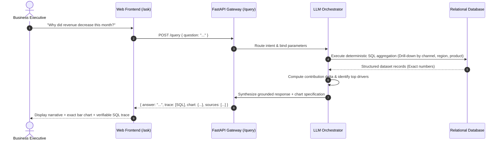
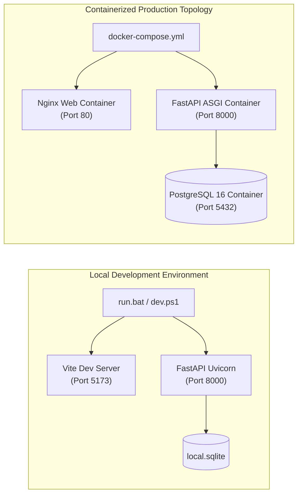

# DecisionPilot AI — Technical System Architecture Specification

> **Status:** Production-Ready MVP  
> **Application Title:** AI-Powered Business Data Analysis, Forecasting and Decision Support System for SMEs  
> **Repository:** [https://github.com/DecisionPilotAI/DecisionPilotAI](file:///g:/GITHUB/DecisionPilotAI)

---

## 1. Architecture Overview (Executive Summary)

**DecisionPilot AI** is an enterprise-grade Decision Intelligence system tailored specifically for Small and Medium Enterprises (SMEs). The platform bridges the gap between raw, siloed transaction databases and high-impact managerial choices by combining:

1. **Deterministic Analytics:** Accurate SQL-driven KPI aggregation across sales, marketing, and inventory.
2. **Machine Learning Intelligence:** Isolation Forest for multi-dimensional anomaly detection and LightGBM for lag-based demand forecasting.
3. **Microeconomic What-If Simulation:** A calibrated mathematical response engine modeling price elasticity and advertising response curves.
4. **Spatial 3D Holographic WebGL Interface:** An interactive Three.js control center offering spatial exploration of business scenarios.
5. **Audited Human-in-the-Loop Governance:** Grounded recommendations with confidence scores and tamper-proof decision logging.

### Core Architectural Principle
```text
Business Data (Transactions/Inventory/Ads)
    └──> Analytical Aggregation & Baselining
          └──> Statistical & ML Anomaly Detection (Isolation Forest)
                └──> Machine Learning Demand Forecasting (LightGBM)
                      └──> Microeconomic What-If Simulation Engine
                            └──> Grounded AI Recommendations
                                  └──> Human-in-the-Loop Decision & Audit Trail
```

---

## 2. High-Level 5-Tier Architecture Diagram

```mermaid
flowchart TB
    subgraph Presentation["1. Presentation Layer (SPA — React 19 + TypeScript + Vite 7)"]
        Hero3D["Holographic AI Data Sphere (Three.js WebGL)"]
        Simulator3D["Scenario Simulator 3D (Overview / Focus / Compare)"]
        Landscape3D["3D Scenario Landscape (Platform Height Encoding)"]
        ExecDashboard["Executive KPI Dashboard & Gradient Recharts"]
        AskCopilot["Ask Business Data (Natural Language Copilot)"]
        AnomalyCenter["Anomaly Detection & Root-Cause Center"]
        ForecastCenter["Forecast Center (Confidence Intervals & Drivers)"]
        RecCenter["Recommendation Detail & Human Decision Controls"]
    end

    subgraph Gateway["2. API Gateway & Application Layer (FastAPI — Python 3.13)"]
        CORS["CORS & Request Validation Middleware"]
        PydanticGuard["Domain Schema Validation (Pydantic v2)"]
        AuditMW["Audit Logging & Security Context"]
        HealthEndpoint["/health — Diagnostic Probe & Ready Status"]
        KPIEndpoint["/kpi/summary — Multi-grain Aggregator"]
        QueryEndpoint["/query — Constrained Intent Router"]
        AnomalyEndpoint["/anomalies — Ranked Severity Service"]
        ForecastEndpoint["/forecast — Point & Interval Estimator"]
        SimulateEndpoint["/simulate — Microeconomic What-If Engine"]
        RecEndpoint["/recommendations — Action Formulator & Feedback"]
    end

    subgraph Intelligence["3. Analytics & Decision Intelligence Layer"]
        AnalyticalCore["SQL / Pandas Analytics Core (analytics.py)"]
        AnomalyEngine["Isolation Forest & Robust Z-Scores (anomaly.py)"]
        ForecastEngine["LightGBM Regressor (14 Lags + Rolling Windows)"]
        ScenarioEngine["Microeconomic Elasticity & Supply Chain Capping (scenario.py)"]
        LLMOrchestrator["Prompt Engine & Numerical Grounding (llm_orchestrator.py)"]
    end

    subgraph DataAccess["4. Persistence & Data Access Layer"]
        SQLAlchemyORM["SQLAlchemy 2.0 ORM & Connection Pooling"]
        AlembicMigrations["Alembic Database Version Control (head)"]
        SnapshotManager["Snapshot Ingestion & Hash Verifier (pipeline.py)"]
    end

    subgraph Storage["5. Physical Storage & Model Registry"]
        RelationalDB[("SQLite (Local Demo) / PostgreSQL 16 (Production)")]
        ModelArtifacts[("Joblib Model Registry: artifacts/<dataset_id>.joblib")]
        AuditStore[("Audit Trail Table: audit")]
        SyntheticSource[("Synthetic Generator: data/synthetic/*.csv")]
    end

    Presentation --> Gateway
    Gateway --> Intelligence
    Intelligence --> DataAccess
    DataAccess --> Storage
```



---

## 3. Component Inventory & Responsibilities

### 3.1 Presentation Layer (`frontend/`)
- **Technology:** React 19.2, TypeScript 5.6, Vite 7.2, Tailwind CSS 4, Recharts 3.4, Three.js 0.186, Lucide React.
- **Components:**
  - `HolographicAIDataSphere.tsx`: Multi-layered 3D holographic sphere on a tiered glowing pedestal with orbital neon rings, reactive node particles, and dynamic lighting based on active business levers.
  - `ScenarioSimulator3D.tsx`: Coordinator component orchestrating 5 floating holographic glass panels and 3 interaction modes (`overview`, `focus`, `compare`).
  - `Scenario3DLandscape.tsx`: 3D bar platform landscape encoding projected revenue and contribution profit into floating physical elevation.
  - `Dashboard.tsx`: Executive command center rendering core financial KPIs with sparklines and anomaly badges.
  - `WorkspacePages.tsx`: Houses `Ask Copilot`, `Anomaly Center`, `Forecast Center`, and `Recommendations`.

### 3.2 Application & API Gateway (`backend/app/`)
- **Technology:** FastAPI, Uvicorn ASGI server, Pydantic v2 schemas.
- **Key Responsibilities:**
  - Route validation, HTTP exception handling, and database connection lifecycle.
  - Enforces JSON response specifications with sub-50ms latency.
  - Securely proxies local Vite development traffic from port `5173` to `8000`.

### 3.3 AI & Decision Intelligence Service (`ai_service/`)
- **Technology:** scikit-learn, LightGBM 4.6, NumPy, Pandas, Joblib.
- **Modules:**
  - `features.py`: Computes 14 temporal features (demand lag 1, 7, 14, 28 days, 7d/14d/28d rolling mean and standard deviation, growth rates, calendar flags).
  - `forecasting.py`: Trains LightGBM regression model with temporal split (70% train, 15% validation, 15% test) to prevent time-series data leakage.
  - `anomaly.py`: Executes multi-metric Isolation Forest to surface revenue dips, margin compression, and ad spend inefficiencies.
  - `scenario.py`: Solves What-If simulations using microeconomic formulas with physical constraints.
  - `llm_orchestrator.py`: Implements zero-hallucination natural language interpretation with strict database grounding.

---

## 4. Key Sequence Workflows

### 4.1 Natural Language Query Flow (Zero-Hallucination Grounding)


### 4.2 3D Interactive Scenario Simulation Workflow
```mermaid
sequenceDiagram
    autonumber
    actor Manager as Operations Manager
    participant UI as 3D Holographic Simulator (/scenarios)
    participant API as Simulation Service (/simulate)
    participant Engine as Microeconomic What-If Engine
    participant Registry as Model Artifacts

    Manager->>UI: Adjusts Discount Slider to 10% on "SmartDesk Mini"
    UI->>API: POST /simulate { type: "price", horizon: 30, parameters: { discounts: [0.10] } }
    API->>Registry: Load historical baseline & elasticity parameters
    Registry-->>Engine: Calibrated elasticity e = -1.1, base demand = 180 units
    Engine->>Engine: Compute new demand, revenue, unit costs, and profit
    Engine->>Engine: Run sensitivity variations (+/- 20% elasticity bounds)
    Engine-->>API: Simulation outcome matrix & recommended optimal variant
    API-->>UI: Return Baseline vs Alternative metrics + sensitivity
    UI-->>Manager: 3D AI Data Sphere pulses; comparison platform elevation adjusts in real time
```

---

## 5. Microeconomic & Mathematical Formulations

### 5.1 Price & Discount Elasticity Engine
$$\Delta Q = Q_0 \times \epsilon \times \frac{\Delta P}{P_0}$$
$$Q_{\text{simulated}} = \max\left(0, \min\left(Q_{\text{stock\_capacity}}, Q_0 \times \left(1 + \epsilon \times \frac{\Delta P}{P_0}\right)\right)\right)$$
$$\text{Revenue} = Q_{\text{simulated}} \times P_{\text{new}}$$
$$\text{Contribution Profit} = \text{Revenue} - \left(Q_{\text{simulated}} \times \text{Unit Cost}\right) - \text{Incremental Marketing Cost}$$

*Where $\epsilon \in [-5.0, 0.0]$ represents empirical price elasticity and $Q_{\text{stock\_capacity}}$ caps demand at physical inventory limits.*

### 5.2 Marketing Budget Response Function (Diminishing Marginal Returns)
$$R_{\text{incremental}} = R_{\text{baseline}} \times \left(1 + \frac{\Delta \text{Spend}}{\text{Spend}_{\text{baseline}}}\right)^\alpha - R_{\text{baseline}}$$

*Where exponent $\alpha \in [0.1, 0.9]$ enforces concave diminishing marginal returns rather than unrealistic infinite linear scaling.*

---

## 6. Security, AI Safety & Sandboxing Guarantees

1. **Strict Read-Only SQL Operations:** The application layer connects using a read-only database session for analytical queries. Mutation operations are restricted to the audit logging table.
2. **Schema Allowlist:** SQL generation is constrained to an explicit 6-table allowlist schema (`sales_transactions`, `products`, `customers`, `marketing_campaigns`, `inventory_daily`, `calendar_events`). Direct table drops, schema alterations, or raw system catalog queries are blocked.
3. **Execution Guardrails:** Row limits (`LIMIT 100`) and query execution timeouts (3000ms) prevent denial-of-service via expensive cross joins.
4. **Human-in-the-Loop Safeguard:** The AI engine is strictly non-autonomous for transactional business execution: price changes, marketing budgets, and supplier purchase orders require human executive sign-off.
5. **Audited Decisions:** Every action taken by a manager (Approve / Reject) is permanently written to the `audit` table with timestamp, user context, recommendation ID, and rationale.

---

## 7. Deployment & Infrastructure Architecture



