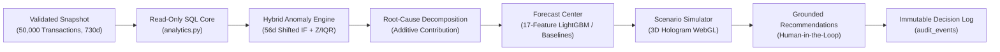

# DecisionPilot AI — Competition Submission

> **Competition:** AI for Business Innovation 2026 — LIKELION & K-TECH College  
> **Track:** 5. Data & Decision Intelligence  
> **Status:** Production MVP (`v1.0.0` / Model Bundle `dp-1.1`)  
> **Repository:** [https://github.com/NguyenTriBaoThang/DecisionPilotAI](https://github.com/NguyenTriBaoThang/DecisionPilotAI)  
> **Live Portal:** [Technical Documentation Site](https://nguyentribaothang.github.io/DecisionPilotAI/) • [Interactive App Demo](https://nguyentribaothang.github.io/DecisionPilotAI/app/)

---

## 1. Project Overview

| Attribute | Details |
| :--- | :--- |
| **Product Name** | **DecisionPilot AI** |
| **Official Title** | AI-Powered Business Data Analysis, Forecasting and Decision Support System for SMEs |
| **Tagline** | *Ask. Understand. Predict. Decide.* |
| **Primary Domain** | Applied Artificial Intelligence, Decision Intelligence, Predictive Business Analytics |
| **Target Audience** | Small & Medium Enterprises (retail, e-commerce, services): Founders, Sales, Marketing, Inventory & Finance Leads |
| **Submission Version** | `v1.0.0` (Model bundle `dp-1.1`, dataset `f32e87e3a5744333ff98d3bf`) |

---

## 2. Executive Summary & Problem Statement

### 2.1 The SME Decision Paradox
Small and Medium Enterprises in retail, e-commerce, and services generate operational logs across POS software, digital advertising platforms, warehouse sheets, and customer histories, yet routinely hit a critical **decision bottleneck**:

1. **Scattered & Siloed Data:** Sales transactions, ad funnel metrics, and warehouse stock ledgers live in fragmented spreadsheets without cross-table relational checks.
2. **Absence of Dedicated Data Teams:** Most SMEs lack full-time data scientists or analysts to write time-series lag pipelines or statistically controlled anomaly monitors.
3. **Passive & Delayed Visibility:** Traditional dashboards only summarize historical totals (*"What happened?"*), leaving teams unsure *why* gross profit shifted across channels or *when* physical stock will run out relative to supplier lead times.
4. **Gut-Feel Tactical Decisions:** Ad-hoc discounting, budget scaling, and restock orders are made without counterfactual sensitivity bounds—causing margin erosion or stockouts on fast-moving SKUs.
5. **Unconstrained Chatbot Hallucinations:** Generic LLM wrappers invent numbers or attempt unsafe raw SQL generation against production databases.

---

## 3. The DecisionPilot AI Solution

DecisionPilot AI unifies relational analytics, machine learning, econometric simulation, and executive approval inside a deterministic **Decision Intelligence Chain**:

$$\mathbf{Business\ Data} \longrightarrow \mathbf{Read\text{-}Only\ Analytics} \longrightarrow \mathbf{Anomaly\ Radar} \longrightarrow \mathbf{Root\text{-}Cause\ Drivers} \longrightarrow \mathbf{LightGBM\ Forecast} \longrightarrow \mathbf{Scenario\ Simulator} \longrightarrow \mathbf{Recommendations} \longrightarrow \mathbf{Audit\ Log}$$



### 3.1 Four Core Architectural Capabilities

1. **Counterfactual Price, Marketing & Inventory Simulation ([`ai_service/scenario.py`](./ai_service/scenario.py)):**
   - **Price Promotion:** Models linear percentage demand response relative to 90-day realized prices: $Q = Q_0 \cdot \max(0,\; 1 + e \cdot (P_{\text{new}}/P_0 - 1))$ where $e \in [-5, 0]$, capped at warehouse stock on hand with $\pm 0.30$ elasticity sensitivity bounds.
   - **Marketing Spend:** Models diminishing marginal returns via power-law response $(1 + \Delta S)^\alpha$ where $\alpha \in [0.20, 0.95]$ (default `0.65`) with $\pm 0.15$ exponent sensitivity checks.
   - **Inventory Replenishment:** Simulates daily opening stock, inbound delivery day `arrival_day`, demand drawdowns, unmet stockout units, and `reorder_point` buffer breaches.

2. **Interactive 3D Holographic Scenario Simulator (Three.js WebGL):**  
   Spatial executive interface in [`frontend/src/features/scenario-simulator/`](./frontend/src/features/scenario-simulator/) pairing a WebGL Holographic AI Data Sphere with 5 floating holographic workspace panels (`overview`, `pricing`, `marketing`, `inventory`, `recommendations`), 3 interaction modes (`overview`, `focus`, `compare`), and 3D outcome landscapes.

3. **Zero-Hallucination Grounding ([`ai_service/llm_orchestrator.py`](./ai_service/llm_orchestrator.py)):**  
   Bilingual VI/EN inputs pass through a prompt/SQL-injection guard and map strictly onto a Pydantic `Intent` (`extra="forbid"`) bound to pre-approved SQLAlchemy Core queries on `READ ONLY` database transactions (`REPEATABLE READ, READ ONLY` + `8s` timeout in PostgreSQL; `PRAGMA query_only` in SQLite).

4. **Human-in-the-Loop Governance & Auditing ([`backend/app/main.py`](./backend/app/main.py)):**  
   Every query, simulated scenario run (`simulation_runs` keyed by SHA-256), and executive decision (`Accept` / `Reject`) is recorded alongside the active `dataset_id` and actor role inside `audit_events`.

---

## 4. Technical Stack & Implementation Integrity

```text
┌───────────────────────────────────────────────────────────────────────────────────────┐
│                               DECISIONPILOT AI (v1.0.0)                               │
├──────────────────┬────────────────────────────────────────────────────────────────────┤
│ Frontend         │ React 19.2, TypeScript 5.9, Vite 7.3, Three.js 0.186, Tailwind 4.1 │
│                  │ Recharts 3.4, TanStack Query 5.90, React Router 7.18, Zod 4.6     │
├──────────────────┼────────────────────────────────────────────────────────────────────┤
│ Backend API      │ FastAPI 0.121.3, Uvicorn 0.38.0, Pydantic v2, Python 3.12+         │
├──────────────────┼────────────────────────────────────────────────────────────────────┤
│ Database & ORM   │ SQLAlchemy 2.0.44, Alembic 1.17.2, SQLite 3 / PostgreSQL 16       │
├──────────────────┼────────────────────────────────────────────────────────────────────┤
│ Machine Learning │ LightGBM 4.6.0, scikit-learn 1.7.2, Joblib 1.5.2, Pandas 2.3.3     │
├──────────────────┼────────────────────────────────────────────────────────────────────┤
│ Verified Dataset │ 730 days (2024-10-01..2026-09-30), 50 SKUs, 10,000 customers,      │
│ & CI Checks      │ 50,000 transactions, 2,920 campaigns, 24,820 stock rows, 5-job CI │
└──────────────────┴────────────────────────────────────────────────────────────────────┘
```

- **Verified Code & Artifacts:** All charts and numbers derive directly from reproducible snapshot validation (`data/synthetic`) and trained artifacts (`artifacts/f32e87e3a5744333ff98d3bf.joblib`).
- **Dual-Mode Hosting:** Full-stack via `docker compose up --build` / `scripts/dev.ps1`, plus static offline fallback demo on GitHub Pages (`/DecisionPilotAI/app/`).

---

## 5. Model Evaluation & Benchmark Results (Verified)

All empirical metrics originate directly from [`artifacts/MODEL_EVALUATION.md`](./artifacts/MODEL_EVALUATION.md), [`artifacts/query_benchmark.json`](./artifacts/query_benchmark.json), and [`artifacts/scenario_backtest.json`](./artifacts/scenario_backtest.json):

| Task / Scope | Architecture / Method | Baseline / Gate | Verified Holdout Result |
| :--- | :--- | :--- | :--- |
| **Forecast: Aggregate Revenue (`all`, 30d)** | `Moving Average` selected (`17`-feature `LightGBM` challenger tested) | `>2%` val MAE gate vs `seasonal_naive` & `moving_average` | **`moving_average`**: **24.14% WAPE**, `34.58M ₫ MAE`, **83.81%** 90% cov. (7d: **21.84% WAPE**, **91.96%** cov.) |
| **Forecast: SKU Demand (`sku:P001`, 30d)** | **`LightGBM Regressor`** (`17` causal features, promoted via `>2%` gate) | `moving_average` (`43.28%`), `seasonal_naive` (`54.54%`) | **`lightgbm`**: **2.68 units MAE**, **41.87% WAPE**, **92.86%** empirical interval coverage |
| **Anomaly Detection (`facebook_spend` / `revenue`)** | `IsolationForest` + IQR + robust Z (`56d` window shifted `7d`) | Standalone `z_score` / `robust_z` / `iqr` | `facebook_spend`: **100.00% precision**, **82.14% recall**, **90.20% F1**, **0.00% FPR**; `revenue`: **86.67% precision** |
| **Conditional Scenario Replay (7d)** | Price elasticity + P003 stock ledger + FB spend curve | Historical baseline WAPE | Weekly P001 units: **23.99% WAPE** (vs `24.24%` baseline); P003 depletion matched **15/15** weeks |
| **NL Copilot (`POST /query`)** | Constrained VI/EN Intent Router + Read-Only SQLAlchemy Core | 46-case golden & adversarial suite | **46/46 (100.0%)** across intent, execution, filters, chart, numerical & grounding; **1,432.2 ms median** latency |

---

## 6. Projected SME Workflow Value (Design Goals)

Unlike the empirical ML benchmarks above, operational workflow improvements represent **target design benefits** for SMEs adopting the platform over manual spreadsheet workflows:

| Workflow Dimension | Typical Manual SME Process | DecisionPilot AI Workflow Capability |
| :--- | :--- | :--- |
| **Weekly KPI Consolidation** | Multi-hour manual CSV/Excel pivot assembly | Pre-aggregated SQLAlchemy KPIs filtered instantaneously across 6 relational tables |
| **Ad-Hoc Question Answering** | Waiting for spreadsheet lookup or analyst availability | Self-service VI/EN Copilot (`1.43s` median latency on benchmark suite) with transparent query trace |
| **Anomaly & Spend Surveillance** | Discovered passively at month-end accounting close | Proactive 56d-shifted daily detection highlighting spend spikes, margin slips, and stock depletion risks |
| **Discount & Stock Planning** | Gut-feel promotions risking stockouts or margin bleed | Side-by-side counterfactual P&L and sensitivity comparison before executive sign-off in `audit_events` |

---

## 7. Submission Deliverables Index

- [x] **Full Application Codebase:** [`frontend/`](./frontend), [`backend/`](./backend), [`ai_service/`](./ai_service), [`scripts/`](./scripts), [`tests/`](./tests).
- [x] **GitHub Pages Documentation & Live App:** [`docs-site/`](./docs-site) + [`.github/workflows/deploy-pages.yml`](./.github/workflows/deploy-pages.yml).
- [x] **Project Overview & Quick Start:** [`README.md`](./README.md).
- [x] **System Architecture Guide:** [`ARCHITECTURE.md`](./ARCHITECTURE.md).
- [x] **Model Versioning & Lifecycle:** [`MODEL_VERSIONING.md`](./MODEL_VERSIONING.md).
- [x] **AI Explainability & Jury Q&A:** [`docs/AI_EXPLAINABILITY_AND_EVALUATION.md`](./docs/AI_EXPLAINABILITY_AND_EVALUATION.md).
- [x] **Relational Data Model & Dictionary:** [`docs/data-model.md`](./docs/data-model.md) & [`docs/DATA_DICTIONARY.md`](./docs/DATA_DICTIONARY.md).
- [x] **REST API Specifications:** [`docs/API.md`](./docs/API.md).
- [x] **Machine Learning Technical Specs:** [`docs/ml-training-and-data.md`](./docs/ml-training-and-data.md).
- [x] **Operations & Deployment Manual:** [`docs/operations.md`](./docs/operations.md).
