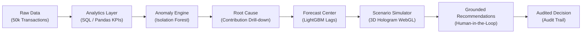

# DecisionPilot AI — Competition Submission

> **Competition:** AI for Business Innovation 2026 — LIKELION & K-TECH College  
> **Track:** 5. Data & Decision Intelligence  
> **Status:** Working MVP (prototype) on synthetic data (`dp-1.1` / `f32e87e3a5744333ff98d3bf`)  
> **Repository:** [https://github.com/NguyenTriBaoThang/DecisionPilotAI](https://github.com/NguyenTriBaoThang/DecisionPilotAI)  
> **Documentation Portal:** [https://nguyentribaothang.github.io/DecisionPilotAI/](https://nguyentribaothang.github.io/DecisionPilotAI/) *(Home + 17 paginated chapters)*  
> **Hosted Live Demo:** [https://nguyentribaothang.github.io/DecisionPilotAI/app/](https://nguyentribaothang.github.io/DecisionPilotAI/app/)

---

## 1. Project Overview

| Attribute | Details |
| :--- | :--- |
| **Product Name** | **DecisionPilot AI** |
| **Official Title** | AI-Powered Business Data Analysis, Forecasting and Decision Support System for SMEs |
| **Tagline** | *Ask. Understand. Predict. Decide.* |
| **Primary Domain** | Applied Artificial Intelligence, Decision Intelligence, Predictive Business Analytics |
| **Target Audience** | Small & Medium Enterprises (10–100 employees): CEOs, Sales, Marketing, Inventory & Finance Managers |
| **Submission Version**| 1.0.0 MVP |

---

## 2. Executive Summary & Problem Statement

### 2.1 The SME Decision Paradox
Small and Medium Enterprises (SMEs) in retail, e-commerce, and distribution generate thousands of operational records daily across point-of-sale (POS) systems, e-commerce stores (Shopee, TikTok Shop), digital advertising platforms (Meta Ads, Google Ads), and inventory spreadsheets. However, they face a critical **decision bottleneck**:

1. **Scattered & Siloed Data:** Business data remains trapped in disparate formats, making unified real-time reporting impossible without hours of manual spreadsheet assembly.
2. **Absence of Dedicated Data Teams:** SMEs cannot afford dedicated data scientists or business intelligence engineers to build predictive models or causal drill-downs.
3. **Passive & Delayed Visibility:** Traditional dashboards only report historical metrics (*"What happened?"*), leaving managers unaware of why revenue declined or when inventory is running out.
4. **Gut-Feeling Decision Making:** Tactical choices regarding discounts, ad spend reallocations, and supplier reorders are made on guesswork rather than empirical simulation, leading to margin erosion and stockouts.
5. **Chatbot Hallucinations:** Generic LLM chatbots invent fictional figures, cannot guarantee numerical precision, and lack mathematical grounding in enterprise databases.

---

## 3. The DecisionPilot AI Solution

DecisionPilot AI transcends generic chatbots and static dashboards by implementing a cohesive, closed-loop **Decision Intelligence Chain**:

$$\mathbf{Business\ Data} \longrightarrow \mathbf{Analytics} \longrightarrow \mathbf{Anomaly\ Detection} \longrightarrow \mathbf{Root\ Cause} \longrightarrow \mathbf{Forecasting} \longrightarrow \mathbf{Scenario\ Simulation} \longrightarrow \mathbf{AI\ Recommendation} \longrightarrow \mathbf{Human\ Decision}$$



### 3.1 Four Core Architectural Innovations

1. **Microeconomic What-If Simulation Engine:**  
   Unlike static calculators, DecisionPilot AI models non-linear market responses:
   - Price elasticity $\epsilon \in [-5, 0]$ with physical stockout limits: $Q = Q_0 \cdot \max(0, 1 + \epsilon \cdot \Delta P / P_0)$ (catalog elasticity for P001 is $-1.1$).
   - Diminishing marginal returns on marketing spend: $R = R_0 \cdot (\text{budget ratio})^\alpha$ where $\alpha \in [0.2, 0.95]$ (default $0.65$).
   - Supply chain replenishment lead-time simulation and safety stock capping.

2. **Interactive 3D Scenario Simulator (Three.js WebGL):**  
   A spatial decision environment featuring an AI Hologram Data Sphere on a tiered glowing pedestal with 5 floating glassmorphic panels and 3 interaction modes (Overview, Focus, Comparison).

3. **Numerical Grounding:**  
   When an LLM is enabled (optional), it only classifies the question into a fixed set of tools; it does not write SQL or compute numbers. All metrics, revenue deltas, and forecasts come from SQLite/PostgreSQL queries and scikit-learn/LightGBM pipelines, and every answer shows its sources.

4. **Human-in-the-Loop Governance & Auditing:**  
   AI generates ranked action recommendations (`budget`, `price`, `inventory`) bridged directly into `/scenarios` and `/ask?q=...`. Recording `accepted` or `rejected` in the simulator with an active `recommendation_id` atomically writes both `scenario_feedback` and `recommendation_feedback` in one database transaction into trigger-protected `audit_events`.

---

## 4. Technical Stack & Implementation Integrity

```
┌────────────────────────────────────────────────────────────────────────┐
│                          DECISIONPILOT AI MVP                          │
├───────────────────┬────────────────────────────────────────────────────┤
│ Frontend          │ React 19, TypeScript, Three.js WebGL, Tailwind 4,  │
│                   │ Recharts Gradient Visualizations, Lucide React     │
├───────────────────┼────────────────────────────────────────────────────┤
│ Backend API       │ FastAPI (Python 3.13), Uvicorn, Pydantic v2        │
├───────────────────┼────────────────────────────────────────────────────┤
│ Database & ORM    │ SQLAlchemy 2.0, SQLite / PostgreSQL, Alembic head  │
├───────────────────┼────────────────────────────────────────────────────┤
│ Machine Learning  │ LightGBM 4.6, Isolation Forest,     │
│                   │ scikit-learn, joblib artifact bundles              │
├───────────────────┼────────────────────────────────────────────────────┤
│ Data Pipeline     │ 50,000 Transactions, 50 SKUs, 730 Days (24 Mo.),   │
│                   │ Calendar Seasonality, Injected Anomaly Scenarios   │
└───────────────────┴────────────────────────────────────────────────────┘
```

- **Real backend:** every number in the full application comes from the database or a trained model (`dp-1.1`). The GitHub Pages deployment serves the **Multi-Page Technical Documentation Portal** at `/` and the interactive SPA at `/app/` (using built-in demo data labeled as practice data when no server is attached).
- **Single-Command Launch:** Instant bootstrap via `run.bat` or `powershell -ExecutionPolicy Bypass -File scripts/dev.ps1`.
- **No GPU needed:** training and inference run on a laptop CPU.

---

## 5. Model Evaluation & Benchmark Results

All figures come from `artifacts/` (dataset `f32e87e3a5744333ff98d3bf`, model bundle `dp-1.1`, chronological holdout 2026-06-13 to 2026-09-30). **The data is synthetic**, so these numbers do not establish accuracy on a real business.

| Model / Task | Method | Result on the synthetic holdout |
| :--- | :--- | :--- |
| **Revenue forecast (30 days)** | LightGBM vs. Seasonal Naive / Moving Average; LightGBM is chosen only if it beats the better baseline by >2% on validation | Enterprise-wide: moving average selected, **WAPE 24.14%**, 90% band covers **83.81%** of days (target 90%). SKU P001: LightGBM, **WAPE 41.87%**, coverage **92.86%** |
| **Anomaly detection** | Isolation Forest + rolling Z-score + IQR (hybrid) | Facebook spend: precision **100%**, recall **82.1%**. Revenue: precision 86.7%, recall **38.2%**. Stockout risk: F1 21.4% (weak, flagged as limited in the app) |
| **Natural-language analytics** | Intent router (local rules; Gemini/OpenAI optional) + fixed analytics tools | 46 curated English/Vietnamese/refusal cases on local rules: **100%** pass; median **1.43 s**, p95 3.27 s |
| **Scenario replay (weekly)** | Price and marketing simulators replayed on the holdout | Price scenario WAPE 23.99% vs. baseline 24.24% (about equal). Marketing scenario **33.00% vs. 25.44%** (worse than baseline, disclosed in the app) |

## 6. Business Impact (targets and assumptions, not measured results)

No pilot with a real business has been run. The figures below are the reasoning behind the product, to be validated with real users.

| Area | Today (manual) | Intended with DecisionPilot AI | How it would be validated |
| :--- | :--- | :--- | :--- |
| Weekly reporting | Hours of spreadsheet work | Minutes (dashboard + Ask) | Time a pilot user on the same report |
| Ad-hoc question | Ask an analyst or build a pivot | Seconds, with sources shown | Compare answers with the owner's own numbers |
| Spotting an ad-spend problem | At month end | Alert as it happens (Facebook spend: 100% precision on the test) | Run on a pilot shop's ad data |
| Discounts and ad budget | Guess | Compare options and see the margin and stock trade-off first | Small controlled trial recommended by the app itself |

---

## 7. Submission Deliverables Index

- [x] **Full MVP Codebase:** Backend API + Web Client + AI Service + Multi-Page Documentation Portal (`docs-site/`).
- [x] **System Architecture Guide:** [`ARCHITECTURE.md`](./ARCHITECTURE.md).
- [x] **Model Governance & Lifecycle:** [`MODEL_VERSIONING.md`](./MODEL_VERSIONING.md).
- [x] **Plain-Language Domain Glossary:** [`CONTEXT.md`](./CONTEXT.md).
- [x] **AI Explainability & Jury Answers:** [`docs/AI_EXPLAINABILITY_AND_EVALUATION.md`](./docs/AI_EXPLAINABILITY_AND_EVALUATION.md).
- [x] **Relational Data Model & Dictionary:** [`docs/data-model.md`](./docs/data-model.md) & [`docs/DATA_DICTIONARY.md`](./docs/DATA_DICTIONARY.md).
- [x] **REST API Specifications:** [`docs/API.md`](./docs/API.md).
- [x] **Machine Learning Technical Specs:** [`docs/ml-training-and-data.md`](./docs/ml-training-and-data.md).
- [x] **Operations & Verification Guides:** [`docs/operations.md`](./docs/operations.md) & [`docs/VERIFICATION.md`](./docs/VERIFICATION.md).

