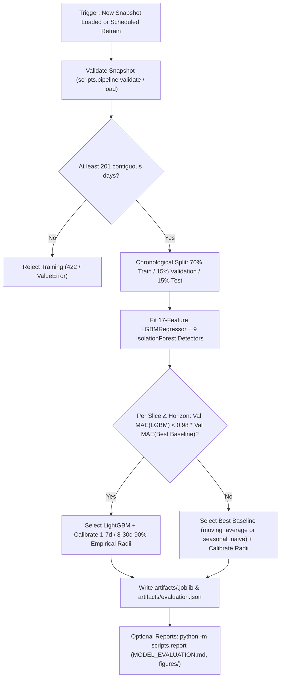

# DecisionPilot AI — Model Versioning & Lifecycle Governance Policy

> **Scope:** Forecasting, Anomaly Detection, Scenario Econometrics, and Grounded Query Orchestration  
> **Active Bundle Version:** `dp-1.1` (Platform MVP `v1.0.0`)  
> **Artifacts Directory:** [`artifacts/`](./artifacts)

---

## 1. Overview & Versioning Principles

DecisionPilot AI enforces reproducible model serialization, leakage-free temporal evaluation, and explicit baseline comparisons before serving forecasts or anomaly scores. Trained bundles are stored deterministically by SHA-256 dataset snapshot signature (`artifacts/<dataset_id>.joblib`).

### Core Governance Principles
1. **Snapshot-Locked Bundling:** Every bundle in `artifacts/<dataset_id>.joblib` embeds its exact `dataset_id`, `version` (`dp-1.1`), trained `forecast` models/scales/calibration radii, fitted `anomaly` detectors, and full `report` dictionary—written alongside [`artifacts/evaluation.json`](./artifacts/evaluation.json).
2. **Leakage-Free Temporal Partition:** Forecast evaluation uses strict chronological splits (`70%` train, `15%` validation, `15%` test). Validation is further divided into independent selection (`selection_range`) and interval calibration (`calibration_range`) slices whenever enough history exists (`validation_end - train_end >= 2 * horizon`).
3. **Validation Gate Over Baselines (>2% Rule):** A learned `LGBMRegressor` is selected for a given `(target, scope, horizon)` slice **only** if its validation MAE improves over the better of `moving_average` and `seasonal_naive` by strictly more than `2.0%` (`lgbm_mae < 0.98 * best_baseline_mae`).
4. **Reproducible Seed Control:** Synthetic data generation, LightGBM (`random_state=42`), and Isolation Forest (`random_state=42`) use pinned random seeds.

---

## 2. Model & Engine Catalog (`dp-1.1`)

| Component | Module Path | Method & Hyperparameters | Target / Scope | Verification & Holdout Findings (`f32e87e3a5744333ff98d3bf`) |
| :--- | :--- | :--- | :--- | :--- |
| **Demand Forecaster** | [`ai_service/forecasting.py`](./ai_service/forecasting.py) | Global scaled `LGBMRegressor` (`n_estimators=125`, `lr=0.045`, `num_leaves=23`, `min_child_samples=28`) competing vs. `moving_average` & `seasonal_naive` across `17` features | `revenue`, `orders`, `demand` for `7d` & `30d` horizons (`all`, category, SKU) | `moving_average` selected for smooth aggregates (`revenue\|all` 30d WAPE `24.14%`, 7d WAPE `21.84%`); **`lightgbm`** promoted for `demand\|sku:P001` 30d (`MAE 2.68`, `WAPE 41.87%`, `92.86%` interval coverage). |
| **Anomaly Detector** | [`ai_service/anomaly.py`](./ai_service/anomaly.py) | **56-day rolling window shifted 7 days** (`min_periods=28`): `IsolationForest(n_estimators=120, contamination=0.065)` on `(robust_z, z)` + IQR + sustained 7d revenue drop + `stockout_risk` rule | Daily KPIs, Facebook spend/ROAS/conversion, margins, stockout risk | Test precision `100.00%` (`90.20%` F1, `0.00%` FPR) on `facebook_spend`; `86.67%` precision on `revenue`; `75.00%` F1 on `facebook_conversion`. |
| **What-If Simulator** | [`ai_service/scenario.py`](./ai_service/scenario.py) | Linear-% price elasticity ($1 + e \cdot \Delta P / P_0$), power-law spend response ($r^\alpha$, $\alpha \in [0.20, 0.95]$), daily stock ledger balance | Counterfactual 7d/30d P&L, demand & shortage simulation | Conditional 7d replay: weekly P001 units **23.99% WAPE** (vs `24.24%` baseline); P003 depletion checks matched **15/15** weeks (`scenario_backtest.json`). |
| **Query Copilot** | [`ai_service/llm_orchestrator.py`](./ai_service/llm_orchestrator.py) | Bilingual VI/EN parser (OpenAI/Gemini/regex) -> Pydantic `Intent` (`extra="forbid"`) -> parameterized read-only SQLAlchemy Core | Executive KPI, trends, ranking, explainability, forecasts, refusals | **46/46 (100%)** benchmark accuracy across intent, filters, execution, chart, numerical & grounding (`query_benchmark.json`). |

---

## 3. Feature Set & Serialized Bundle Structure

### 3.1 Exact 17 Point-in-Time Forecast Features ([`ai_service/features.py`](./ai_service/features.py))

```python
FEATURES = (
    "lag_1", "lag_7", "lag_14", "lag_28",
    "mean_7", "std_7", "mean_14", "std_14", "mean_28", "std_28",
    "growth_7", "weekday", "month", "quarter", "weekend", "holiday", "scale",
)
```

*`scale` equals `log1p(mean_train_series_value)` allowing one scaled `LGBMRegressor` per target (`revenue`, `orders`, `demand`) to share signal across enterprise aggregate, category, and SKU slices without future leakage.*

### 3.2 Actual Serialized Artifact Bundle (`scripts/train.py`)

When running `python -m scripts.train --out artifacts`, the persisted joblib dictionary (`artifacts/<dataset_id>.joblib`) contains:

```python
{
    "dataset_id": "f32e87e3a5744333ff98d3bf",
    "version": "dp-1.1",
    "forecast": {
        "revenue": {
            "model": <LGBMRegressor>,
            "scales": {"all": ..., "sku:P001": ..., "category:Electronics": ...},
            "series": {
                ("all", 7):  {"selected": "moving_average", "radii": [(7, ...)], "report": {...}},
                ("all", 30): {"selected": "moving_average", "radii": [(7, ...), (30, ...)], "report": {...}},
                ("sku:P001", 30): {"selected": "lightgbm", "radii": [(7, ...), (30, ...)], "report": {...}},
                ...
            },
            "drivers": [(feature_name, gain_importance), ...],  # Top 6 gain features
        },
        "orders": { ... },
        "demand": { ... },
    },
    "anomaly": {
        "revenue": <IsolationForest | None>,
        "margin": <IsolationForest | None>,
        "units": <IsolationForest | None>,
        "facebook_spend": <IsolationForest | None>,
        "facebook_roas": <IsolationForest | None>,
        "facebook_conversion": <IsolationForest | None>,
        "marketing_spend": <IsolationForest | None>,
        "marketing_roas": <IsolationForest | None>,
        "marketing_conversion": <IsolationForest | None>,
    },
    "report": {
        "dataset_id": "f32e87e3a5744333ff98d3bf",
        "version": "dp-1.1",
        "split": {
            "train": ["2024-10-01", "2026-02-22"],
            "validation": ["2026-02-23", "2026-06-12"],
            "test": ["2026-06-13", "2026-09-30"],
        },
        "forecast": [ ... ],   # Detailed per-(target, scope, horizon) validation/test metrics
        "anomaly": { ... },    # Hybrid vs z_score vs robust_z vs iqr confusion metrics per signal
        "notes": [ ... ],
    },
}
```

---

## 4. Retraining, Evaluation & Publication Workflow



### Offline Feature Exports & Rebuilding Evidence
Running `python -m scripts.train --out artifacts` (without `--skip-features`) also exports compressed feature tables (`daily_features.csv.gz`, `customer_rfm.csv.gz`, `inventory_features.csv.gz`). Running `python -m scripts.report` regenerates `MODEL_EVALUATION.md`, `forecast_metrics.csv`, `scenario_backtest.json`, and all 10 charts in `artifacts/figures/`.

---

## 5. Planned Evolution

- **Periodic Elasticity Recalibration:** Empirical price elasticity estimation from observed historical promotion windows alongside catalog defaults and operator overrides.
- **Automated Drift Alerts:** Tracking rolling out-of-sample WAPE and 90% coverage drift against validation expectations after snapshot imports.
- **Multi-Tenant Artifact Partitioning:** Scoped `artifacts/<workspace_id>/<dataset_id>.joblib` directories once multi-tenant workspaces are introduced.
