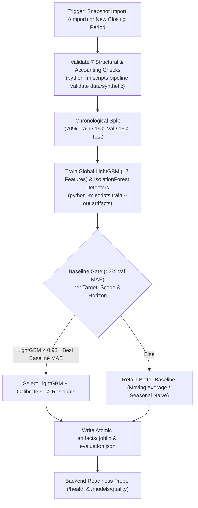

# DecisionPilot AI — Model Versioning & Lifecycle Governance Policy

> **Scope:** Machine Learning, Econometric Simulation, and Anomaly Detection Models  
> **Current Model Bundle:** `dp-1.1` (dataset `f32e87e3a5744333ff98d3bf`)  
> **Artifacts Directory:** [`artifacts/`](./artifacts/)

---

## 1. Overview & Versioning Principles

DecisionPilot AI enforces a reproducible model-versioning lifecycle keyed strictly to the SHA-256 snapshot digest (`dataset_id`). Every model bundle is saved atomically alongside chronological holdout metrics and calibration bands in `artifacts/<dataset_id>.joblib`.

### Core Governance Principles
1. **Deterministic Artifact Bundling:** Every trained bundle (`dp-1.1`) stores `dataset_id`, `version`, per-target forecast models/calibration radii, Isolation Forest detectors, and the full evaluation `report`. If a different snapshot is imported via `POST /import`, forecasts and price/inventory simulations require retraining for the new `dataset_id`.
2. **Chronological Split Guarantee:** Time-series demand forecasting strictly uses chronological partitions (Train 70%: `2024-10-01..2026-02-22`, Validation 15%: `2026-02-23..2026-06-12`, Test 15%: `2026-06-13..2026-09-30`). When sufficient history exists (`validation_len >= 2 * horizon`), model selection and 90% interval residual calibration run on separate chronological validation segments. Random cross-validation is forbidden.
3. **Baseline Gate Discipline (>2% Validation MAE):** LightGBM is promoted for a `(target, scope, horizon)` slice **only if** its validation MAE improves over the better of `seasonal_naive` and `moving_average` by strictly more than `2.0%`. Otherwise, the simpler baseline is retained automatically.
4. **Reproducible Seed Control:** Both `LGBMRegressor` (`random_state=42`) and `IsolationForest` (`random_state=42`) use fixed random seeds across runs.

---

## 2. Model Catalog (`dp-1.1` on Dataset `f32e87e3a5744333ff98d3bf`)

| Model / Engine | Module Path | Algorithm / Method | Output | Measured Holdout Performance (`artifacts/MODEL_EVALUATION.md`) |
| :--- | :--- | :--- | :--- | :--- |
| **Demand Forecaster** | [`ai_service/forecasting.py`](./ai_service/forecasting.py) | `LGBMRegressor` (`17` causal features) gated against `moving_average` & `seasonal_naive` (`>2%` val MAE rule) | 7-day & 30-day revenue, orders, demand + 90% empirical intervals (`1–7d`, `8–30d`) | **Aggregate Revenue (30d):** `moving_average` selected — MAE `34,584,971.67 ₫`, WAPE `24.14%`, 90% band coverage `83.81%`<br/>**SKU `P001` (`SmartDesk Mini`, 30d):** `lightgbm` selected — MAE `2.68` units, WAPE `41.87%`, 90% band coverage `92.86%` |
| **Anomaly Detector** | [`ai_service/anomaly.py`](./ai_service/anomaly.py) | Hybrid: `56d` trailing baseline shifted `7d` + `IsolationForest` (`120` trees, `0.065` contamination) + IQR + robust Z-score + `7d` drop check + stockout rule | Ranked operational alerts (`critical`/`high`/`medium`) & root-cause waterfall drivers | `facebook_spend`: **100.00% P / 82.14% R / 90.20% F1** (`0.00%` FPR)<br/>`revenue`: **86.67% P / 38.24% R / 53.06% F1**<br/>`facebook_conversion`: **75.00% P / 75.00% R**<br/>`stockout_risk` rule: **18.75% P / 25.00% R** *(flagged as limited)* |
| **What-If Simulator** | [`ai_service/scenario.py`](./ai_service/scenario.py) | Linear-% price elasticity ($1 + e \cdot \Delta P/P_0$), stock caps, power-law ad response ($\alpha = 0.65$), & warehouse ledger | Simulated demand, revenue, gross profit delta, stockout risk, $\varepsilon \pm 0.3$ sensitivity | Weekly `P001` conditional price replay: `23.99%` WAPE vs. `24.24%` baseline (`15` weeks); Facebook Ads marketing replay: `33.00%` vs. `25.44%` baseline *(disclosed in UI)* |
| **NL Analytics Router** | [`ai_service/llm_orchestrator.py`](./ai_service/llm_orchestrator.py) | `BLOCKED` injection/SQL guard + typed Pydantic `Intent` (`extra="forbid"`) bound to read-only SQLAlchemy tools (`local_rules` default; optional Gemini / OpenAI) | Grounded KPI reports, rankings, trends, contributor drill-downs, forecasts & chart specs | `46/46` (`100%`) EN/VI/refusal accuracy on local rules; median **`1,432.2 ms`**, p95 **`3,268.6 ms`** ([`artifacts/query_benchmark.json`](./artifacts/query_benchmark.json)) |

---

## 3. Artifact Bundle Specification (`scripts/train.py`)

Running `python -m scripts.train --out artifacts` serializes `artifacts/<dataset_id>.joblib` alongside `artifacts/evaluation.json` and compressed feature snapshots (`daily_features.csv.gz`, `customer_rfm.csv.gz`, `inventory_features.csv.gz`):

```python
{
    "dataset_id": "f32e87e3a5744333ff98d3bf",
    "version": "dp-1.1",
    "forecast": {
        "revenue": {
            "model": LGBMRegressor(n_estimators=125, learning_rate=0.045, num_leaves=23, min_child_samples=28, random_state=42),
            "scales": {"all": ..., "sku:P001": ..., "category:...": ...},
            "series": {("all", 7): {"selected": "moving_average", "radii": [...], "report": {...}}, ...},
            "drivers": [(feature_name, gain), ...],  # top 6 out of 17 FEATURES in ai_service/features.py
        },
        "orders": {...},
        "demand": {...},
    },
    "anomaly": {
        # Per-metric IsolationForest(n_estimators=120, contamination=0.065, random_state=42)
        "revenue": IsolationForest(...),
        "margin": IsolationForest(...),
        "units": IsolationForest(...),
        "facebook_spend": IsolationForest(...),
        "facebook_roas": IsolationForest(...),
        "facebook_conversion": IsolationForest(...),
        ...
    },
    "report": {
        "dataset_id": "f32e87e3a5744333ff98d3bf",
        "version": "dp-1.1",
        "split": {
            "train": ["2024-10-01", "2026-02-22"],
            "validation": ["2026-02-23", "2026-06-12"],
            "test": ["2026-06-13", "2026-09-30"],
        },
        "forecast": [...],  # per-target, scope & horizon validation/test MAE, RMSE, WAPE, MAPE, bias & coverage
        "anomaly": {...},   # hybrid, z_score, robust_z, iqr & stockout_risk confusion metrics
        "notes": [...],
    },
}
```

### Exact 17 Point-in-Time Features (`ai_service/features.py`)
`lag_1`, `lag_7`, `lag_14`, `lag_28`, `mean_7`, `std_7`, `mean_14`, `std_14`, `mean_28`, `std_28`, `growth_7`, `weekday`, `month`, `quarter`, `weekend`, `holiday`, and `scale` (`log1p(train_mean)`).

---

## 4. Retraining & Rollout Protocol



### 4.1 Retraining Requirements & Commands
1. **Minimum History:** `train_forecasts()` requires at least `201` contiguous calendar days so that train, validation, and 30-day rolling test origins contain sufficient observations.
2. **Dataset Mismatch Guard:** On startup or `/health`, `backend/app/main.py` checks `artifacts/<dataset_id>.joblib`. Importing a new snapshot with a different hash (`POST /import`) automatically marks `model_ready: false` until `python -m scripts.train --out artifacts` produces a matching artifact bundle.
3. **Human Decision Logging:** Operational choices (`accepted` / `rejected`) made against forecasts, scenarios, and recommendations are written atomically to trigger-protected `audit_events` (`alembic/versions/0002_decision_integrity.py`).

---

## 5. Planned Future Releases (Beyond `dp-1.1`)

- **v1.2 (Planned):** Empirical estimation of per-SKU price elasticity and per-channel marketing exponents from randomized promotion tests rather than catalog/user-adjustable parameters.
- **v1.3 (Planned):** Multi-item basket associations, refund-rate modeling, and multi-tenant workspace isolation across independent databases.
