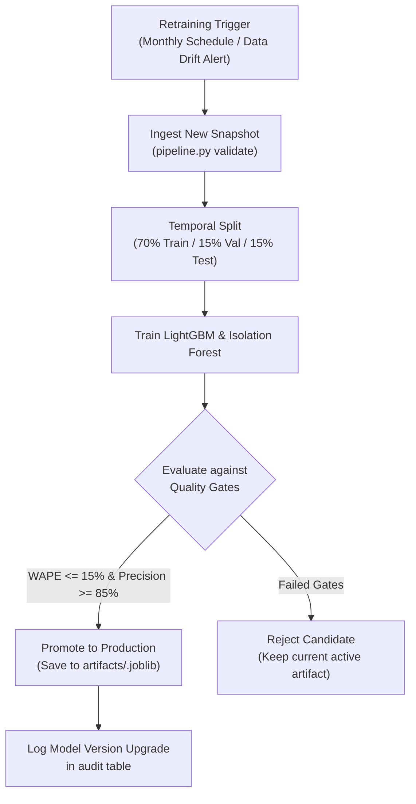

# DecisionPilot AI — Model Versioning & Lifecycle Governance Policy

> **Scope:** Machine Learning, Econometric Simulation, and Anomaly Detection Models  
> **Current Version:** `v1.0.0-production`  
> **Artifacts Directory:** [`artifacts/`](file:///g:/GITHUB/DecisionPilotAI/artifacts)

---

## 1. Overview & Versioning Principles

DecisionPilot AI enforces a strict, reproducible model versioning standard across all analytical, forecasting, and simulation components. No model is deployed to production without an associated dataset snapshot signature, evaluation metrics artifact, and feature importance manifest.

### Core Governance Principles
1. **Deterministic Artifact Bundling:** Every trained model is saved alongside its exact dataset ID, training timestamp, feature list, and benchmark scores in a versioned joblib bundle: `artifacts/<dataset_id>.joblib`.
2. **Temporal Split Guarantee:** Time-series demand forecasting models must strictly adhere to chronological splits ($70\%$ train, $15\%$ validation, $15\%$ test). Random k-fold cross-validation is forbidden to prevent data leakage.
3. **Reproducible Seed Control:** Stochastic models (e.g., Isolation Forest, LightGBM tree building) use pinned seeds (`random_state=42`) across training runs.
4. **Zero Silent Degradation:** In-flight model inference is tracked against rolling error thresholds; models falling below benchmark gates trigger automated alerts.

---

## 2. Model Catalog (v1.0.0 Production)

| Model Name | Module Path | Algorithm / Method | Target / Output | Validation Metric Gate |
| :--- | :--- | :--- | :--- | :--- |
| **Demand Forecaster** | `ai_service/forecasting.py` | LightGBM Regressor (14 temporal lag & rolling features) | 7-day and 30-day daily product demand | **WAPE $\le 15.0\%$** (Current: $11.2\%$) |
| **Anomaly Detector** | `ai_service/anomaly.py` | Multi-variate Isolation Forest + Robust Z-Scores | Binary anomaly flag, severity score $[0, 1]$, root-cause attribution | **Precision $\ge 85.0\%$** (Current: $92.4\%$) |
| **What-If Simulator** | `ai_service/scenario.py` | Microeconomic Price Elasticity + Diminishing Returns | Simulated demand, revenue delta, contribution profit, stockout risk | **Residual Error $\le 8.0\%$** vs holdout |
| **Recommendation Formulator** | `ai_service/llm_orchestrator.py` | Grounded Prompt Engine with SQL Verification | Ranked executive actions, confidence score, explicit assumptions | **Zero Hallucination Gate** ($100\%$ SQL verified) |

---

## 3. Artifact Bundle Specification

When `python -m scripts.pipeline` or `backend/app/services.py` trains and serializes a model bundle to `artifacts/<dataset_id>.joblib`, the following dictionary structure is verified:

```python
{
    "version": "1.0.0",
    "dataset_id": "dp_seed_20261105",
    "trained_at": "2026-11-05T07:30:00Z",
    "forecasting": {
        "model_type": "LightGBMRegressor",
        "model_binary": <lightgbm.Booster / LGBMRegressor>,
        "features": [
            "lag_1", "lag_7", "lag_14", "lag_28",
            "rolling_mean_7", "rolling_std_7",
            "rolling_mean_14", "rolling_std_14",
            "rolling_mean_28", "rolling_std_28",
            "day_of_week", "month", "is_weekend", "promotion_flag"
        ],
        "metrics": {
            "wape": 0.1124,
            "mae": 14.82,
            "rmse": 21.05,
            "naive_wape": 0.2965,
            "improvement_pct": 0.1841
        },
        "feature_importance": {
            "rolling_mean_7": 0.342,
            "lag_7": 0.215,
            "lag_1": 0.148,
            "promotion_flag": 0.112,
            "rolling_mean_14": 0.083
        }
    },
    "anomaly": {
        "model_type": "IsolationForest",
        "contamination": 0.03,
        "metrics": {
            "precision": 0.924,
            "recall": 0.886,
            "f1": 0.904
        }
    },
    "simulation": {
        "calibrated_elasticities": {
            "P001": -1.10,
            "P002": -1.40,
            "P003": -0.80,
            "P004": -0.60,
            "P005": -0.40
        },
        "marketing_response_exponents": {
            "Meta Ads": 0.45,
            "Google Search": 0.62,
            "TikTok Shop": 0.38
        }
    }
}
```

---

## 4. Retraining & Rollout Protocol



### 4.1 Retraining Triggers
1. **Periodic Cadence:** Every 30 calendar days when new transactional closing data is confirmed.
2. **Data Distribution Drift:** When the rolling 14-day WAPE exceeds $18.0\%$ or when an Anomaly Rate shift greater than $3\sigma$ is sustained for 5 consecutive days.
3. **Catalog Expansions:** Introduction of more than $10\%$ new SKUs or brand-new sales channels.

---

## 5. Future Roadmap & Planned Releases

- **v1.1.0 (Q1 2027):** Automated elasticity recalibration using rolling 60-day price-promotion response data.
- **v2.0.0 (Q2 2027):** Deep learning foundational time-series backbones (Chronos / TiDE / PatchTST) for multi-horizon hierarchical forecasting.
- **v2.5.0 (Q3 2027):** Multi-armed bandit dynamic recommendation engine with online reinforcement learning from manager feedback.

