<div align="center">

<p align="center">
  
</p>

# DecisionPilot AI

### AI-Powered Business Data Analysis, Forecasting and Decision Support System for SMEs

**Ask. Understand. Predict. Decide.**

[](./COMPETITION_SUBMISSION.md)
[](https://nguyentribaothang.github.io/DecisionPilotAI/)
[](./LICENSE)

<p align="center">
  <a href="https://nguyentribaothang.github.io/DecisionPilotAI/"><strong>Documentation Portal (GitHub Pages)</strong></a>
  &nbsp;•&nbsp;
  <a href="https://nguyentribaothang.github.io/DecisionPilotAI/app/"><strong>Live Interactive Demo</strong></a>
  &nbsp;•&nbsp;
  <a href="./ARCHITECTURE.md"><strong>System Architecture</strong></a>
  &nbsp;•&nbsp;
  <a href="./COMPETITION_SUBMISSION.md"><strong>Competition Submission</strong></a>
  &nbsp;•&nbsp;
  <a href="#quick-start"><strong>Quick Start</strong></a>
  &nbsp;•&nbsp;
  <a href="#api-catalog--reference"><strong>API Catalog</strong></a>
</p>

<p align="center">
  
  
  
  
  
  
  
  
  
  
  
  
</p>

<p align="center">
  
</p>

</div>

---

## 📌 Executive Summary

**DecisionPilot AI** is an AI-powered decision intelligence platform specifically engineered for Small and Medium Enterprises (SMEs). Rather than serving as a superficial chatbot or a static business intelligence dashboard, DecisionPilot AI operates as a unified decision loop: converting natural-language executive questions into verified analytical reports, isolating multi-dimensional anomalies with statistical root-cause decomposition, forecasting demand trends with calibrated confidence intervals, and stress-testing strategy trade-offs in an interactive 3D simulation sandbox before capital is committed.

```text
  [1. ASK]            [2. UNDERSTAND]            [3. PREDICT]            [4. SIMULATE]           [5. DECIDE]
Natural Language  ->  Multidimensional  ->  LightGBM Demand    ->  Microeconomic What-If  ->  Audited Human
Query Ingestion       Anomaly Detection      Forecasting (90%)       3D Sandbox (P&L)        Approval & Audit
```

---

## 📑 Table of Contents

- [Executive Summary](#executive-summary)
- [The Business Problem & Our Solution](#the-business-problem--our-solution)
- [Challenge Alignment — Data & Decision Intelligence](#challenge-alignment--data--decision-intelligence)
- [Core Workspaces & Documentation Portal](#core-workspaces--documentation-portal)
- [Product Visual Showcase](#product-visual-showcase)
- [System Architecture](#system-architecture)
- [AI & Machine Learning Foundations](#ai--machine-learning-foundations)
- [Dataset & Synthetic Data Pipeline](#dataset--synthetic-data-pipeline)
- [Model Evaluation & Benchmarks](#model-evaluation--benchmarks)
- [Technology Stack](#technology-stack)
- [Quick Start](#quick-start)
- [API Catalog & Reference](#api-catalog--reference)
- [Project Structure](#project-structure)
- [Security, Privacy & Responsible AI](#security-privacy--responsible-ai)
- [Roadmap, Contributing & License](#roadmap-contributing--license)

---

## 💡 The Business Problem & Our Solution

### The SME Dilemma

Small and Medium Enterprises represent the engine of retail and services in emerging markets, yet they routinely face acute operational barriers:

1. **Siloed Data & "The Excel Graveyard":** Sales records sit in point-of-sale software, marketing spend resides across Facebook and Google Ads managers, inventory is recorded in disconnected warehouse sheets, and customer records exist only in order histories. Consolidating this manually consumes days of repetitive spreadsheet wrangling.
2. **Absence of Dedicated Analytics Talent:** SMEs rarely possess the budget to hire dedicated data analysts, data scientists, or econometrics engineers to build custom statistical pipelines.
3. **Descriptive Inadequacy of Traditional BI:** Conventional reporting tools (Power BI, Tableau) require expensive recurring licenses and specialized data modeling expertise. Crucially, they are strictly *descriptive*—answering *"What happened last month?"* while leaving managers completely in the dark regarding *"Why did revenue fall?"* or *"What will happen if we discount SKU P001 by 5%?"*.
4. **High-Risk Gut-Feel Decision Making:** Product reorders, pricing promotions, and advertising allocation are frequently made on intuition. This results in costly supply stockouts on bestseller items, margin compression during indiscriminate promotions, or capital bleed into saturated ad campaigns.

### The DecisionPilot AI Solution

DecisionPilot AI addresses this dilemma through a continuous, verifiable **Decision Intelligence Loop**:

- **Ask Natural Language Queries:** Business managers inquire in plain Vietnamese or English (`"Why did revenue drop this month?"`, `"Which marketing channel is underperforming?"`). The engine classifies the question's intent (local rules by default; Gemini or OpenAI optional) and runs a fixed, tested analytics tool over the database. It never executes SQL written by a user or a model.
- **Understand Root Causes:** The anomaly engine decomposes observed variance into exact SKU, regional, and marketing attribution deltas—reconciling 100% of the variance without hand-waving or hallucinated causation.
- **Predict Future Trajectories:** An engineered **LightGBM** regressor projects 7-day and 30-day demand curves bounded by calibrated 90% confidence intervals, outperforming standard seasonal baselines.
- **Simulate Strategy Before Execution:** A what-if sandbox couples a price-sensitivity (elasticity) model, a diminishing-returns advertising model and warehouse lead-time constraints, letting executives compare options and see margin and stock trade-offs before spending capital. Estimates are conditional assumptions, not verified causal effects.
- **Decide with Auditability:** Recommended interventions provide explicit financial impact estimates (projected gross profit delta) and require human approval, logged immutably for executive governance.

---

## 🎯 Challenge Alignment — Data & Decision Intelligence

DecisionPilot AI was submitted under the **LIKELION — AI for Business Innovation 2026** competition for **Track 5: Data & Decision Intelligence**. The platform directly implements all four competition requirements:

| Challenge Requirement (Official Topic) | DecisionPilot AI Capability | Technical Implementation | Verified Business Value |
| :--- | :--- | :--- | :--- |
| **1. AI converts natural language questions into data reports**<br/>*(AI chuyển câu hỏi bằng ngôn ngữ tự nhiên thành báo cáo dữ liệu)* | **Ask Business Data / Copilot**<br/>[`ai_service/llm_orchestrator.py`](./ai_service/llm_orchestrator.py)<br/>[`backend/app/main.py`](./backend/app/main.py) | • Rule & LLM intent classification (Gemini / OpenAI / Local).<br/>• Questions that contain SQL or fall outside the supported scope are refused; no model-written SQL is ever executed.<br/>• Zero-hallucination deterministic database calculation.<br/>• Dynamic chart generation and structured JSON KPIs. | Replaces hours of manual Excel pivot compiling with audited business reports delivered in under **1.43 seconds** (46 curated EN/VI cases on local rules: 100% pass; median 1.43 s; Gemini/OpenAI paths are not part of this benchmark). |
| **2. AI analyzes revenue and detects significant business anomalies**<br/>*(AI phân tích doanh thu và nhận diện các biến động đáng chú ý)* | **Anomaly Center & Revenue Diagnostics**<br/>[`ai_service/anomaly.py`](./ai_service/anomaly.py)<br/>[`backend/app/analytics.py`](./backend/app/analytics.py) | • Multidimensional **Isolation Forest** outlier isolation.<br/>• Past-only trailing baseline (56-day window, 7-day exclusion).<br/>• Rolling **Z-Score** and IQR bounds.<br/>• Waterfall variance decomposition by SKU and marketing channel. | Flags abnormal ad spend (Facebook spend: **100% precision, 82% recall**). Revenue-contraction recall is only **38%** on the synthetic test and the app shows this limitation next to the alerts. |
| **3. AI forecasts product or service demand based on historical data**<br/>*(AI dự báo nhu cầu sản phẩm hoặc dịch vụ dựa trên dữ liệu lịch sử)* | **Forecast Center**<br/>[`ai_service/forecasting.py`](./ai_service/forecasting.py)<br/>[`artifacts/MODEL_EVALUATION.md`](./artifacts/MODEL_EVALUATION.md) | • Chronological 70/15/15 time-series partition.<br/>• **LightGBM** regressor trained with 17 point-in-time features (lags 1/7/14/28, 7/14/28d rolling mean/std, 7d growth, calendar flags, scale).<br/>• Strict **>2% Validation MAE Gate** against Seasonal Naive and Moving Average baselines.<br/>• Empirical residual calibration (1–7d & 8–30d buckets) for 90% confidence bands. | Supports stock and cash planning. Enterprise-wide 30d revenue forecast: **WAPE 24.14%** (moving average is selected because LightGBM does not clear the 2% gate). SKU P001: LightGBM, **WAPE 41.87%**, **92.86%** interval coverage. |
| **4. AI compares business scenarios to support strategic decision making**<br/>*(AI so sánh các kịch bản kinh doanh để hỗ trợ ra quyết định)* | **3D Scenario Simulator**<br/>[`ai_service/scenario.py`](./ai_service/scenario.py)<br/>[`frontend/src/features/scenario-simulator/`](./frontend/src/features/scenario-simulator/) | • Price-sensitivity demand response, linear in the percentage price change: $Q = Q_0 \cdot \max(0, 1 + \varepsilon \, \Delta P/P_0)$ (P001 $\varepsilon = -1.1$, catalog assumption; users can override it).<br/>• Concave advertising response $R = R_0 \cdot (\text{budget ratio})^{\alpha}$ (default $\alpha = 0.65$).<br/>• Lead-time replenishment buffer modeling.<br/>• Three.js WebGL spatial landscape and multi-scenario comparison matrix. | Shows the volume-versus-margin trade-off before a discount is applied. Scenario estimates are conditional: in the holdout replay the price scenario is about equal to the baseline (WAPE 24.0% vs 24.2%) and the marketing scenario is worse (33.0% vs 25.4%); see `artifacts/scenario_backtest.json`. |

---

## 🖥️ Core Workspaces & Documentation Portal

DecisionPilot AI connects six primary operational workspaces with administrative views inside a closed-loop workflow (`Alert -> Investigate in Ask (/ask?q=...) -> Recommendation -> Try First in Simulator -> Transactional Decision Log`):

```text
┌────────────────────────────────────────────────────────────────────────────────────────┐
│                                   DECISIONPILOT AI                                     │
├────────────────────┬────────────────────┬────────────────────┬─────────────────────────┤
│ 1. Executive       │ 2. Ask Business    │ 3. Anomaly Radar   │ 4. Forecast Center      │
│    Dashboard (/)   │    Copilot (/ask)  │    (/anomalies)    │    (/forecast)          │
│ • Financial KPIs   │ • Typed Intent API │ • Isolation Forest │ • LightGBM vs Baselines │
│ • Gross Margin     │ • 1.43s Latency    │ • 56d Shifted IQR  │ • 90% Confidence Bands  │
│ • ROAS & AOV       │ • Fixed Read Tools │ • Waterfall Decomp │ • 7-day / 30-day Horizon│
├────────────────────┴────────────────────┴────────────────────┴─────────────────────────┤
│ 5. 3D Scenario Simulator (/scenarios)   │ 6. Recommendations & Audit (/recommendations)│
│ • Linear-% Price Elasticity (P001 -1.1) │ • Prioritized Strategy Playbooks             │
│ • Concave Ad-Spend Response (α = 0.65)  │ • Shared recommendation_id Decision Binding  │
│ • Three.js WebGL Spatial Elevation      │ • Trigger-Protected audit_events Governance  │
└─────────────────────────────────────────┴──────────────────────────────────────────────┘
```

1. **Executive Dashboard (`/`):** Instant 360-degree financial pulse tracking Gross Revenue, Gross Profit, Margin %, Orders, AOV, Marketing ROAS, and inventory status, with one-click deep links into **Ask AI Copilot** (`?q=...`).
2. **Ask AI Copilot (`/ask`):** Conversational intelligence interface allowing staff to query business performance in English or Vietnamese. Maps each prompt to a strict Pydantic `Intent`, runs fixed parameterized analytics tools inside a read-only DB session (never model-written SQL), and renders charts + computation trace.
3. **Anomaly Center (`/anomalies`):** Surveillance radar ranking operational irregularities by severity (`Critical`, `High`, `Medium`) against a 56-day trailing baseline (7-day exclusion), with observed vs. expected baselines and additive driver decomposition.
4. **Forecast Center (`/forecast`):** 7-day and 30-day projections across aggregate revenue, orders, unit demand, category, or individual SKUs with empirical 90% prediction intervals and >2% baseline-gate provenance.
5. **3D Scenario Simulator (`/scenarios`):** Interactive microeconomic What-If sandbox powered by Three.js WebGL (`overview`, `focus`, `compare` modes) evaluating pricing discounts, ad-spend reallocation, and replenishment lead times.
6. **Recommendations & Decision Log (`/recommendations`):** Prescriptive recommendation feed bridged directly with simulated scenarios. Recording `Accept` or `Reject` in the simulator with an active `recommendation_id` atomically logs both `scenario_feedback` and `recommendation_feedback` in one database transaction into trigger-protected `audit_events`.
7. **Workspace Admin & Embedded Views (`/data-sources`, `/settings`, `/docs`, `/landing`):** Authenticated ZIP/XLSX snapshot replacement (up to 40 MiB), persisted EN/VI language (default `vi`) & VND formatting preferences, and an embedded architecture summary.

### Multi-Page Technical Documentation Portal (`https://nguyentribaothang.github.io/DecisionPilotAI/`)

The GitHub Pages site (`docs-site/`) is structured as a dedicated multi-page portal rather than a single long scrolling document:
- **Portal Home (`/`):** Dedicated landing overview introducing the **Ask -> Understand -> Predict -> Simulate -> Decide** workflow, interactive cards for Track 5 capabilities, and a categorized directory of all 17 chapters.
- **Paginated Documentation (`/docs/<chapter>`):** 17 focused single-chapter pages (`01`..`16` plus `05★ Data & Decision Intelligence`) with top navigation, active breadcrumb (`Page X of 17`), Previous/Next page buttons, dynamic per-page Table of Contents, interactive Track 5 tabs (`?tab=ask|analyze|forecast|simulate`), and instant **Ctrl+K** client-side search.
- **Hosted Interactive Demo (`/app/`):** Live static SPA preview backed by automatic fallback to verified `dp-1.1` / `f32e87e3a5744333ff98d3bf` demo payloads when no backend server is attached.

---

## 📸 Product Visual Showcase

| Historical Demand vs. LightGBM 90% Prediction Intervals | Multi-Dimensional Anomaly Detection Radar |
| :---: | :---: |
|  |  |
| *Chronological holdout validation: Actual observations vs LightGBM median with 90% quantile bands.* | *Rolling 3-sigma Z-Score and Isolation Forest anomaly flags over synthetic enterprise history.* |

| Scenario Sensitivity & Price Elasticity Trade-Off | Engineered Time-Series Feature Importance |
| :---: | :---: |
|  |  |
| *Simulated P&L response curve identifying the optimal profit margin versus the volume loss trap.* | *Relative information gain ranking across 17 lag, rolling window, growth, scale, and calendar features.* |

---

## 🏗️ System Architecture

DecisionPilot AI is built upon a modular **5-Tier Enterprise Architecture** adhering to clean separation of concerns and local-first execution principles:

```mermaid
flowchart TB
    subgraph Presentation["1. Presentation Tier (React 19 + TypeScript + Vite 7)"]
        Hero3D["Holographic 3D Data Sphere (Three.js WebGL)"]
        Sim3D["Interactive Scenario Simulator (Three.js)"]
        ExecDash["Executive Dashboard & Recharts"]
        AskUI["Natural Language Copilot (Trace)"]
        AnomalyUI["Anomaly Radar & Waterfall View"]
        ForecastUI["Forecast Center (90% Interval Bands)"]
        RecUI["Actionable Playbooks & Audit History"]
    end

    subgraph Gateway["2. API Gateway & Middleware (FastAPI)"]
        CORS["CORS & Request Security Context"]
        PydanticGuard["Domain Schema Validation (Pydantic v2)"]
        HealthProbe["Health Check Probe (/health)"]
        AuditMW["Audit Trail Recorder (/audit)"]
    end

    subgraph Intelligence["3. Analytics & Decision Intelligence Layer"]
        AnalyticalCore["SQL / Pandas Analytics Engine (analytics.py)"]
        IntentRouter["Intent Router & Refusal Rules (llm_orchestrator.py)"]
        AnomalyEngine["Isolation Forest & Rolling 3-Sigma (anomaly.py)"]
        ForecastEngine["LightGBM Time-Series Regressor (forecasting.py)"]
        ScenarioEngine["Price Elasticity & Ad-Spend Response (scenario.py)"]
    end

    subgraph Persistence["4. Persistence Layer (SQLAlchemy 2.0 & Alembic)"]
        SQLAlchemyORM["SQLAlchemy ORM (Connection Pool)"]
        AlembicMigrations["Alembic Migration Engine (Head)"]
        SnapshotLoader["Data Bootstrap & SHA-256 Validator (pipeline.py)"]
    end

    subgraph Storage["5. Physical Storage & Registry"]
        RelationalDB[("PostgreSQL 16 (Production) / SQLite (Local)")]
        ModelRegistry[("Trained Model Registry: artifacts/<dataset_id>.joblib")]
        AuditLogStore[("Trigger-Protected Decision Log: audit_events & simulation_runs")]
        SyntheticData[("Synthetic Source: data/synthetic/*.csv")]
    end

    Presentation --> Gateway
    Gateway --> Intelligence
    Intelligence --> Persistence
    Persistence --> Storage
```



> For exhaustive architectural specifications, sequence diagrams, and concurrency guarantees, see [`ARCHITECTURE.md`](./ARCHITECTURE.md).

---

## 🧠 AI & Machine Learning Foundations

DecisionPilot AI deliberately combines empirical machine learning with microeconomic domain logic, completely avoiding fragile black-box models.

### 1. Natural Language Analytics & Grounded Answers
- **LLM Intent Routing:** Classifies incoming inquiries into structured intent domains (`executive_kpi_summary`, `diagnostic_root_cause_analysis`, `product_profitability_leaderboard`, `regional_sales_breakdown`).
- **Refusals and no model-written SQL:** The question is classified into one of a fixed set of tools (KPI, ranking, trend, explanation, marketing, forecast, alerts). Questions that contain SQL, ask for unsupported metrics (net profit, cash flow, tax) or fall outside the business data are refused. The model, when enabled, only returns a structured intent; its filter values are checked against the dataset and mapped or rejected before use.
- **Deterministic Math Execution:** The database engine computes aggregates over immutable tables with zero numerical hallucination. The resulting verified record set is injected into the context to generate explanatory prose.

### 2. Hybrid Anomaly Radar & Waterfall Variance Decomposition
- **Isolation Forest:** Builds an ensemble of isolation trees partitioning high-dimensional feature spaces (Spend, Orders, Traffic, Cost) to flag multidimensional anomalies.
- **Past-Only Trailing Baseline:** Compares each day with a 56-day trailing window that excludes the most recent 7 days, so no future data is used.
- **Rolling Z-Score and IQR Filtering:** Flags robust z-scores of at least 3 and values outside the IQR bounds; the hybrid signal combines these with Isolation Forest.
- **Waterfall Contribution Decomposition:** Quantifies variance across product categories and regions, reconciling exactly 100% of the observed shift:
  $$\Delta M = \sum_{d \in D} \text{Contribution}(d)$$

### 3. LightGBM Time-Series Forecasting & The 2% Rule Selection Gate
- **Feature Engineering:** Extracts 17 point-in-time features strictly avoiding future leakage (`ai_service/features.py`):
  - Lag features: `lag_1`, `lag_7`, `lag_14`, `lag_28`.
  - Rolling window statistics: `mean_7`, `std_7`, `mean_14`, `std_14`, `mean_28`, `std_28`, plus 7-day momentum `growth_7`.
  - Calendar & scale encoding: `weekday`, `month`, `quarter`, `weekend`, `holiday`, and `scale` (`log1p(train_mean)`).
- **The >2% Validation MAE Gate:** A candidate LightGBM model is promoted over simple baselines (Seasonal Naive and Moving Average) **only if holdout validation MAE beats the better baseline by strictly more than 2.00%**.
- **90% Confidence Interval Calibration:** Computes empirical residual quantile bounds over separate validation segments (split into `1–7d` and `8–30d` lead buckets) at nominal 90% coverage.

### 4. What-If Scenario Simulation
- **Price Elasticity (linear response):** Models how demand reacts to a price change:
  $$Q_{new} = Q_{base} \times \max\left(0,\; 1 + \varepsilon \cdot \frac{\Delta P}{P_{base}}\right)$$
  *(Catalog elasticity for SKU P001 is $\varepsilon = -1.1$; an operator can override it, and the app shows a sensitivity of $\varepsilon \pm 0.3$.)*
- **Diminishing Returns on Advertising:** Attributed revenue scales with the budget ratio to a power $\alpha < 1$ (default $\alpha = 0.65$), so extra spend returns less than the previous spend.
- **Lead-Time Replenishment Constraints:** Reorders are bounded by supplier lead time and physical stock; no future receipts are assumed unless entered.
- **Limits:** results are conditional estimates, not verified causal effects, and the marketing replay is worse than the baseline (see Model Evaluation).

---

## 📊 Dataset & Synthetic Data Pipeline

The system is validated against a comprehensive, reproducible synthetic enterprise dataset (`f32e87e3a5744333ff98d3bf`) representing a multi-channel retail SME operating in Vietnam:

| Relational Table | Record Count | Temporal Coverage | Description |
| :--- | :---: | :---: | :--- |
| `calendar_events` | 730 days | 2024-10-01 to 2026-09-30 | Full 2-year calendar with day-of-week, statutory holidays, and promotional event flags. |
| `products` | 50 SKUs | Static catalog | 34 physical SKUs and 16 services across 6 categories with unit cost, list price, elasticity, and lead time. |
| `customers` | 10,000 users | Active cohort | 4 segments (`Returning`, `Individual`, `Corporate`, `Price-sensitive`) across 4 regions (`HCMC`, `Hanoi`, `Da Nang`, `Can Tho`). |
| `marketing_campaigns` | 2,920 records | Daily ad spend | Daily spend, impressions, clicks, leads, and attributed orders across `Facebook Ads`, `Google Ads`, `TikTok Ads`, and `Email`. |
| `sales_transactions` | 50,000 orders | 2-year history | Transaction-level records across `Online`, `Retail`, and `B2B` channels with integer VND cost and gross profit checks. |
| `inventory_daily` | 24,820 records | Daily warehouse log | 34 physical SKUs × 730 days tracking opening stock, receipts, units sold, closing stock, and stockout flags. |

*(Plus 3 system persistence tables managed by Alembic: `dataset_metadata`, `simulation_runs`, and `audit_events`.)*

```text
DATA PIPELINE:
Synthetic Generation (scripts/generate.py) -> Schema Validation (scripts/pipeline.py)
  -> Chronological Partition (70/15/15) -> Feature Matrix Ingestion -> Model Training (scripts/train.py)
    -> Verification Artifacts (artifacts/evaluation.json) -> API Deployment
```

---

## 📈 Model Evaluation & Benchmarks

All metrics reported below originate directly from verified evaluation artifacts ([`artifacts/MODEL_EVALUATION.md`](./artifacts/MODEL_EVALUATION.md), [`artifacts/query_benchmark.json`](./artifacts/query_benchmark.json), [`artifacts/scenario_backtest.json`](./artifacts/scenario_backtest.json)):

### 1. 30-Day Demand & Revenue Forecasting (Test Set: 2026-06-13 to 2026-09-30)

| Forecast Target | Scope | Selected Model | Test MAE | Test WAPE | 90% Interval Coverage |
| :--- | :---: | :---: | :---: | :---: | :---: |
| **Gross Revenue (₫)** | Enterprise-wide | Moving Average | 34,584,971.67 ₫ | 24.14% | 83.81% |
| **Total Order Count** | Enterprise-wide | Moving Average | 14.98 orders | 23.22% | 83.81% |
| **Total Unit Demand** | Enterprise-wide | Moving Average | 17.74 units | 23.46% | 80.00% |
| **SKU P001 (SmartDesk Mini)** | Single SKU | **LightGBM** | **2.68 units** | **41.87%** | **92.86%** *(Calibrated)* |

*Note: LightGBM is selected per target only when its validation MAE beats the better baseline by more than 2%. For enterprise-wide revenue it does not, so the moving average is used (WAPE 24.14%, interval coverage 83.81% against a 90% target).*

### 2. Labeled Anomaly Detection Benchmark

| Anomaly Signal | Detection Architecture | Precision | Recall | F1-Score | False-Positive Rate |
| :--- | :---: | :---: | :---: | :---: | :---: |
| `facebook_spend` | Hybrid (Z-Score + Isolation Forest) | **100.00%** | **82.14%** | **90.20%** | **0.00%** |
| `revenue` | Hybrid | 86.67% | 38.24% | 53.06% | 2.63% |
| `facebook_conversion` | Hybrid | 75.00% | 75.00% | 75.00% | 8.54% |
| `facebook_roas` | Hybrid | 68.00% | 60.71% | 64.15% | 9.76% |
| `margin` | Hybrid | 50.00% | 75.00% | 60.00% | 2.83% |

### 3. Natural Language Query Benchmark (`artifacts/query_benchmark.json`)
- **Evaluated Test Suite:** 46 curated Vietnamese, English, and refusal edge-case queries.
- **Accuracy Pass Rate:** 100% intent classification, 100% execution and grounding checks, 100% numerical verification.
- **Execution Latency:** Median: **1,432 ms** | p95: **3,268 ms**.

---

## 🛠️ Technology Stack

| Architecture Layer | Core Technology | Version | Purpose in System |
| :--- | :--- | :---: | :--- |
| **Frontend Framework** | React | 19.2.0 | Reactive Single-Page Application with Concurrent rendering. |
| **Language (Frontend)** | TypeScript | 5.9.3 | Complete end-to-end type safety across domain interfaces. |
| **Spatial 3D Graphics** | Three.js | 0.186.1 | WebGL holographic data sphere and 3D scenario landscape. |
| **Styling & Theme** | Tailwind CSS | 4.1.17 | Futuristic Glassmorphism styling with dark/light mode support. |
| **Charting Engine** | Recharts | 3.4.1 | Financial area charts, bar breakdowns, and scatter plots. |
| **Data Fetching** | TanStack Query | 5.90.10 | Server-state caching, optimistic updates, and background refetching. |
| **Backend Framework** | FastAPI | 0.121.3 | High-performance asynchronous Python REST API with OpenAPI auto-generation. |
| **ASGI Web Server** | Uvicorn | 0.38.0 | Lightweight asynchronous server engine. |
| **Data Modeling** | Pydantic | 2.14.2 | Strict runtime schema enforcement for request/response payloads. |
| **Database ORM** | SQLAlchemy | 2.0.44 | Parameterized SQL query execution with SQL-injection protection. |
| **Database Migrations**| Alembic | 1.17.2 | Automated relational schema version control. |
| **Relational Database** | PostgreSQL / SQLite | 16 / 3.45+ | Persistent transactional storage and decision audit logs. |
| **Machine Learning** | LightGBM | 4.6.0 | Gradient boosted decision trees for multi-quantile time-series forecasting. |
| **Scientific Computing**| scikit-learn / NumPy / Pandas | 1.7 / 2.2 / 2.3 | Isolation Forest anomaly detection, data matrices, and feature engineering. |
| **Containerization** | Docker & Compose | v2+ | Production container bundling with health check orchestration. |

---

## 🚀 Quick Start

### Prerequisites
- **Option A (Docker):** Docker Engine 24+ & Docker Compose v2+ *(Recommended)*
- **Option B (Local Dev):** Python 3.11, 3.12, or 3.13 and Node.js 20+ (with npm 10+)

---

### Option A — Run via Docker Compose (Recommended)

Run the complete multi-service stack (PostgreSQL 16, FastAPI backend, and React frontend) with two commands:

```bash
# 1. Clone repository & configure environment
git clone https://github.com/NguyenTriBaoThang/DecisionPilotAI.git
cd DecisionPilotAI
cp .env.example .env

# 2. Build and launch all services
docker compose up --build
```

Access the application in your browser:
- 🌐 **Web Application:** [http://localhost:8080](http://localhost:8080)
- 📚 **Interactive Swagger API Docs:** [http://localhost:8080/api/docs](http://localhost:8080/api/docs)
- 🩺 **Health Check Endpoint:** [http://localhost:8080/api/health](http://localhost:8080/api/health)

*(The database automatically runs Alembic migrations and bootstraps 50,000 synthetic records on first startup).*

---

### Option B — Local Development Setup

#### 1. Backend Setup (Python)

```bash
# Create and activate Python virtual environment
python -m venv .venv

# Windows (PowerShell):
.\.venv\Scripts\Activate.ps1

# Linux / macOS:
source .venv/bin/activate

# Install required Python dependencies
pip install -r requirements.txt

# Run migrations (0001..0003 incl. multi-tenant ingestion tables) & populate local SQLite database
# On Windows, invoke Alembic through Python module mode:
python -m alembic upgrade head
python -m scripts.bootstrap
```

#### Enterprise Data Ingestion Environment Variables

| Variable | Default | Description |
| :--- | :--- | :--- |
| `INGESTION_STORAGE_BACKEND` | `local` | Object storage adapter (`local` atomic filesystem or `s3` / MinIO). |
| `INGESTION_STORAGE_DIR` | `data/storage` | Local object store root when `INGESTION_STORAGE_BACKEND=local`. |
| `INGESTION_S3_BUCKET` | `""` | S3/MinIO bucket required when `INGESTION_STORAGE_BACKEND=s3`. |
| `INGESTION_S3_ENDPOINT` | `""` | Custom S3-compatible endpoint URL (e.g. MinIO / R2). |
| `INGESTION_S3_REGION` | `ap-southeast-1` | AWS/S3 region identifier. |
| `INGESTION_MAX_FILE_BYTES` | `52428800` | Maximum uploaded ingestion file size in bytes (50 MiB default). |

#### 2. Frontend Setup (React + Vite)

```bash
# Install frontend packages
npm --prefix frontend install

# Start Vite dev server
npm --prefix frontend run dev
```

#### 3. One-Click Windows Development Script

For Windows workstations, a unified launcher starts the backend, frontend, and technical documentation server simultaneously:

```powershell
powershell -ExecutionPolicy Bypass -File scripts/dev.ps1
```

- **Frontend App:** `http://127.0.0.1:5173`
- **Backend API:** `http://127.0.0.1:8000`
- **Documentation Site:** `http://127.0.0.1:5174/DecisionPilotAI/`

---

## 📡 API Catalog & Reference

The FastAPI backend exposes 16 structured REST endpoints with complete OpenAPI 3.1 schema documentation:

| HTTP Method | Route Endpoint | Purpose & Functionality |
| :---: | :--- | :--- |
| `GET` | `/health` | Diagnostic probe verifying DB connectivity, dataset readiness, and active ML models. |
| `GET` | `/session` | Current workspace session status and active dataset identifier. |
| `GET` | `/dataset` | Metadata query returning SHA-256 integrity hash, date range, and record totals. |
| `GET` | `/options` | Active filter options (sales channels, geographic regions, product categories, SKU list). |
| `GET` | `/models/quality` | Ground-truth empirical validation metrics and benchmark scores. |
| `GET` | `/kpi/summary` | Executive financial pulse: Gross Revenue, Profit, Margin, Orders, AOV, and ROAS. |
| `POST` | `/query` | Natural language question processor (intent routing, fixed analytics tools, charts, trace). |
| `GET` | `/anomalies` | Ranked list of detected business anomalies prioritized by severity level. |
| `GET` | `/anomalies/{alert_id}` | Detailed anomaly drill-down with observed vs expected baselines and waterfall drivers. |
| `POST` | `/forecast` | LightGBM point and quantile prediction for 7-day or 30-day horizons. |
| `POST` | `/simulate` | Microeconomic What-If simulator (price discount, ad budget, inventory buffer). |
| `POST` | `/scenarios/feedback` | Captures user approval/rejection feedback on simulated business scenarios. |
| `GET` | `/recommendations` | Prioritized prescriptive actions with expected P&L impact and underlying evidence. |
| `POST` | `/recommendations/feedback`| Human-in-the-loop audit recording decision acceptance or dismissal. |
| `GET` | `/audit` | Immutable audit trail log recording all analytical queries, actions, and decisions. |
| `POST` | `/import` | Secure snapshot ingestion endpoint protected by authorization token. |
| `GET` / `POST` | `/v1/companies` | List authorized company workspaces or provision an isolated tenant workspace (`admin`). |
| `GET` | `/v1/connectors` | Catalog active (`file_upload`) and extensible (`postgresql`, `sqlserver`, `mysql`, `rest_api`, `erp_crm_pos`) connectors. |
| `GET` / `POST` | `/v1/data-sources` & `/test` | Register or validate tenant-scoped external connector configurations (secrets redacted at rest). |
| `POST` | `/v1/datasets/upload` | Upload `CSV`, `XLSX`, `XLS`, or `JSON` file to isolated company object storage & trigger initial profiling. |
| `POST` | `/v1/datasets/{id}/preview` | Preview parsed records and switch worksheets for multi-sheet Excel workbooks. |
| `POST` | `/v1/datasets/{id}/mapping` | Persist confirmed user/AI column mappings (`date`..`inventory`, `custom:<field>`) and reusable company templates. |
| `POST` | `/v1/datasets/{id}/validate` | Run 5-axis Data Quality Engine (`completeness`, `validity`, `consistency`, `uniqueness`, `accuracy`) & cleaning preview. |
| `POST` | `/v1/datasets/{id}/import` | Execute transactional ingestion (`confirmed: true` required) into tenant analytical tables + train company LightGBM artifacts. |
| `GET` / `DELETE` | `/v1/datasets`, `/{id}`, `/{id}/quality`, `/{id}/error-report`, `/{id}/history`, `/{id}/activate` | Manage tenant catalog, download CSV/JSON error reports, switch active company dataset, inspect lifecycle audit, or remove datasets. |
| `GET` / `DELETE` | `/v1/mapping-templates` | Reuse or manage tenant-scoped saved column mapping templates. |

> Complete schema definitions, request payloads, and curl snippets are documented in [`docs/API.md`](./docs/API.md) and on the live Swagger UI (`http://127.0.0.1:5173/api/docs` via Vite proxy, `http://localhost:8080/api/docs` via Docker Compose, or `http://127.0.0.1:8000/docs` directly on Uvicorn).

---

## 📂 Project Structure

```text
DecisionPilotAI/
├── .github/                       # GitHub workflows, CI/CD pipeline, and community templates
│   └── workflows/
│       ├── ci.yml                 # 5-job CI pipeline (frontend, docs-check, backend sqlite/postgres, E2E, docker)
│       └── deploy-pages.yml       # Unified GitHub Pages deploy: docs-site (/) + live demo SPA (/app/)
├── ai_service/                    # Core AI & Machine Learning services
│   ├── anomaly.py                 # Hybrid Isolation Forest, rolling 56d shifted IQR/Z-score, 7d contraction & stockout rules
│   ├── features.py                # 17-feature point-in-time time-series matrix constructor
│   ├── forecasting.py             # LightGBM regressor and baseline models (>2% validation MAE gate)
│   ├── llm_orchestrator.py        # Intent router (local rules + optional LLM), BLOCKED guard, fixed answer tools
│   ├── root_cause.py              # Additive driver contribution decomposition engine
│   └── scenario.py                # Price elasticity, power-law ad-spend response and inventory simulation
├── backend/                       # Production FastAPI backend application
│   ├── alembic/                   # Relational migrations (0001_initial, 0002_decision_integrity triggers)
│   └── app/
│       ├── analytics.py           # Read-only parameterized SQLAlchemy Core analytical engine
│       ├── db.py                  # SQLAlchemy schema, read/write connections, advisory locks
│       ├── main.py                # 16 REST API routes, RBAC token middleware, security headers
│       ├── schemas.py             # Pydantic v2 strict domain schemas (extra="forbid")
│       └── services.py            # Bridge layer orchestrating DB queries, artifacts, and atomic feedback
├── frontend/                      # Modern React 19 Single-Page Web Application
│   ├── e2e/                       # Playwright E2E specs (workspace.spec.ts, demo-flow.spec.ts)
│   ├── src/
│   │   ├── components/            # Reusable UI widgets, bilingual switcher, Landing & TechnicalDocs views
│   │   ├── features/              # 3D Scenario Simulator (Three.js WebGL canvas & interactive tabs)
│   │   ├── utils/investigate.ts   # Cross-workspace deep-link helper (?q=...)
│   │   ├── Dashboard.tsx          # Executive Command Center and financial charts
│   │   ├── WorkspacePages.tsx     # Ask, Anomaly, Forecast, Recommendations & Audit workspaces
│   │   ├── preferences.tsx        # Bilingual localization provider (VI default / EN) & VND formatter
│   │   └── api.ts                 # Typed HTTP client with GitHub Pages offline demo fallback
│   └── package.json               # Frontend dependencies and build/test scripts
├── docs-site/                     # Standalone Multi-Page GitHub Pages Technical Documentation Portal
│   ├── src/                       # HomePage + 17 paginated chapters (01..16 + Track 5 interactive showcase)
│   └── vite.config.ts             # Static documentation portal build configuration
├── docs/                          # Engineering specifications, API/schema references & audit reports
├── data/synthetic/                # 6 verified CSV datasets (50,000 transactions, 730 days)
├── artifacts/                     # Trained model bundles (dp-1.1), evaluation metrics, and 10 figures
├── scripts/                       # generate.py, pipeline.py, train.py, benchmark.py, bootstrap.py, dev.ps1
├── report/                        # Competition slide deck materials & demo voiceover script
├── tests/                         # Pytest integration suite & 46-case NL benchmark
├── CONTEXT.md                     # Plain-language domain glossary & honesty guidelines
├── run.bat                        # Windows one-click launch helper (invokes scripts/dev.ps1)
├── docker-compose.yml             # Multi-container PostgreSQL 16 + FastAPI + Nginx stack
├── Dockerfile                     # Multi-stage production backend image
├── requirements.txt               # Strict Python runtime dependency specifications
├── ARCHITECTURE.md                # System Architecture specification
├── COMPETITION_SUBMISSION.md      # Official LIKELION 2026 competition proposal
├── MODEL_VERSIONING.md            # Model lifecycle & artifact governance policy
└── LICENSE                        # MIT License
```

---

## 🔒 Security, Privacy & Responsible AI

DecisionPilot AI is designed around strict principles of data privacy, defensive engineering, and transparent artificial intelligence:

- **Local-First & On-Premises Capability:** The entire stack runs self-contained via Docker or local virtual environments. Transactional rows and customer records are never sent to a model provider; when Gemini or OpenAI is enabled, only the question text and the list of valid filter names are sent.
- **No Model-Written SQL:** Prompts cannot trigger database mutations because questions are routed to a fixed set of read-only analytics tools; questions containing SQL are refused.
- **Zero-Hallucination Grounding:** Mathematical aggregations (sums, averages, margins) are executed deterministically by the database engine, not estimated by language models. The LLM, when enabled, only classifies the question; numbers and answer text come from tested code.
- **Disclosed Model Uncertainty:** Point forecasts are accompanied by explicit 90% confidence bands. The anomaly radar distinguishes descriptive co-occurrence from causal proof.
- **Human-in-the-Loop Governance:** AI recommendations never execute autonomous transactions or inventory orders. High-stakes actions require explicit human manager approval (`Accept` / `Reject`), recorded in an immutable audit log.

---

## 🗺️ Roadmap, Contributing & License

### Current Status & Milestones

- [x] **v1.0.0 (Implemented — MVP):**
  - [x] 6-table relational schema with 50,000 synthetic transactions spanning 730 days.
  - [x] Executive Dashboard with prior-period comparison and KPI sparklines.
  - [x] Natural language querying with intent routing and read-only analytics tools (1.43s median latency on local rules).
  - [x] Hybrid anomaly detection combining Isolation Forest, rolling Z-scores and IQR bounds.
  - [x] LightGBM demand forecasting with 90% empirical intervals (selected for top SKU `P001` via the >2% validation MAE gate; `moving_average` retained where aggregate baselines remain tighter).
  - [x] What-If Simulator with linear-% price elasticity, diminishing-returns advertising response and lead-time inventory constraints, atomically linked with recommendations via `recommendation_id`.
  - [x] Three.js WebGL spatial holographic data visualization.
  - [x] Full bilingual support (Vietnamese default & English toggle).
  - [x] One-click Docker Compose (`docker-compose.yml`) and Windows (`run.bat` / `scripts/dev.ps1`) launchers.
  - [x] Multi-page GitHub Pages Technical Documentation Portal (`/`) + hosted SPA Demo (`/app/`).
  - [x] Multi-tenant Enterprise Data Ingestion & Workspace (`CSV`, `XLSX`, `XLS`, `JSON`, 4-step workflow, AI column mapping + templates, 5-axis quality scorecard, downloadable error reports, explicit import confirmation, per-company isolation & currency support, extensible DB/API/ERP connectors).

- [ ] **v1.1.0 (In Progress — Q1 2027):**
  - [ ] Live execution drivers for PostgreSQL / SQL Server / MySQL / REST / ERP connectors registered in `Data Sources`.
  - [ ] Direct API connectors for Vietnamese POS platforms (KiotViet, Sapo, Haravan).
  - [ ] Automated real-time anomaly push alerts via Telegram Webhooks and Zalo OA.

- [ ] **v1.2.0 (Planned — Q2 2027):**
  - [ ] Advanced Customer Lifetime Value (CLV) cohort modeling using BG/NBD models.
  - [ ] Automated purchase order draft generation for supplier ERP integration.

### Contributing
Contributions to DecisionPilot AI are welcome! Please review our [Contributing Guidelines](./.github/CONTRIBUTING.md) and [Code of Conduct](./.github/CODE_OF_CONDUCT.md) before opening a pull request.

### Security
To report a security vulnerability or bug, please consult our [Security Policy](./.github/SECURITY.md).

### License
DecisionPilot AI is open-source software licensed under the **[MIT License](./LICENSE)**.

---

<div align="center">
  <p><b>DecisionPilot AI</b> — Empowering SMEs with Evidence-Based Decision Intelligence 🇻🇳</p>
  <p>
    <a href="https://nguyentribaothang.github.io/DecisionPilotAI/">Explore Documentation Site</a> •
    <a href="./COMPETITION_SUBMISSION.md">Competition Submission</a> •
    <a href="./ARCHITECTURE.md">System Architecture</a> •
    <a href="./docs/API.md">API Reference</a>
  </p>
</div>
