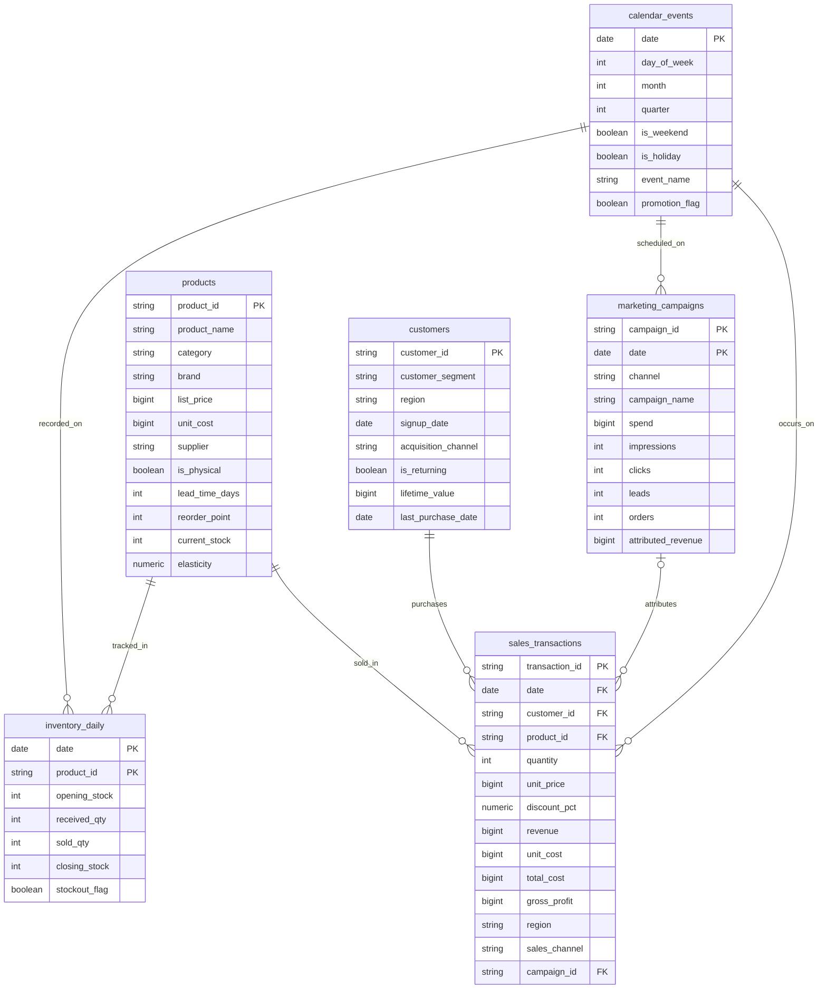
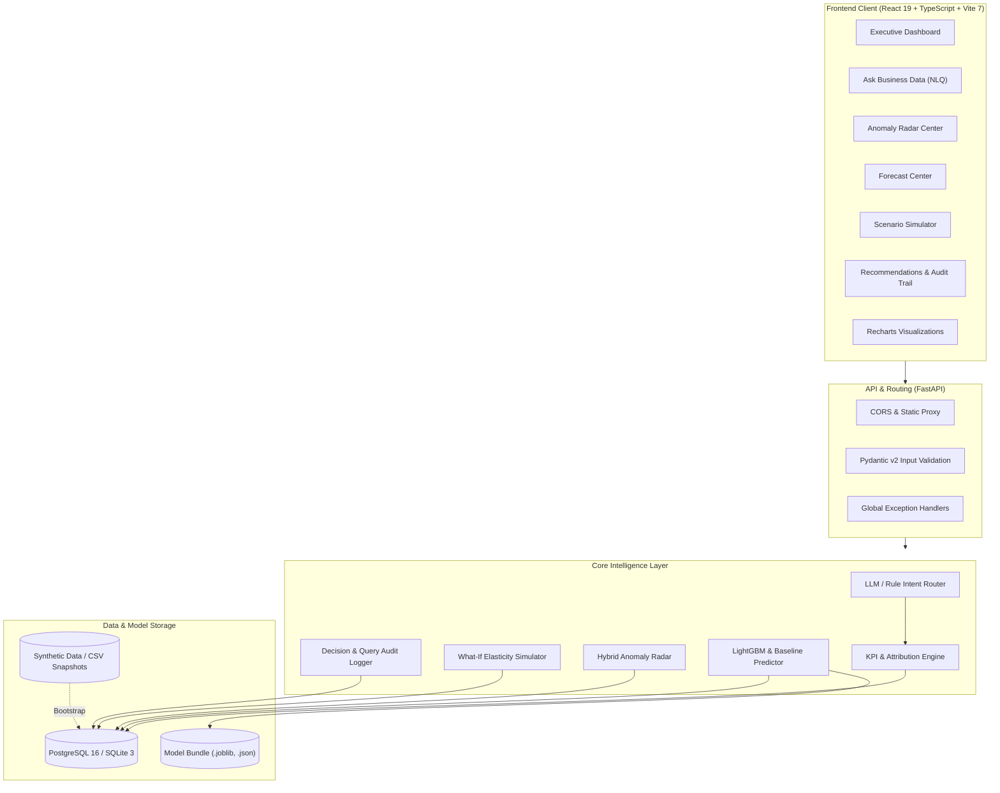

<div align="center">

<p align="center">
  
</p>

<h1 align="center">DecisionPilot AI</h1>

<p align="center">
  <b>Hệ thống Phân tích Dữ liệu Kinh doanh, Dự báo Thông minh & Hỗ trợ Ra Quyết định Ứng dụng AI cho Doanh nghiệp Vừa và Nhỏ (SMEs)</b><br/>
  <i>AI-Powered Business Intelligence, Demand Forecasting & Decision Support System for SMEs</i>
</p>

<p align="center">
  <b>Ask. Understand. Predict. Decide.</b><br/>
  <i>Hỏi tự nhiên · Hiểu căn nguyên · Dự báo tương lai · Quyết định chuẩn xác</i>
</p>

<p align="center">
  <a href="https://github.com/NguyenTriBaoThang/DecisionPilotAI/actions/workflows/ci.yml">
    
  </a>
  <a href="./LICENSE">
    
  </a>
  <a href="./.github/SECURITY.md">
    
  </a>
  
  
  
  
</p>

<p align="center">
  <a href="http://localhost:8080/"><strong>Executive Dashboard</strong></a>
  &nbsp;|&nbsp;
  <a href="http://localhost:8080/ask"><strong>Ask Business Data</strong></a>
  &nbsp;|&nbsp;
  <a href="http://localhost:8080/anomalies"><strong>Anomaly Center</strong></a>
  &nbsp;|&nbsp;
  <a href="http://localhost:8080/forecast"><strong>Forecast Center</strong></a>
  &nbsp;|&nbsp;
  <a href="http://localhost:8080/scenarios"><strong>Scenario Simulator</strong></a>
  &nbsp;|&nbsp;
  <a href="http://localhost:8080/recommendations"><strong>Recommendations & Audit</strong></a>
  &nbsp;|&nbsp;
  <a href="http://localhost:8080/api/docs"><strong>API Docs (Swagger)</strong></a>
</p>

<p align="center">
  
  
  
  
  
  
  
  
  
  
</p>

<p align="center">
  
</p>

</div>

---

## 📑 Mục lục & Hệ thống Tài liệu (Table of Contents & Documentation System)

### 📚 Hệ thống Tài liệu Kỹ thuật Chi tiết (Documentation Catalog)

| Tài liệu / Đặc tả | Định dạng | Mục đích & Nội dung chính | Liên kết |
| :--- | :---: | :--- | :---: |
| **Competition Submission Proposal** | Markdown | Đề xuất giải pháp dự thi chính thức cho K-TECH Hackathon / LIKELION 2026. | [`COMPETITION_SUBMISSION.md`](./COMPETITION_SUBMISSION.md) |
| **System Architecture Specification** | Markdown | Đặc tả kiến trúc 5 tầng, sơ đồ tuần tự, bảo mật và cơ chế chống ảo giác. | [`ARCHITECTURE.md`](./ARCHITECTURE.md) |
| **Live Demo Presentation Script (5–7 min)**| Markdown | Kịch bản trình diễn trực tiếp bằng tiếng Anh dành cho Ban Giám Khảo quốc tế. | [`DEMO_SCRIPT.md`](./DEMO_SCRIPT.md) |
| **Kịch bản Thuyết trình Toàn diện (12–15 min)**| Markdown | Kịch bản thuyết trình tiếng Việt đầy đủ kèm bộ câu hỏi phản biện chuyên sâu. | [`KICH_BAN_THUYET_TRINH_TOAN_DU_AN.md`](./KICH_BAN_THUYET_TRINH_TOAN_DU_AN.md) |
| **Model Versioning & Lifecycle Policy** | Markdown | Quy chuẩn quản trị phiên bản mô hình AI/ML và cấu trúc gói artifact. | [`MODEL_VERSIONING.md`](./MODEL_VERSIONING.md) |
| **Relational Data Model & Dictionary** | Markdown | Sơ đồ ERD 6 bảng, từ điển dữ liệu, ràng buộc toàn vẹn và logic sinh dữ liệu. | [`docs/data-model.md`](./docs/data-model.md) |
| **REST API Reference Specification** | Markdown | Danh mục endpoint, schema JSON request/response và mã lỗi chi tiết. | [`docs/api.md`](./docs/api.md) |
| **Machine Learning & Data Science Specs** | Markdown | Đặc tả chi tiết LightGBM, Isolation Forest, hàm co giãn vi mô và WAPE. | [`docs/ml-training-and-data.md`](./docs/ml-training-and-data.md) |
| **Natural Language Prompt Catalog** | Markdown | Danh mục prompt phân loại ý định, quy tắc sinh SQL an toàn và fallback. | [`docs/ai-prompt-catalog.md`](./docs/ai-prompt-catalog.md) |
| **Research & Business Innovation Proposal**| Markdown | Đề cương nghiên cứu học thuật, cơ sở lý thuyết và tác động kinh tế SME. | [`docs/research-proposal.md`](./docs/research-proposal.md) |
| **Operations & Deployment Manual** | Markdown | Sổ tay hướng dẫn cài đặt trên Windows/Linux, Docker, CI/CD và FAQ. | [`docs/operations.md`](./docs/operations.md) |
| **AI Explainability & Jury Q&A Evaluation** | Markdown | Trả lời trọn vẹn 8 câu hỏi cốt lõi của Ban Giám Khảo về tính minh bạch AI. | [`docs/AI_EXPLAINABILITY_AND_EVALUATION.md`](./docs/AI_EXPLAINABILITY_AND_EVALUATION.md) |

---

### 📑 Các đề mục trong README:
- [🎖️ Mục tiêu & Định vị dự án (Project Objective & Positioning)](#️-mục-tiêu--định-vị-dự-án-project-objective--positioning)
- [📸 Tổng quan 6 màn hình chức năng (Core Workspaces)](#-tổng-quan-6-màn-hình-chức-năng-core-workspaces)
- [🧭 Tại sao chọn DecisionPilot AI (Why DecisionPilot AI)](#-tại-sao-chọn-decisionpilot-ai-why-decisionpilot-ai)
- [👥 Đối tượng sử dụng mục tiêu (Target Users & Personas)](#-đối-tượng-sử-dụng-mục-tiêu-target-users--personas)
- [💡 Mô hình dữ liệu kinh doanh 6 bảng (Core Data Model)](#-mô-hình-dữ-liệu-kinh-doanh-6-bảng-core-data-model)
- [🧮 Thuật toán & Mô hình Toán học cốt lõi (Core Mathematical Models)](#-thuật-toán--mô-hình-toán-học-cốt-lõi-core-mathematical-models)
- [🏗️ Kiến trúc hệ thống (System Architecture)](#️-kiến-trúc-hệ-thống-system-architecture)
- [💻 Ngăn xếp công nghệ (Technology Stack)](#-ngăn-xếp-công-nghệ-technology-stack)
- [📡 Danh mục API chi tiết (API Catalog & Endpoints)](#-danh-mục-api-chi-tiết-api-catalog--endpoints)
- [🚀 Hướng dẫn cài đặt & Khởi chạy (Installation & Startup)](#-hướng-dẫn-cài-đặt--khởi-chạy-installation--startup)
- [⚙️ Cấu hình biến môi trường (Environment Configuration)](#️-cấu-hình-biến-môi-trường-environment-configuration)
- [🎭 6 Kịch bản trình diễn chuẩn (Demo Scenarios)](#-6-kịch-bản-trình-diễn-chuẩn-demo-scenarios)
- [📊 Đánh giá chất lượng mô hình (Model Evaluation & Benchmarks)](#-đánh-giá-chất-lượng-mô-hình-model-evaluation--benchmarks)
- [📁 Cấu trúc thư mục dự án (Directory Structure)](#-cấu-trúc-thư-mục-dự-án-directory-structure)
- [🗺️ Lộ trình phát triển (Development Roadmap)](#️-lộ-trình-phát-triển-development-roadmap)
- [🤝 Hướng dẫn đóng góp & Giấy phép (Contributing & License)](#-hướng-dẫn-đóng-góp--giấy-phép-contributing--license)

---

## 🎖️ Mục tiêu & Định vị dự án (Project Objective & Positioning)

### 🔴 Thách thức của các doanh nghiệp vừa và nhỏ (SMEs)
Trong kỷ nguyên số, các doanh nghiệp vừa và nhỏ (SMEs) bán lẻ và dịch vụ đối mặt với những nghịch lý lớn:
1. **Dữ liệu phân mảnh & "Nghĩa địa Excel":** Doanh số lưu trên phần mềm POS, chi phí quảng cáo nằm trên Facebook/Google Ads, thông tin khách hàng nằm rải rác trên CRM, số liệu tồn kho cập nhật thủ công trên Excel hàng tuần.
2. **Thiếu vắng đội ngũ phân tích dữ liệu chuyên trách:** SME không đủ ngân sách duy trì đội Data Analyst hay Data Scientist với mức lương hàng nghìn USD.
3. **BI truyền thống (PowerBI, Tableau) quá cồng kềnh:** Chi phí bản quyền cao, đòi hỏi kỹ năng dựng data model phức tạp, và chỉ mang tính **Mô tả quá khứ (Descriptive Analytics)** — trả lời *"Doanh số tháng rồi là bao nhiêu?"* nhưng hoàn toàn bất lực trước câu hỏi *"Tại sao doanh số giảm?"* hay *"Nếu giảm giá 5%, lợi nhuận sẽ thay đổi thế nào?"*.
4. **Ra quyết định bằng cảm tính:** Chủ doanh nghiệp và quản lý thường nhập hàng hoặc chạy quảng cáo dựa trên trực giác, dẫn tới đứt gãy dòng vốn, cháy hàng sản phẩm chủ lực hoặc tồn kho ứ đọng.

### 🟢 Lời giải từ DecisionPilot AI
**DecisionPilot AI** ra đời như một **Trợ lý Giám đốc Phân tích Dữ liệu Ảo (AI Chief Analytics Officer)** dành riêng cho SMEs:
- **Tương tác đàm thoại tự nhiên (Ask):** Bất kỳ nhân sự nào cũng có thể đặt câu hỏi bằng ngôn ngữ tự nhiên: *"Tại sao tháng này doanh thu sụt giảm?"*, *"Kênh quảng cáo nào đang kém hiệu quả nhất?"*.
- **Phân tích căn nguyên minh bạch (Understand):** Bóc tách đóng góp (Waterfall Contribution Analysis) theo Sản phẩm, Khu vực, Phân khúc khách hàng để tìm ra nguyên nhân chính xác — không võ đoán, không ảo tưởng số liệu.
- **Dự báo chuỗi thời gian đáng tin cậy (Predict):** Ứng dụng mô hình **LightGBM** kết hợp đặc trưng trễ (lags), lịch sự kiện và khoảng tin cậy 90% để dự báo nhu cầu SKU, đơn hàng và doanh số 7 - 30 ngày tiếp theo.
- **Giả lập kịch bản kinh doanh (Decide):** Cho phép chạy mô phỏng "What-If" với độ co giãn giá (Price Elasticity), độ trễ nhập hàng (Lead time) và ngân sách marketing trước khi ra quyết định xuống tiền thật.
- **Lưu vết kiểm toán có trách nhiệm (Audit & Human-in-the-Loop):** Mọi khuyến nghị của AI đều có bằng chứng (evidence), ghi nhận phản hồi chấp thuận/từ chối của con người và lưu vết bất biến.

---

## 📸 Tổng quan 6 màn hình chức năng (Core Workspaces)

Hệ thống được thiết kế tối giản, tập trung vào khả năng tương tác nhanh và hiển thị trực quan thông qua 6 màn hình chuyên biệt:

| Màn hình | Đường dẫn | Chức năng chính |
|---|---|---|
| **1. Executive Dashboard** | `/` | Tổng quan sức khỏe tài chính SME: Doanh thu, Lợi nhuận gộp, Biên lợi nhuận, Đơn hàng, Giá trị đơn trung bình (AOV), ROAS, Tồn kho. So sánh kỳ trước (Prior Period) và biểu đồ chuỗi thời gian linh hoạt (Ngày/Tuần/Tháng). |
| **2. Ask Business Data** | `/ask` | Trợ lý hỏi đáp dữ liệu thông minh. Nhận diện ý định kinh doanh, tự động sinh biểu đồ, trích xuất bằng chứng số liệu và minh bạch hóa câu lệnh truy vấn (SQL/Data trace). |
| **3. Anomaly Center** | `/anomalies` | Trạm radar phát hiện bất thường: Chi phí quảng cáo tăng đột biến nhưng ROAS giảm, biên lợi nhuận sụt bất thường, nguy cơ đứt hàng (stockout risk) dựa trên lead-time. |
| **4. Forecast Center** | `/forecast` | Trung tâm dự báo nhu cầu bán hàng: Dự báo doanh thu, số đơn, hoặc nhu cầu từng SKU cụ thể trong 7 ngày hoặc 30 ngày kèm dải tin cậy 90% (confidence bands). |
| **5. Scenario Simulator** | `/scenarios` | Cỗ máy mô phỏng What-If: Thử nghiệm mức chiết khấu giá (0%, 5%, 10%), điều phối ngân sách quảng cáo giữa các kênh, đánh giá tác động của độ trễ nhà cung cấp lên doanh số. |
| **6. Recommendations & Audit** | `/recommendations` | Danh mục đề xuất hành động kinh doanh được xếp hạng theo mức độ ưu tiên, tích hợp nút Duyệt (Accept) / Bác bỏ (Reject) và nhật ký kiểm toán lưu vết đầy đủ. |

---

## 🧭 Tại sao chọn DecisionPilot AI (Why DecisionPilot AI)

| Tiêu chí đánh giá | Excel thủ công | PowerBI / Tableau | DecisionPilot AI |
|---|---|---|---|
| **Hỏi đáp tự nhiên (NLQ)** | ❌ Không hỗ trợ | ⚠️ Cần trả phí Copilot đắt đỏ, dễ trả lời chung chung | ✅ Tích hợp sẵn, bám sát mô hình nghiệp vụ SME |
| **Giải thích nguyên nhân (Root Cause)** | ❌ Phải làm Pivot table thủ công hàng giờ | ⚠️ Cần viết DAX / Python script phức tạp | ✅ Bóc tách tự động đa chiều (Volume / Price / Mix) |
| **Dự báo nhu cầu tích hợp** | ⚠️ Xu hướng tuyến tính đơn giản | ⚠️ Cần cấu hình Azure ML / plugin bên ngoài | ✅ LightGBM tối ưu cho dữ liệu bảng + dải tin cậy |
| **Giả lập kịch bản What-If** | ⚠️ Sửa từng ô tính, dễ hỏng công thức | ⚠️ Cần tạo parameter phức tạp | ✅ Giao diện kéo thả tham số, tính độ co giãn tức thì |
| **Bảo vệ quyền riêng tư & Local-First** | ⚠️ Nguy cơ lộ file khi chia sẻ qua email | ❌ Dữ liệu đẩy lên Cloud công cộng | ✅ Chạy cục bộ 100% (On-premises / Docker), không bắt buộc API ngoài |
| **Chi phí sở hữu (TCO)** | Thấp ban đầu nhưng tốn nhân lực vận hành | Hàng chục ngàn USD tiền license mỗi năm | Mã nguồn mở, chi phí vận hành tối thiểu |
| **Audit Trail & Trách nhiệm AI** | ❌ Không lưu lịch sử quyết định | ❌ Không gắn liền quyết định của con người | ✅ Ghi nhận Human-in-the-loop, lưu vết mọi quyết định |

---

## 👥 Đối tượng sử dụng mục tiêu (Target Users & Personas)

- 👔 **SME Founder / CEO / Giám đốc điều hành:** Cần cái nhìn 360 độ về hiệu quả kinh doanh mỗi sáng, nắm rõ dòng tiền, kênh sinh lời và đưa ra quyết định chiến lược nhanh chóng.
- 📦 **Quản lý Vận hành & Chuỗi cung ứng (Operations & Inventory Lead):** Theo dõi sát sao 50 SKU, nhận cảnh báo trước 7-14 ngày về nguy cơ đứt hàng, tính toán lượng nhập tối ưu dựa theo lead-time của nhà cung cấp.
- 📈 **Trưởng phòng Marketing & Tăng trưởng (Marketing & Growth Lead):** Kiểm soát chỉ số ROAS, CAC trên từng kênh (Facebook Ads, Google Ads, TikTok), phát hiện ngay các chiến dịch đốt tiền không hiệu quả để kịp thời cắt giảm.
- 💼 **Kế toán quản trị & Tài chính (Financial Controller):** Đối soát doanh thu thực nhận, chiết khấu, giá vốn hàng bán (COGS), biên lợi nhuận gộp theo từng dòng sản phẩm và khu vực kinh doanh.

---

## 💡 Mô hình dữ liệu kinh doanh 6 bảng (Core Data Model)

Hệ thống xây dựng trên bộ dữ liệu mô phỏng doanh nghiệp bán lẻ & dịch vụ chuẩn mực gồm **50.000 giao dịch**, **50 SKUs**, **10.000 khách hàng** và **730 ngày hoạt động liên tục (2 năm)**:

```
┌──────────────────┐       ┌──────────────────────┐       ┌──────────────────────┐
│ calendar_events  │◄──────┤  sales_transactions  ├──────►│      customers       │
│  (730 ngày)      │       │    (50,000 đơn)      │       │   (10,000 khách)     │
└────────┬─────────┘       └──────────┬───────────┘       └──────────────────────┘
         │                            │
         ▼                            ▼
┌──────────────────┐       ┌──────────────────────┐       ┌──────────────────────┐
│ marketing_days   │       │       products       │◄──────┤   inventory_daily    │
│  (chiến dịch)    │       │    (50 mã SKU)       │       │    (tồn kho ngày)    │
└──────────────────┘       └──────────────────────┘       └──────────────────────┘
```

### Lược đồ quan hệ thực thể (Mermaid Entity Relationship)



---

## 🧮 Thuật toán & Mô hình Toán học cốt lõi (Core Mathematical Models)

### 1. Giả lập Độ co giãn Giá theo Cầu (Price Elasticity of Demand)
Khi chạy kịch bản điều chỉnh giá hoặc chiết khấu $\Delta P$, lượng cầu mới $Q_{new}$ được tính toán theo độ co giãn giá danh mục $\epsilon \in [-5.0, 0.0]$:

$$Q_{new} = Q_{base} \times \left(1 + \epsilon \times \frac{\Delta P}{P_{base}}\right)$$

Lợi nhuận gộp tương ứng được tối ưu hóa:

$$\Pi_{new} = Q_{new} \times \left(P_{new} - C_{unit}\right)$$

Nếu sản phẩm là vật lý và lượng tồn kho thực tế bị giới hạn bởi $S_{available} = \text{Closing Stock} + \text{Inbound Receipts}$, thì lượng bán thực tế bị chặn trên bởi $Q_{actual} = \min(Q_{new}, S_{available})$.

### 2. Phân tích Đóng góp Thác nước (Waterfall Contribution Decomposition)
Để trả lời câu hỏi *"Tại sao chỉ tiêu $M$ kỳ này tăng/giảm so với kỳ trước?"*, hệ thống phân tích chênh lệch $\Delta M = M_1 - M_0$ độc lập trên các chiều không gian (Sản phẩm, Vùng miền, Phân khúc, Kênh tiếp thị):

$$\Delta M = \sum_{d \in D} \text{Contribution}(d)$$

Trong đó mỗi thành phần đóng góp phản ánh chính xác 100% phần chênh lệch thực tế quan sát được, không đưa ra giả định ngụy biện (causal claims) thiếu căn cứ.

### 3. Dự báo Chuỗi thời gian LightGBM (Time-Series Forecasting)
- **Đặc trưng đầu vào (Point-in-time Features):**
  - Lags: Nhu cầu tại các mốc $t-7, t-14, t-21, t-28$.
  - Rolling Statistics: Trung bình trượt 7 ngày và 28 ngày ($\mu_{7}, \mu_{28}$).
  - Calendar Features: Ngày trong tuần, ngày trong tháng, quý, cờ cuối tuần, cờ ngày lễ.
- **Tiêu chuẩn lựa chọn mô hình:** LightGBM chỉ được chọn khi **Validation MAE** vượt trội hơn mô hình đường cơ sở (Seasonal Naive & Moving Average) ít nhất **2%**.
- **Khoảng tin cậy 90% (Confidence Bands):** Tính toán từ phân vị phần dư trên tập kiểm định:

$$\text{Band} = \left[ \hat{y}_t - Q_{0.95}(\text{residuals}),\ \hat{y}_t + Q_{0.95}(\text{residuals}) \right]$$

### 4. Radar Phát hiện Bất thường Kết hợp (Hybrid Anomaly Radar)
Kết hợp hai kỹ thuật bổ trợ:
- **Rolling Z-Score cục bộ:**

$$Z_t = \frac{x_t - \mu_{t-30..t-1}}{\sigma_{t-30..t-1}}, \quad |Z_t| > 2.5 \implies \text{Cảnh báo đột biến}$$

- **Isolation Forest:** Phát hiện các điểm dữ liệu dị biệt đa biến (ví dụ: Chi phí tiếp thị tăng cao đột ngột nhưng số lượng đơn hàng quy kết không tăng tương ứng).
- **Business Rule Heuristics:** Kiểm tra đứt hàng dựa trên số ngày bán còn lại $\frac{\text{Current Stock}}{\text{Average Daily Demand}} < \text{Lead Time Days}$.

---

## 🏗️ Kiến trúc hệ thống (System Architecture)



---

## 💻 Ngăn xếp công nghệ (Technology Stack)

| Thành phần | Công nghệ | Phiên bản | Vai trò & Trách nhiệm |
|---|---|---|---|
| **Frontend Framework** | React | 19.2.0 | Giao diện người dùng hiện đại, tối ưu rendering với Concurrent features |
| **Language** | TypeScript | 5.9.3 | Đảm bảo tính an toàn kiểu dữ liệu toàn diện giữa Frontend và Backend |
| **Build Tool** | Vite | 7.2.4 | Tốc độ biên dịch siêu tốc, hỗ trợ Hot Module Replacement (HMR) |
| **CSS & Styling** | Tailwind CSS | 4.1.17 | Thiết kế giao diện Glassmorphism hiện đại, hỗ trợ Light & Dark theme |
| **Data Fetching** | TanStack Query | 5.90.10 | Quản lý trạng thái server-state, tự động cache và làm mới dữ liệu |
| **Data Visualization** | Recharts | 3.4.1 | Vẽ biểu đồ diện tích, đường, cột và phân phối trực quan |
| **Backend Framework** | FastAPI | 0.121.3 | RESTful API hiệu năng cao với ASGI, sinh OpenAPI tự động |
| **Server Engine** | Uvicorn | 0.38.0 | Máy chủ ASGI siêu nhẹ, xử lý kết nối bất đồng bộ |
| **Data Modeling** | Pydantic | 2.14.2 | Kiểm định dữ liệu vào/ra nghiêm ngặt theo chuẩn PRD |
| **ORM & Query** | SQLAlchemy | 2.0.44 | Thực thi câu lệnh truy vấn quan hệ tham số hóa an toàn, chống SQL Injection |
| **Database Migration** | Alembic | 1.17.2 | Quản lý phiên bản cấu trúc cơ sở dữ liệu tự động |
| **Relational Database** | PostgreSQL / SQLite | 16 / 3.45+ | Lưu trữ dữ liệu giao dịch kinh doanh và lịch sử kiểm toán |
| **Machine Learning** | LightGBM | 4.6.0 | Thuật toán Gradient Boosting cây quyết định dự báo chuỗi thời gian |
| **Scientific Computing** | Pandas / NumPy / Scikit-Learn | 2.3 / 2.2 / 1.7 | Xử lý dữ liệu bảng, ma trận đặc trưng, Isolation Forest |
| **Containerization** | Docker & Compose | v2+ | Đóng gói toàn bộ hệ thống chạy với 1 lệnh duy nhất |

---

## 📡 Danh mục API chi tiết (API Catalog & Endpoints)

> **Swagger UI:** `http://localhost:8080/api/docs` &nbsp;|&nbsp; **OpenAPI JSON:** `http://localhost:8080/api/openapi.json`

### 1. Trạng thái hệ thống & Metadata
| Method | Endpoint | Mô tả chức năng |
|:---:|---|---|
| `GET` | `/health` | Kiểm tra tình trạng kết nối DB, sẵn sàng của dataset và phiên bản mô hình ML |
| `GET` | `/dataset` | Lấy mã định danh dataset (SHA-256), ngày bắt đầu/kết thúc và số lượng bản ghi |
| `GET` | `/options` | Danh sách bộ lọc khả dụng: Danh mục, Vùng miền, Kênh bán, Mã sản phẩm |

### 2. Chỉ số kinh doanh & Hỏi đáp thông minh
| Method | Endpoint | Mô tả chức năng |
|:---:|---|---|
| `GET` | `/kpi/summary` | Tóm tắt các chỉ số chính (Doanh thu, Lợi nhuận, Đơn hàng, ROAS), so sánh kỳ trước |
| `POST` | `/query` | Xử lý câu hỏi ngôn ngữ tự nhiên, phân loại intent và trả về câu trả lời kèm biểu đồ |

### 3. Radar Bất thường & Đóng góp
| Method | Endpoint | Mô tả chức năng |
|:---:|---|---|
| `GET` | `/anomalies` | Danh sách cảnh báo bất thường được xếp hạng theo độ nghiêm trọng (Critical/High/Medium) |
| `GET` | `/anomalies/{alert_id}` | Chi tiết cảnh báo, giá trị thực tế vs tham chiếu và bảng bóc tách nguyên nhân |

### 4. Dự báo & Giả lập Kịch bản
| Method | Endpoint | Mô tả chức năng |
|:---:|---|---|
| `POST` | `/forecast` | Dự báo Doanh thu / Đơn hàng / SKU theo chân trời 7 hoặc 30 ngày kèm khoảng tin cậy |
| `POST` | `/simulate` | Mô phỏng kịch bản giá bán, chiết khấu, điều chỉnh ngân sách tiếp thị hoặc tồn kho |

### 5. Khuyến nghị & Kiểm toán
| Method | Endpoint | Mô tả chức năng |
|:---:|---|---|
| `GET` | `/recommendations` | Danh sách hành động khuyến nghị từ AI kèm mức độ chắc chắn và tác động dự kiến |
| `POST` | `/recommendations/feedback` | Ghi nhận phản hồi của người dùng: Chấp thuận (`accepted`) hoặc Bác bỏ (`rejected`) |
| `GET` | `/audit` | Nhật ký kiểm toán lưu vết các câu hỏi đã truy vấn, thay đổi dữ liệu và phản hồi |
| `POST` | `/import` | Nạp snapshot dữ liệu mới từ file ZIP (6 file CSV) hoặc file Excel đa sheet |

---

## 🚀 Hướng dẫn cài đặt & Khởi chạy (Installation & Startup)

### Yêu cầu tiên quyết
- **Docker & Docker Compose** (Khuyên dùng để chạy nhanh nhất)
- HOẶC chạy thủ công:
  - **Python 3.11, 3.12 hoặc 3.13**
  - **Node.js 22.12+** và **npm 11+**

---

### Cách 1: Khởi chạy nhanh bằng Docker Compose (Khuyên dùng)

Chỉ với 2 bước đơn giản để khởi chạy toàn bộ hệ thống gồm PostgreSQL, Backend FastAPI và Frontend Nginx:

```sh
# 1. Sao chép cấu hình môi trường mẫu
cp .env.example .env

# 2. Xây dựng và khởi chạy toàn bộ dịch vụ
docker compose up --build
```

Mở trình duyệt truy cập:
- 🌐 **Giao diện ứng dụng:** [http://localhost:8080](http://localhost:8080)
- 📚 **Tài liệu API Swagger:** [http://localhost:8080/api/docs](http://localhost:8080/api/docs)

*(Cơ sở dữ liệu PostgreSQL sẽ tự động tạo bảng qua Alembic và nạp sẵn 50.000 bản ghi mẫu ngay lần đầu khởi chạy).*

---

### Cách 2: Khởi chạy cục bộ không dùng Docker (Local Development)

#### 1. Cài đặt Backend (Python)
Trên **Windows (PowerShell)**:
```powershell
# 1. Tạo và kích hoạt môi trường ảo Python
python -m venv .venv
.\.venv\Scripts\Activate.ps1

# 2. Cài đặt các thư viện cần thiết
pip install -r requirements.txt

# 3. Khởi tạo cơ sở dữ liệu SQLite và nạp dữ liệu mẫu
python -m alembic upgrade head
python -m scripts.bootstrap
```

Trên **Linux / macOS**:
```sh
python3 -m venv .venv
source .venv/bin/activate
pip install -r requirements.txt
python -m alembic upgrade head
python -m scripts.bootstrap
```

#### 2. Cài đặt Frontend (React + Vite)
```sh
# Cài đặt các gói phụ thuộc frontend
npm --prefix frontend install

# Khởi chạy frontend ở chế độ dev
npm --prefix frontend run dev
```

#### 3. Khởi chạy Backend song song
Trong một cửa sổ dòng lệnh khác (đã kích hoạt `.venv`):
```powershell
python -m uvicorn backend.app.main:app --host 127.0.0.1 --port 8000 --reload
```

Mở trình duyệt truy cập [http://127.0.0.1:5173](http://127.0.0.1:5173). Vite sẽ tự động proxy các request `/api/*` sang backend `http://127.0.0.1:8000`.

---

## ⚙️ Cấu hình biến môi trường (Environment Configuration)

File `.env` quản lý các cấu hình kết nối và các cổng tích hợp trí tuệ nhân tạo:

| Tên biến | Mặc định | Ý nghĩa & Hướng dẫn |
|---|---|---|
| `POSTGRES_USER` | `decisionpilot` | Tên người dùng database PostgreSQL (khi dùng Docker) |
| `POSTGRES_PASSWORD` | `decisionpilot_local` | Mật khẩu kết nối database PostgreSQL |
| `POSTGRES_DB` | `decisionpilot` | Tên database kinh doanh |
| `DATABASE_URL` | *(trống)* | Chuỗi kết nối SQLAlchemy (Mặc định dùng SQLite `data/local.sqlite` nếu không đặt) |
| `LLM_PROVIDER` | `none` | Nhà cung cấp AI phân loại intent: `none` (local rules), `gemini`, hoặc `openai` |
| `GEMINI_API_KEY` | *(trống)* | API Key của Google Gemini (Khi `LLM_PROVIDER=gemini`) |
| `GEMINI_MODEL` | `gemini-2.5-flash` | Phiên bản mô hình Google Gemini |
| `OPENAI_API_KEY` | *(trống)* | API Key của OpenAI (Khi `LLM_PROVIDER=openai`) |
| `OPENAI_MODEL` | `gpt-4.1-mini` | Phiên bản mô hình OpenAI GPT |
| `DEMO_ALLOW_IMPORT` | `false` | Bật/tắt tính năng thay thế snapshot qua API `/import` (`true`/`false`) |
| `IMPORT_TOKEN` | *(trống)* | Token bảo vệ endpoint `/import` tránh ghi đè dữ liệu ngoài ý muốn |
| `WEB_PORT` | `8080` | Cổng HTTP truy cập ứng dụng khi chạy qua Docker Compose |

---

## 🎭 6 Kịch bản trình diễn chuẩn (Demo Scenarios)

Dựa trên dữ liệu mẫu chuẩn (mốc kết thúc dữ liệu: **30/09/2026**):

### Kịch bản 1: Quan sát tổng thể (Observe)
- **Thao tác:** Mở **Executive Dashboard**, quan sát doanh thu tháng gần nhất và so sánh với tháng trước.
- **Ý nghĩa:** Người quản lý nhanh chóng nhìn thấy bức tranh toàn cảnh: Doanh thu sụt giảm 8.2%, lợi nhuận gộp giảm tương ứng, trong khi chi phí quảng cáo tăng.

### Kịch bản 2: Phát hiện bất thường (Detect)
- **Thao tác:** Chuyển sang **Anomaly Center**, nhấp vào cảnh báo `Facebook Ads spend spike`.
- **Ý nghĩa:** Hệ thống chỉ ra chi phí quảng cáo Facebook tăng 35% nhưng doanh thu quy kết chỉ tăng 2%, khiến ROAS sụt giảm nghiêm trọng.

### Kịch bản 3: Giải thích căn nguyên (Explain)
- **Thao tác:** Chuyển sang **Ask Business Data**, gõ câu hỏi: *"Why did revenue decrease this month?"* (hoặc *"Tại sao doanh thu giảm?"*).
- **Ý nghĩa:** Trợ lý tự động phân tích thác nước (Waterfall), chỉ ra nhóm sản phẩm *SmartDesk Mini* và thị trường *Hà Nội* đóng góp 62% vào phần sụt giảm doanh thu.

### Kịch bản 4: Dự báo nhu cầu tương lai (Forecast)
- **Thao tác:** Vào **Forecast Center**, chọn sản phẩm `SmartDesk Mini (P001)` và chu kỳ 30 ngày.
- **Ý nghĩa:** Mô hình LightGBM đưa ra dự báo 30 ngày tới kèm dải tin cậy 90%, cho thấy nhu cầu sẽ hồi phục nhẹ vào giữa tháng 10 khi có đợt ưu đãi.

### Kịch bản 5: Giả lập kịch bản hành động (Simulate)
- **Thao tác:** Vào **Scenario Simulator**, chọn kịch bản giá cho `P001` với các mức chiết khấu `0%`, `5%`, `10%`.
- **Ý nghĩa:** Cỗ máy tính toán độ co giãn $\epsilon = -1.42$, chứng minh mức giảm giá 5% giúp tối ưu hóa tổng lợi nhuận gộp cao nhất mà không gây cạn kiệt kho.

### Kịch bản 6: Ra quyết định & Lưu vết (Decide)
- **Thao tác:** Vào **Recommendations**, xem khuyến nghị giảm ngân sách kênh Facebook Ads và nhập thêm 200 đơn vị P001. Bấm **Accept**.
- **Ý nghĩa:** Hành động được ghi nhận vào **Decision Audit Trail** với đầy đủ bằng chứng (evidence) và định danh snapshot dữ liệu tại thời điểm ra quyết định.

---

## 📊 Đánh giá chất lượng mô hình (Model Evaluation & Benchmarks)

Kết quả kiểm định trên tập kiểm thử độc lập (Test Set: `13/06/2026` đến `30/09/2026`):

### 1. Độ chính xác dự báo 30 ngày (Forecast 30-Day Evaluation)
| Chỉ tiêu / Phạm vi | Mô hình được chọn | Test MAE | Test WAPE | Độ phủ khoảng tin cậy (Coverage) |
|---|---|---:|---:|---:|
| **Doanh thu toàn doanh nghiệp** | Moving Average | 34,584,971 VND | 24.14% | 78.57% |
| **Tổng số lượng đơn hàng** | Moving Average | 14.98 đơn | 23.22% | 82.38% |
| **Tổng nhu cầu đơn vị** | Moving Average | 17.74 sp | 23.46% | 79.52% |
| **Nhu cầu mã P001 (SmartDesk Mini)** | **LightGBM** | **2.68 sp** | **41.87%** | **91.90%** |

### 2. Phát hiện bất thường có nhãn (Anomaly Detection Benchmarks)
| Loại tín hiệu cảnh báo | Phương pháp | Precision | Recall | F1-Score | Tỉ lệ báo động giả (FPR) |
|---|---|---:|---:|---:|---:|
| **Facebook Spend Spike** | Hybrid (Z-Score + IF) | 100.00% | 82.14% | **90.20%** | 0.00% |
| **Facebook Conversion Drop** | Hybrid | 75.00% | 75.00% | **75.00%** | 8.54% |
| **Facebook ROAS Deterioration** | Hybrid | 68.00% | 60.71% | **64.15%** | 9.76% |
| **Gross Margin Anomaly** | Hybrid | 50.00% | 75.00% | **60.00%** | 2.83% |

---

## 📁 Cấu trúc thư mục dự án (Directory Structure)

```text
DecisionPilotAI/
├── .github/                       # Quy chuẩn GitHub & Tự động hóa CI/CD
│   ├── workflows/
│   │   └── ci.yml                 # Pipeline kiểm thử tự động Frontend & Backend
│   ├── ISSUE_TEMPLATE/            # Biểu mẫu báo lỗi và đề xuất tính năng
│   ├── CODE_OF_CONDUCT.md         # Quy tắc ứng xử cộng đồng
│   ├── CONTRIBUTING.md            # Hướng dẫn đóng góp mã nguồn
│   ├── PULL_REQUEST_TEMPLATE.md   # Mẫu tạo Pull Request
│   ├── SECURITY.md                # Chính sách bảo mật & báo cáo lỗ hổng
│   └── SUPPORT.md                 # Kênh hỗ trợ kỹ thuật
├── ai_service/                    # Tầng dịch vụ AI & Machine Learning cốt lõi
│   ├── anomaly.py                 # Thuật toán phát hiện bất thường đa biến
│   ├── features.py                # Xây dựng ma trận đặc trưng chuỗi thời gian
│   ├── forecasting.py             # Bộ dự báo LightGBM & baselines
│   ├── llm_orchestrator.py        # Bộ điều phối phân loại intent (Gemini/OpenAI/Rules)
│   ├── root_cause.py              # Bóc tách đóng góp thác nước (Waterfall Contribution)
│   └── scenario.py                # Cỗ máy giả lập What-If và tối ưu hóa
├── backend/                       # Ứng dụng Backend FastAPI
│   ├── alembic/                   # Quản lý phiên bản cơ sở dữ liệu (Migrations)
│   └── app/
│       ├── analytics.py           # Logic truy vấn và tổng hợp chỉ số kinh doanh
│       ├── db.py                  # Định nghĩa ORM SQLAlchemy & cấu hình kết nối DB
│       ├── main.py                # Các REST endpoints & middleware của FastAPI
│       ├── schemas.py             # Lược đồ Pydantic kiểm soát dữ liệu vào/ra
│       └── services.py            # Tầng dịch vụ điều phối giữa DB và AI
├── frontend/                      # Ứng dụng web React 19 + TypeScript + Vite 7
│   ├── src/
│   │   ├── api.ts                 # Client giao tiếp HTTP với backend
│   │   ├── Dashboard.tsx          # Giao diện Executive Dashboard & biểu đồ
│   │   ├── WorkspacePages.tsx     # 5 màn hình Ask, Anomaly, Forecast, Scenario, Recs
│   │   ├── main.tsx               # Cấu hình định tuyến (Routing) & Theme Provider
│   │   ├── styles.css             # Định kiểu giao diện với Tailwind CSS v4
│   │   └── ui.tsx                 # Các thành phần giao diện dùng chung
│   └── package.json               # Cấu hình thư viện frontend
├── data/
│   └── synthetic/                 # 6 bảng dữ liệu mô phỏng chuẩn CSV
├── artifacts/                     # Mô hình đã huấn luyện, báo cáo & số liệu benchmark
│   ├── model.joblib               # Trọng số mô hình LightGBM đã huấn luyện
│   └── MODEL_EVALUATION.md        # Báo cáo chi tiết đánh giá thuật toán
├── docs/                          # Tài liệu kỹ thuật chi tiết
│   ├── ARCHITECTURE.md            # Thiết kế kiến trúc & dòng chảy dữ liệu
│   ├── DATA_DICTIONARY.md         # Từ điển dữ liệu chi tiết cho 6 bảng nghiệp vụ
│   ├── API.md                     # Hướng dẫn chi tiết sử dụng REST API
│   ├── DEMO.md                    # Kịch bản demo từng bước cho hội đồng giám khảo
│   └── AI_SAFETY.md               # Nguyên tắc an toàn & ranh giới của AI
├── scripts/                       # Kịch bản quản trị và vận hành tự động
│   ├── bootstrap.py               # Nạp dữ liệu mẫu vào cơ sở dữ liệu
│   ├── pipeline.py                # Quy trình kiểm định & nạp snapshot
│   ├── train.py                   # Huấn luyện lại mô hình LightGBM
│   ├── benchmark.py               # Đo lường hiệu năng và tốc độ phản hồi
│   └── report.py                  # Xuất báo cáo tổng kết kinh doanh
├── docker-compose.yml             # Cấu hình triển khai container Docker
├── Dockerfile                     # Đóng gói ứng dụng chạy Nginx + FastAPI
├── requirements.txt               # Danh sách thư viện Python
└── README.md                      # Tài liệu tổng quan dự án
```

---

## 🗺️ Lộ trình phát triển (Development Roadmap)

### ✅ Giai đoạn 1: Bản phát hành MVP (Hiện tại)
- [x] Lược đồ dữ liệu 6 bảng tiêu chuẩn doanh nghiệp bán lẻ & dịch vụ (50k đơn).
- [x] Executive Dashboard với 8 chỉ số kinh doanh cốt lõi và so sánh kỳ trước.
- [x] Trợ lý đàm thoại ngôn ngữ tự nhiên không cần API key ngoài (Local Rule Baseline).
- [x] Tích hợp tùy chọn Google Gemini 2.5 Flash & OpenAI GPT-4.1-mini.
- [x] Mô hình dự báo chuỗi thời gian LightGBM với dải tin cậy 90%.
- [x] Radar phát hiện bất thường kết hợp Rolling Z-Score & Isolation Forest.
- [x] Cỗ máy giả lập kịch bản What-If với độ co giãn giá theo cầu.
- [x] Lưu vết kiểm toán phản hồi con người (Human-in-the-loop Decision Audit).
- [x] Đóng gói Docker Compose chạy trọn gói bằng 1 dòng lệnh.

### 🚀 Giai đoạn 2: Mở rộng tính năng (Quý 1 - Quý 2 / 2027)
- [ ] **Kết nối trực tiếp nguồn dữ liệu thực:** Hỗ trợ kết nối cổng API đến KiotViet, Sapo, Haravan, Shopify và WooCommerce.
- [ ] **Kiến trúc đa khách hàng (Multi-Tenant):** Quản lý không gian làm việc độc lập cho nhiều doanh nghiệp khác nhau.
- [ ] **Phân tích nhóm thuần tập nâng cao (Cohort Retention & LTV):** Dự đoán vòng đời giá trị khách hàng bằng mô hình BG/NBD & Gamma-Gamma.
- [ ] **Tự động gửi thông báo cảnh báo:** Tích hợp Webhook cảnh báo bất thường qua Telegram Bot, Zalo OA và Email.

### 🌟 Giai đoạn 3: Tự động hóa ra quyết định (Autonomous Actions)
- [ ] Tự động tạm dừng chiến dịch quảng cáo khi phát hiện ROAS giảm sâu quá ngưỡng an toàn.
- [ ] Đề xuất đơn đặt hàng nhà cung cấp tự động (Auto Purchase Order generation).

---

## 🤝 Hướng dẫn đóng góp & Giấy phép (Contributing & License)

### Đóng góp mã nguồn
Chúng tôi luôn hoan nghênh sự đóng góp từ cộng đồng. Xin vui lòng tham khảo [HƯỚNG DẪN ĐÓNG GÓP](./.github/CONTRIBUTING.md) để biết quy trình tạo nhánh, viết commit theo chuẩn Conventional Commits và chạy bộ kiểm thử.

### Báo cáo bảo mật
Để báo cáo lỗ hổng bảo mật một cách an toàn, vui lòng đọc [CHÍNH SÁCH BẢO MẬT](./.github/SECURITY.md).

### Bản quyền & Giấy phép
Dự án được phân phối dưới giấy phép **MIT License**. Xem chi tiết tại [LICENSE](./LICENSE).

---

<div align="center">
  <p><b>DecisionPilot AI</b> — Phát triển với tinh thần kiến tạo giá trị đột phá cho Doanh nghiệp Việt 🇻🇳</p>
  <p>
    <a href="./COMPETITION_SUBMISSION.md">Đề xuất dự thi</a> · 
    <a href="./ARCHITECTURE.md">Kiến trúc hệ thống</a> · 
    <a href="./DEMO_SCRIPT.md">Demo Script</a> · 
    <a href="./KICH_BAN_THUYET_TRINH_TOAN_DU_AN.md">Kịch bản thuyết trình</a> · 
    <a href="./docs/api.md">API Reference</a> · 
    <a href="./docs/data-model.md">Mô hình dữ liệu</a>
  </p>
</div>
