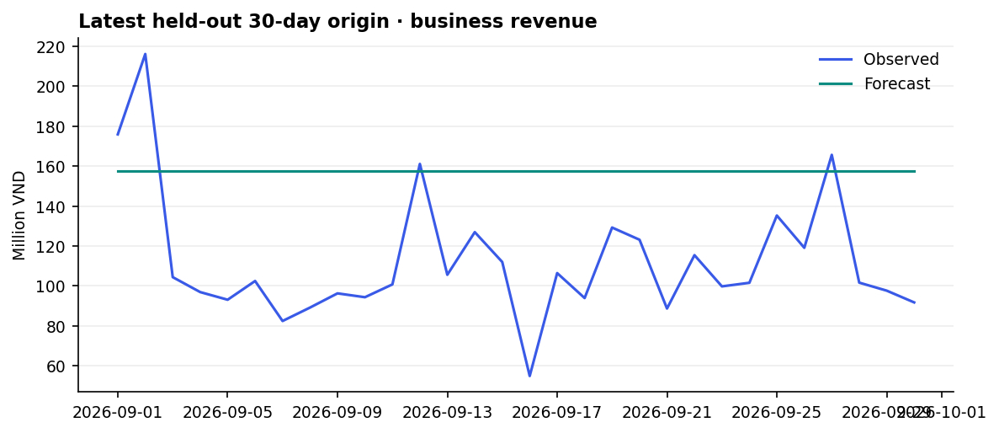
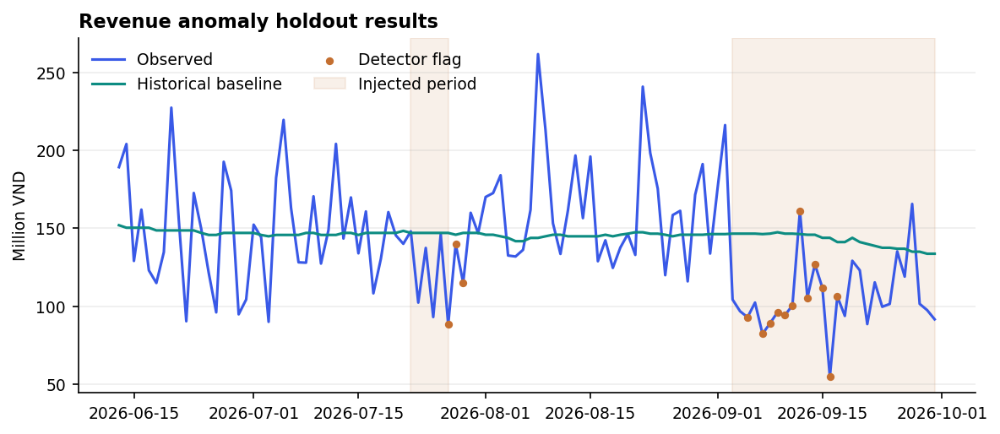
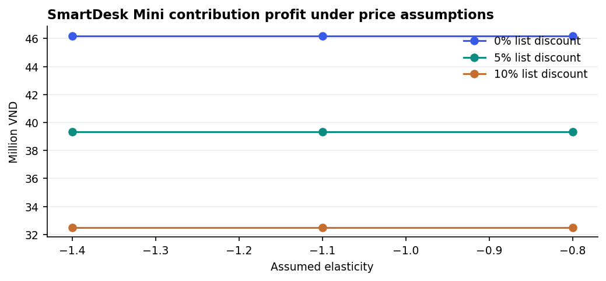
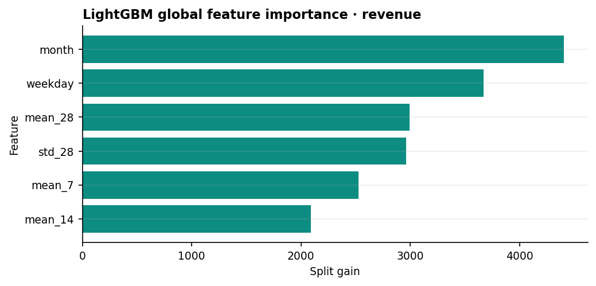

<div align="center">

<p align="center">
  
</p>

# DecisionPilot AI

### AI-Powered Business Data Analysis, Forecasting and Decision Support System for SMEs

**Ask. Understand. Predict. Decide.**

[](./COMPETITION_SUBMISSION.md)
[](https://nguyentribaothang.github.io/DecisionPilotAI/)
[](./LICENSE)

<p align="center">
  <a href="https://nguyentribaothang.github.io/DecisionPilotAI/"><strong>Technical Documentation Portal (GitHub Pages)</strong></a>
  &nbsp;•&nbsp;
  <a href="https://nguyentribaothang.github.io/DecisionPilotAI/app/"><strong>Live App Demo (GitHub Pages)</strong></a>
  &nbsp;•&nbsp;
  <a href="./ARCHITECTURE.md"><strong>System Architecture</strong></a>
  &nbsp;•&nbsp;
  <a href="./COMPETITION_SUBMISSION.md"><strong>Competition Submission</strong></a>
  &nbsp;•&nbsp;
  <a href="./MODEL_VERSIONING.md"><strong>Model Governance</strong></a>
  &nbsp;•&nbsp;
  <a href="#-quick-start"><strong>Quick Start</strong></a>
</p>

<p align="center">
  
  
  
  
  
  
  
  
  
  
  
  
</p>

<p align="center">
  
</p>

</div>

---

## 📌 Executive Summary

**DecisionPilot AI** is an AI-powered decision intelligence platform engineered for Small and Medium Enterprises (SMEs). Rather than functioning as an unconstrained LLM chatbot or a static reporting dashboard, DecisionPilot AI runs a verifiable, deterministic **Decision Intelligence Loop**: parsing bilingual natural-language executive questions into strict typed intents over read-only relational data, surfacing operational anomalies via hybrid statistical/ML surveillance with 100%-reconciled driver attribution, forecasting demand with validation-gated LightGBM vs. baseline models and calibrated 90% intervals, and stress-testing pricing, marketing, and inventory scenarios in an interactive 3D WebGL sandbox before human sign-off.

```text
  [1. ASK]             [2. UNDERSTAND]          [3. PREDICT]            [4. SIMULATE]              [5. DECIDE]
Typed Intent NLQ  ->  56d Shifted Baseline  ->  LightGBM / Baselines -> Price Elasticity & Power -> Human Accept/Reject
& Root Cause SQL      & Isolation Forest        (90% Empirical Bands)   Curve 3D Sandbox (P&L)      & audit_events Log
```

---

## 📑 Table of Contents

- [Executive Summary](#-executive-summary)
- [The Business Problem & Our Solution](#-the-business-problem--our-solution)
- [Challenge Alignment — Data & Decision Intelligence](#-challenge-alignment--data--decision-intelligence)
- [Core Workspaces & Capabilities](#-core-workspaces--capabilities)
- [Product Visual Showcase](#-product-visual-showcase)
- [System Architecture](#-system-architecture)
- [AI & Machine Learning Foundations](#-ai--machine-learning-foundations)
- [Dataset & Synthetic Data Pipeline](#-dataset--synthetic-data-pipeline)
- [Model Evaluation & Benchmarks](#-model-evaluation--benchmarks)
- [Technology Stack](#-technology-stack)
- [Quick Start](#-quick-start)
- [API Catalog & Reference](#-api-catalog--reference)
- [Testing & GitHub Actions CI/CD](#-testing--github-actions-cicd)
- [Project Structure](#-project-structure)
- [Security, Privacy & Responsible AI](#-security-privacy--responsible-ai)
- [Roadmap, Contributing & License](#-roadmap-contributing--license)

---

## 💡 The Business Problem & Our Solution

### The SME Dilemma

Small and Medium Enterprises in retail and services routinely face acute operational bottlenecks:

1. **Siloed Operational Data:** Sales transactions live in POS exports, marketing spend sits across ad managers, warehouse stock balances live in inventory logs, and customer cohorts are fragmented across histories.
2. **No Dedicated Data Engineering Team:** Most SMEs lack full-time data analysts or econometricians to maintain statistical anomaly monitors and multi-horizon forecast pipelines.
3. **Descriptive Blind Spots in Legacy BI:** Traditional dashboards summarize historical totals without explaining *why* gross profit shifted across channels/regions or *how* proposed promotions interact with warehouse lead times.
4. **High-Risk Gut Decisions:** Unchecked blanket discounting erodes contribution margin, ad spend scales past diminishing returns, and replenishment delays trigger costly stockouts.

### The DecisionPilot AI Solution

DecisionPilot AI closes the loop between data and decision execution:

- **Ask Natural Language Questions:** Managers query business metrics in English or Vietnamese (e.g., `"Doanh thu tháng này ở HCMC?"`, `"Why did revenue decrease this month?"`). An LLM router (OpenAI/Gemini) or local regex fallback maps text into a strict Pydantic `Intent` (`extra="forbid"`) bound to allowlisted SQLAlchemy Core queries on a `READ ONLY` connection—eliminating arbitrary code/SQL execution and arithmetic hallucination.
- **Understand Root Causes:** Hybrid detection (`IsolationForest` + IQR + robust Z-score + sustained weekly drop + inventory stockout rules) flags deviations against a 56-day rolling window shifted by 7 days, while waterfall contribution decomposition reconciles 100% of period-over-period variance by category, product, region, and channel.
- **Predict Demand with Validation Gates:** A LightGBM regressor trained on 17 point-in-time lag, rolling, calendar, and scale features competes per series and horizon (`7` or `30` days) against Moving Average and Seasonal Naive baselines—promoted **only** when validation MAE beats the better baseline by more than `2%`, paired with empirical validation-residual 90% intervals.
- **Simulate Before Committing Capital:** The Scenario Simulator applies linear-percentage price elasticity, power-law marketing response ($r^\alpha$, default $\alpha = 0.65$), and daily physical stock-balance replenishment to evaluate alternatives against sensitivity bands before recording manager decisions.

---

## 🎯 Challenge Alignment — Data & Decision Intelligence

Submitted for **LIKELION — AI for Business Innovation 2026** (**Track 5: Data & Decision Intelligence**), DecisionPilot AI directly addresses all four competition pillars:

| Challenge Requirement | DecisionPilot AI Module | Verified Implementation | Grounded Evidence |
| :--- | :--- | :--- | :--- |
| **1. Natural language questions to business reports**<br/>*(Ngôn ngữ tự nhiên thành báo cáo)* | **Ask Business Data (`/ask`)**<br/>[`ai_service/llm_orchestrator.py`](./ai_service/llm_orchestrator.py)<br/>[`backend/app/main.py`](./backend/app/main.py) | • Bilingual VI/EN parser (OpenAI `gpt-4.1-mini`, Gemini `gemini-2.5-flash`, or regex fallback).<br/>• Prompt/SQL-injection guard regex + strict Pydantic `Intent` (`extra="forbid"`).<br/>• Parameterized SQLAlchemy Core queries on `read_connection` (`READ ONLY` / `query_only`). | **46/46 (100%)** benchmark pass across intent, execution, filters, chart, numerical accuracy, and grounding; median **1,432.2 ms** latency. |
| **2. Revenue analysis & significant anomaly detection**<br/>*(Phân tích doanh thu & nhận diện biến động)* | **Anomaly Center (`/anomalies`)**<br/>[`ai_service/anomaly.py`](./ai_service/anomaly.py)<br/>[`ai_service/root_cause.py`](./ai_service/root_cause.py) | • `56-day` rolling window shifted `7 days` (`min_periods=28`).<br/>• `IsolationForest(n_estimators=120, contamination=0.065)` + IQR + robust Z-score + sustained 7-day drop check + `stockout_risk` rule.<br/>• Exact contribution decomposition across product, category, region, and channel. | **100.00% precision / 82.14% recall / 90.20% F1** (`0.00%` FPR) on `facebook_spend`; **86.67% precision** on `revenue` spikes/dips. |
| **3. Historical product & service demand forecasting**<br/>*(Dự báo nhu cầu sản phẩm / dịch vụ)* | **Forecast Center (`/forecast`)**<br/>[`ai_service/forecasting.py`](./ai_service/forecasting.py)<br/>[`ai_service/features.py`](./ai_service/features.py) | • Strict chronological train/val/test split (`70% / 15% / 15%`).<br/>• `LGBMRegressor` with **17 point-in-time features** (`lag_1..28`, `mean/std_7..28`, `growth_7`, calendar, `scale`).<br/>• **`>2%` Validation MAE Gate** vs. `moving_average` and `seasonal_naive`.<br/>• Empirical 90% interval calibration (`1–7d` and `8–30d` residual buckets). | Promotes **LightGBM** on SKU P001 (`2.68` units 30d MAE, `41.87%` WAPE, `92.86%` coverage) while safely falling back to `moving_average` on smooth aggregate series (`24.14%` 30d revenue WAPE). |
| **4. Business scenario comparison for decision support**<br/>*(So sánh kịch bản hỗ trợ ra quyết định)* | **3D Scenario Simulator (`/scenarios`)**<br/>[`ai_service/scenario.py`](./ai_service/scenario.py)<br/>[`frontend/src/features/scenario-simulator/`](./frontend/src/features/scenario-simulator/) | • Linear-% price demand ($1 + e \cdot \Delta P/P_0$), stock capping, and sensitivity bounds ($e \pm 0.30$).<br/>• Power-law marketing budget response ($r^\alpha$, default $\alpha = 0.65$, sensitivity $\pm 0.15$).<br/>• Daily closing stock trajectory & reorder scheduling; Three.js WebGL interactive sandbox. | Conditional replay achieves **23.99% WAPE** on weekly P001 units and **15/15** weekly match on P003 depletion checks (`artifacts/scenario_backtest.json`). |

---

## 🖥️ Core Workspaces & Capabilities

The web application (`frontend/`) organizes the decision intelligence workflow across six routed workspaces plus a live overview landing page and embedded technical documentation viewer:

1. **Executive Dashboard (`/`):** Enterprise financial pulse with period comparison across Revenue, Gross Profit, Margin %, Orders, AOV, Marketing ROAS, and Stock Availability, dynamically filterable by date range, category, product, region, sales channel, and customer segment.
2. **Ask Business Data (`/ask`):** Bilingual conversational analytics workspace producing natural-language summaries backed by verifiable KPI cards, drill-down charts, formula provenance, and audit traces—while refusing out-of-scope or SQL-injection prompts.
3. **Anomaly Center (`/anomalies`):** Severity-ranked feed (`Critical`, `High`, `Medium`) displaying observed values against 56-day shifted baselines alongside side-by-side driver decomposition.
4. **Forecast Center (`/forecast`):** Interactive `7-day` or `30-day` horizon selector across Revenue, Orders, and Demand (enterprise-wide, category, or SKU scope) displaying model selection proof, feature importance drivers, and shaded 90% prediction bands.
5. **3D Scenario Simulator (`/scenarios`):** Interactive Three.js WebGL holographic decision space supporting Price Promotion, Marketing Budget, and Inventory Replenishment simulations with comparison matrices, sensitivity checks, and `accepted`/`rejected` scenario decision persistence (`simulation_runs` + `audit_events`).
6. **Recommendations & Audit (`/recommendations`):** Prescriptive intervention feed generated directly from detected alerts and forecast risks, exposing quantitative impact estimates and human-in-the-loop `Accept`/`Reject` governance logged immutably to `audit_events`.

---

## 📸 Product Visual Showcase

| Historical Demand vs. Forecast (90% Calibrated Intervals) | Multi-Dimensional Anomaly Detection Signals |
| :---: | :---: |
|  |  |
| *Chronological holdout evaluation comparing observed demand against selected forecast trajectories and empirical 90% intervals.* | *Hybrid Isolation Forest, IQR, and robust Z-score anomaly detections plotted over the 24-month synthetic enterprise history.* |

| Scenario Sensitivity & Elasticity Trade-Off | Engineered Time-Series Feature Importance |
| :---: | :---: |
|  |  |
| *Sensitivity evaluation illustrating demand/profit trade-offs and elasticity uncertainty bands across promotional discounts.* | *Gain-based LightGBM feature importance across the 17 causal lag, rolling window, growth, calendar, and scale features.* |

---

## 🏗️ System Architecture

DecisionPilot AI separates presentation, typed API orchestration, deterministic ML/econometric computation, and persistence across five architectural tiers:

```mermaid
flowchart TB
    subgraph Presentation["1. Presentation Tier (React 19 + TypeScript + Vite 7)"]
        Hero3D["Holographic 3D Data Sphere (Three.js WebGL)"]
        Sim3D["3D Scenario Simulator & Landscape (Three.js)"]
        ExecDash["Executive Dashboard & Recharts"]
        AskUI["Ask Copilot (VI/EN + Trace Viewer)"]
        AnomalyUI["Anomaly Center & Root Cause Drivers"]
        ForecastUI["Forecast Center (7d/30d + 90% Bands)"]
        RecUI["Recommendations & Audit History"]
    end

    subgraph Gateway["2. API Gateway & Middleware (FastAPI — /api)"]
        AuthMW["Bearer Token RBAC & Security Headers"]
        PydanticGuard["Strict Pydantic v2 Validation (extra=forbid)"]
        HealthProbe["/health & /session Endpoints"]
        AuditMW["Immutable audit_events Logger"]
    end

    subgraph Intelligence["3. AI & Decision Intelligence Layer (ai_service/ + analytics.py)"]
        IntentRouter["Constrained Intent Router & Regex Guard (llm_orchestrator.py)"]
        AnalyticalCore["Allowlisted SQLAlchemy Core Engine (analytics.py / root_cause.py)"]
        AnomalyEngine["56d Shifted Isolation Forest + Robust Z/IQR (anomaly.py)"]
        ForecastEngine["17-Feature LightGBM & 2%-Gate Selector (forecasting.py / features.py)"]
        ScenarioEngine["Price Elasticity, Power Curve & Stock Engine (scenario.py)"]
    end

    subgraph Persistence["4. Persistence & Pipeline Layer (SQLAlchemy 2.0 + Alembic)"]
        ReadConn["read_connection (READ ONLY + 8s Timeout / PRAGMA query_only)"]
        AlembicMigrations["Alembic Migrations (0001_initial -> 0002_decision_integrity)"]
        SnapshotLoader["CSV/XLSX Normalizer & SHA-256 Snapshot Lock (pipeline.py)"]
    end

    subgraph Storage["5. Storage & Model Registry"]
        RelationalDB[("PostgreSQL 16 (Docker/Prod) / SQLite (Local)")]
        ModelRegistry[("Versioned Model Bundle: artifacts/f32e87e3a5744333ff98d3bf.joblib")]
        SystemTables[("System Tables: dataset_metadata, audit_events, simulation_runs")]
        SyntheticData[("Synthetic CSV Snapshot: data/synthetic/*.csv")]
    end

    Presentation --> Gateway
    Gateway --> Intelligence
    Intelligence --> Persistence
    Persistence --> Storage
```



> See [`ARCHITECTURE.md`](./ARCHITECTURE.md) for sequence diagrams, database lock boundaries, and container topology.

---

## 🧠 AI & Machine Learning Foundations

DecisionPilot AI pairs supervised machine learning with auditable domain math—no unverified LLM arithmetic:

### 1. Constrained Natural Language Analytics ([`ai_service/llm_orchestrator.py`](./ai_service/llm_orchestrator.py))
- **Structured Intent Binding:** Incoming English or Vietnamese questions pass through a regex injection/SQL-keyword firewall (`BLOCKED`), then route via OpenAI (`gpt-4.1-mini`), Gemini (`gemini-2.5-flash`), or deterministic bilingual regex into a strict Pydantic `Intent` schema (`extra="forbid"`).
- **Parameterized Execution Only:** Arbitrary text-to-SQL execution is disallowed. Pre-defined allowlisted SQLAlchemy Core builders run inside `read_connection` (`REPEATABLE READ, READ ONLY` + `8s` statement timeout on PostgreSQL; `PRAGMA query_only = ON` on SQLite).

### 2. Hybrid Anomaly Detection & Root-Cause Attribution ([`ai_service/anomaly.py`](./ai_service/anomaly.py), [`ai_service/root_cause.py`](./ai_service/root_cause.py))
- **leakage-Safe Baseline:** Computes medians and interquartile spreads over a **56-day rolling reference shifted 7 days prior** (`shift(7).rolling(56, min_periods=28)`), preventing ongoing anomalies from polluting their own baseline.
- **Multi-Signal Detection:** Fuses `IsolationForest(n_estimators=120, contamination=0.065, random_state=42)` on `(robust_z, z)` with IQR outliers, direction-aware minimum relative shifts, sustained 7-day weekly revenue contractions (`weekly < 0.85 * baseline`), and an inventory lead-time depletion check (`closing_stock < rate_28d * lead_time_days`).
- **Additive Waterfall Decomposition:** Decomposes total period metric change $\Delta M$ by category, product, region, and sales channel so component deltas sum cleanly to 100% of the observed delta.

### 3. LightGBM Demand Forecasting & Validation Gate ([`ai_service/features.py`](./ai_service/features.py), [`ai_service/forecasting.py`](./ai_service/forecasting.py))
- **17 Point-in-Time Features:**
  `lag_1`, `lag_7`, `lag_14`, `lag_28`, `mean_7`, `std_7`, `mean_14`, `std_14`, `mean_28`, `std_28`, `growth_7`, `weekday`, `month`, `quarter`, `weekend`, `holiday`, and series scale `log1p(scale)`.
- **Chronological Split & 2% Rule Gate:** Data splits strictly by date (`70%` Train / `15%` Validation / `15%` Test). A LightGBM model (`n_estimators=125, learning_rate=0.045, num_leaves=23, min_child_samples=28`) is selected for a `(target, scope, horizon)` slice **only if** its validation MAE improves upon the better baseline (`moving_average` or `seasonal_naive`) by more than `2.0%`.
- **Empirical 90% Interval Calibration:** Validation residuals from an independent validation segment (when available) are sorted separately for lead days `1–7` and `8–30` using empirical quantile calibration at nominal `0.90` coverage.

### 4. What-If Econometric & Inventory Simulation ([`ai_service/scenario.py`](./ai_service/scenario.py))
- **Price & Promotion Elasticity:**
  $$Q_{\text{demand}} = Q_{\text{base}} \cdot \max\left(0,\; 1 + e \cdot \left(\frac{P_{\text{new}}}{P_{\text{base}}} - 1\right)\right), \qquad Q_{\text{sold}} = \min(Q_{\text{demand}},\; \text{stock})$$
  Evaluates discounts against catalog/operator elasticity $e \in [-5, 0]$ (e.g., `SmartDesk Mini` P001 catalog $e = -1.1$) with $\pm 0.30$ sensitivity bands.
- **Marketing Diminishing Returns (Power Response):**
  $$\text{Response}(r) = r^\alpha, \qquad r = 1 + \Delta \text{Spend}, \quad \alpha \in [0.20, 0.95] \text{ (default } 0.65\text{)}$$
  Scales attributed orders, leads, revenue, and gross profit across budget changes ($-100\%$ to $+200\%$) with $\pm 0.15$ exponent sensitivity checks.
- **Inventory Replenishment:** Simulates daily opening stock, incoming scheduled shipment at `arrival_day`, forecast demand drawdowns, lost-unit stockout risk, and safety buffer shortfalls relative to product `reorder_point`.

---

## 📊 Dataset & Synthetic Data Pipeline

DecisionPilot AI ships with a deterministic, cross-table-validated synthetic retail and service snapshot (`dataset_id: f32e87e3a5744333ff98d3bf`, generated via `scripts/generate.py` with `seed=42`, currency `VND`, timezone `Asia/Ho_Chi_Minh`):

| Relational Table | Row Count | Coverage / Scope | Key Contents & Invariants |
| :--- | :---: | :--- | :--- |
| `calendar_events` | **730** | `2024-10-01` to `2026-09-30` | Contiguous 24-month calendar with Vietnam holidays (`1/1`, `4/30`, `5/1`, `9/2`, `12/25`) and promotion flags. |
| `products` | **50** | 6 categories | Anchor SKUs (`SmartDesk Mini`, `AirPure S`, `FocusCam Pro`, `WorkHub License`, `CarePlus Support`), unit costs, elasticities, lead times, reorder points. |
| `customers` | **10,000** | 4 segments, 4 regions | Segmented (`Returning`, `Individual`, `Corporate`, `Price-sensitive`) across `HCMC`, `Hanoi`, `Da Nang`, `Can Tho`. |
| `marketing_campaigns` | **2,920** | Daily across 4 channels | `Facebook Ads`, `Google Ads`, `TikTok Ads`, `Email` with validated funnel (`impressions >= clicks >= leads >= orders`). |
| `sales_transactions` | **50,000** | Order line history | Online, Retail, and B2B sales enforcing `total_cost = quantity * unit_cost` and `gross_profit = revenue - total_cost`. |
| `inventory_daily` | **24,820** | Daily physical SKU ledger | 34 physical SKUs $\times$ 730 days enforcing `opening_stock + received_qty - sold_qty = closing_stock`. |
| System Tables | *Runtime* | Workspace state | `dataset_metadata` (active snapshot hash/manifest), `simulation_runs` (SHA-256 keyed scenarios), `audit_events` (query & human approval log). |

---

## 📈 Model Evaluation & Benchmarks

All figures below come verbatim from checked-in evaluation reports ([`artifacts/MODEL_EVALUATION.md`](./artifacts/MODEL_EVALUATION.md), [`artifacts/evaluation.json`](./artifacts/evaluation.json), [`artifacts/query_benchmark.json`](./artifacts/query_benchmark.json), [`artifacts/scenario_backtest.json`](./artifacts/scenario_backtest.json)):

- **Chronological Partition:** Train `2024-10-01..2026-02-22` | Validation `2026-02-23..2026-06-12` | Test `2026-06-13..2026-09-30` (model bundle `dp-1.1`).

### 1. Selected 30-Day Holdout Forecasts

| Target | Scope | Selected Model | Test MAE | Test WAPE | 90% Interval Coverage |
| :--- | :---: | :---: | :---: | :---: | :---: |
| `revenue` | `all` | `moving_average` *(7d: `21.84%` WAPE, `91.96%` cov.)* | 34,584,971.67 ₫ | 24.14% | 83.81% |
| `orders` | `all` | `moving_average` | 14.98 | 23.22% | 83.81% |
| `demand` | `all` | `moving_average` | 17.74 | 23.46% | 80.00% |
| `demand` | `sku:P001` | **`lightgbm`** | **2.68** | **41.87%** | **92.86%** |

*Notes: `revenue | all` LightGBM achieved `22.96%` test WAPE (`32,895,073.61 ₫` test MAE), while validation promoted `moving_average` under the `>2%` validation improvement rule; per-SKU `P001` (`SmartDesk Mini`) showed strong lag/calendar signal and promoted LightGBM (`2.68` MAE vs `2.77` Moving Average and `3.49` Seasonal Naive).*

### 2. Labeled Anomaly Detection Test

| Signal | Detector | Precision | Recall | F1-Score | False-Positive Rate |
| :--- | :---: | :---: | :---: | :---: | :---: |
| `facebook_spend` | `hybrid` | **100.00%** | **82.14%** | **90.20%** | **0.00%** |
| `revenue` | `hybrid` | 86.67% | 38.24% | 53.06% | 2.63% |
| `facebook_conversion` | `hybrid` | 75.00% | 75.00% | 75.00% | 8.54% |
| `facebook_roas` | `hybrid` | 68.00% | 60.71% | 64.15% | 9.76% |
| `margin` | `hybrid` | 50.00% | 75.00% | 60.00% | 2.83% |
| `stockout_risk` | `business_rule` | 18.75% | 25.00% | 21.43% | 13.27% |

### 3. Conditional Scenario Replay & NL Query Benchmark

- **Conditional 7-Day Scenario Replay (`artifacts/scenario_backtest.json`):**
  - Weekly observed P001 units: Baseline WAPE **24.24%** -> Scenario WAPE **23.99%** (`15` weeks).
  - Weekly Facebook Ads attributed revenue: Baseline WAPE **25.44%** -> Scenario WAPE **33.00%** (reflects attribution variance vs. non-randomized observational spend).
  - P003 closing stock depletion check: **15/15** weekly matches (`2/2` observed depletion weeks matched).
- **NL Copilot Benchmark (`artifacts/query_benchmark.json`):**
  - **46/46** curated English, Vietnamese, and security-refusal test cases achieved **100% (`1.0`)** across `intent`, `execution`, `filters`, `chart`, `numerical`, and `grounded`.
  - Latency: **Median `1,432.2 ms`** | **p95 `3,268.6 ms`**.

---

## 🛠️ Technology Stack

| Layer | Technology | Version / Notes |
| :--- | :--- | :--- |
| **Web Frontend** | React + TypeScript + Vite | React `19.2.0`, TypeScript `5.9.3`, Vite `7.3.7` |
| **3D & Visualizations** | Three.js + Recharts + Tailwind CSS | Three.js `0.186.1`, Recharts `3.4.1`, Tailwind CSS `4.1.17` |
| **Client State & Routing** | TanStack Query + React Router + Zod | TanStack Query `5.90.10`, React Router `7.18.5`, Zod `4.6.7` |
| **Backend API** | FastAPI + Uvicorn + Pydantic v2 | FastAPI `0.121.3`, Uvicorn `0.38.0` (`python:3.12` container / CI) |
| **ORM & Migrations** | SQLAlchemy + Alembic | SQLAlchemy `2.0.44`, Alembic `1.17.2` |
| **Database** | PostgreSQL / SQLite | PostgreSQL `16` (Docker/CI), SQLite `3` (`data/local.sqlite`) |
| **ML & Data Science** | LightGBM + scikit-learn + Pandas + NumPy | LightGBM `4.6.0`, scikit-learn `1.7.2`, Pandas `2.3.3`, NumPy `2.2.6`, Joblib `1.5.2` |
| **Docs Portal & CI/CD** | Vite + GitHub Actions + Playwright + Vitest | Playwright `1.65.0`, Vitest `5.1.0`, Docker Compose v2 |

---

## 🚀 Quick Start

### Prerequisites
- **Docker Option:** Docker Engine 24+ and Docker Compose v2+
- **Local Option:** **Python 3.12** (tested on CI; compatible with 3.11–3.13) and **Node.js 22+** (matching GitHub Actions & Dockerfile)

### Option A — Docker Compose (PostgreSQL 16 + FastAPI + Nginx)

```bash
git clone https://github.com/NguyenTriBaoThang/DecisionPilotAI.git
cd DecisionPilotAI
cp .env.example .env
docker compose up --build
```

- **Web App:** [http://localhost:8080](http://localhost:8080)
- **Swagger / OpenAPI Docs (Nginx `/api/` proxy):** [http://localhost:8080/api/docs](http://localhost:8080/api/docs)
- **API Health Probe:** [http://localhost:8080/api/health](http://localhost:8080/api/health)

*(Container startup runs `alembic upgrade head` and `python -m scripts.bootstrap` via `scripts/start_backend.sh`).*

### Option B — Local Development

#### 1. Python Backend & Database

```bash
python -m venv .venv
# Windows PowerShell: .\.venv\Scripts\Activate.ps1
# Linux / macOS:      source .venv/bin/activate

pip install -r requirements.txt
python -m alembic upgrade head
python -m scripts.bootstrap
```

#### 2. Frontend & Docs Portal (Node 22+)

```bash
npm --prefix frontend install
npm --prefix docs-site install

# One-command Windows launcher (starts FastAPI + Frontend + Docs Portal):
npm run dev
# Or Linux/macOS launcher (starts FastAPI + Frontend):
npm run dev:sh
```

Local URLs:
- **Frontend App:** `http://127.0.0.1:5173`
- **Backend API:** `http://127.0.0.1:8000` (Swagger UI at `http://127.0.0.1:8000/docs`, or via proxy at `http://127.0.0.1:5173/api/docs`)
- **Documentation Portal (via `scripts/dev.ps1`):** `http://127.0.0.1:5174/DecisionPilotAI/`

#### 3. Regenerating Data, Retraining Models & Reporting (Optional CLI)

```bash
python -m scripts.generate --months 24 --transactions 50000
python -m scripts.pipeline validate data/synthetic --report artifacts/data_quality.json
python -m scripts.train --out artifacts
python -m scripts.report
```

---

## 📡 API Catalog & Reference

All 16 endpoints live in [`backend/app/main.py`](./backend/app/main.py) (served behind `/api` via Nginx/Vite proxy):

| Method | Route | Min Role | Purpose & Key Payload |
| :---: | :--- | :---: | :--- |
| `GET` | `/health` | Public/Viewer | Readiness probe checking DB dialect (`sqlite`/`postgresql`), dataset presence, and active model bundle (`dp-1.1`). |
| `GET` | `/session` | `viewer` | Current workspace actor, role, auth mode (`local`/`token`), and snapshot import enablement. |
| `GET` | `/dataset` | `viewer` | Active snapshot metadata, SHA-256 `dataset_id`, date bounds, and row counts. |
| `GET` | `/options` | `viewer` | Available categories, products, regions, sales channels, marketing channels, and customer segments. |
| `GET` | `/models/quality` | `viewer` | Empirical evaluation report, forecast/anomaly metrics, and conditional replay stats. |
| `GET` | `/kpi/summary` | `viewer` | Filtered executive KPIs (`revenue`, `gross_profit`, `margin`, `orders`, `units`, `aov`, `roas`, `stock`) and period deltas. |
| `POST` | `/query` | `viewer` | Converts bilingual `Question` into strict `Intent`, executes read-only analytics, and logs query to `audit_events`. |
| `GET` | `/anomalies` | `viewer` | Lists ranked alerts filtered by optional `start`, `end`, `severity`, and `limit` (1–100). |
| `GET` | `/anomalies/{alert_id}` | `viewer` | Returns observed vs. 56d shifted baseline series and waterfall driver attribution for an alert. |
| `POST` | `/forecast` | `viewer` | Returns `7` or `30`-day forecast curve, 90% calibrated upper/lower bounds, selected model, and top drivers. |
| `POST` | `/simulate` | `viewer` | Runs `price`, `marketing`, or `inventory` simulation with sensitivity bands and persists `simulation_runs`. |
| `POST` | `/scenarios/feedback` | `analyst` | Records `accepted` or `rejected` decision for a `simulation_id` into `audit_events`. |
| `GET` | `/recommendations` | `viewer` | Derives ranked operational recommendations paired with latest persisted approval status. |
| `POST` | `/recommendations/feedback` | `analyst` | Records `accepted` or `rejected` executive feedback on a recommendation into `audit_events`. |
| `GET` | `/audit` | `viewer` | Cursor-paginated audit trail (`query`, `dataset_loaded`, `recommendation_feedback`, `scenario_feedback`, `decisions`). |
| `POST` | `/import` | `admin` | Atomic CSV/XLSX snapshot replacement (`<=40 MiB`), guarded by `DEMO_ALLOW_IMPORT=true` + `X-Import-Token`. |

> Full schemas and sample responses: [`docs/API.md`](./docs/API.md).

---

## ⚙️ Testing & GitHub Actions CI/CD

### Local Verification Commands

```bash
# Backend + ML + security regression tests (16 test cases across 14 test functions)
python -m pytest tests/test_decisionpilot.py -v

# Cross-table snapshot validation
python -m scripts.pipeline validate data/synthetic --report artifacts/data_quality.json

# Frontend Vitest suite (4 test files, 8 tests) & production build
npm --prefix frontend test
npm --prefix frontend run build

# Playwright end-to-end decision workflow
npm --prefix frontend run test:e2e

# Technical Documentation Portal typecheck & build
npm --prefix docs-site run build
```

### Automated GitHub Actions Workflows

1. **CI Pipeline ([`.github/workflows/ci.yml`](./.github/workflows/ci.yml)):** Runs on pushes and pull requests to `main`, `master`, and `develop`:
   - `frontend-check` (Node `22`): `npm ci`, `npm run build`, `npm test`, `npm audit --audit-level=high`.
   - `docs-check` (Node `22`): `npm ci`, `npm run build` inside `docs-site/`.
   - `backend-check` (Python `3.12`, matrix `sqlite` + `postgresql:16`): Alembic upgrade, `scripts.bootstrap`, `pytest`, `scripts.pipeline validate`.
   - `browser-workflow` (Python `3.12` + Node `22`): Playwright Chromium full-stack decision workflow (`npm run test:e2e`).
   - `docker-build-check`: Validates `docker build` from [`Dockerfile`](./Dockerfile).
2. **GitHub Pages Deployment ([`.github/workflows/deploy-pages.yml`](./.github/workflows/deploy-pages.yml)):** Runs on pushes to `main` (and `workflow_dispatch`):
   - Builds `docs-site` at root `/` (`https://nguyentribaothang.github.io/DecisionPilotAI/`).
   - Builds `frontend` with `--base=/DecisionPilotAI/app/` and bundles it under `docs-site/dist/app/` (powered in static mode by offline fallback demo data when no backend is reachable).
   - Injects a root `404.html` redirect handler (`sessionStorage['dp-spa-redirect']`) so direct routes like `/DecisionPilotAI/app/scenarios` load cleanly on GitHub Pages (make sure **Settings → Pages → Source** is set to **GitHub Actions**).

---

## 📂 Project Structure

```text
DecisionPilotAI/
├── .github/workflows/
│   ├── ci.yml                     # CI matrix (Frontend, Docs Portal, SQLite+Postgres Backend, E2E, Docker)
│   └── deploy-pages.yml           # Builds & deploys Docs Portal (/) + Interactive App (/app/) to Pages
├── ai_service/                    # Core AI & econometric modules
│   ├── anomaly.py                 # 56d shifted Isolation Forest, IQR, robust Z-score & stockout checks
│   ├── features.py                # 17 point-in-time lag/rolling/calendar/scale features
│   ├── forecasting.py             # LightGBM vs. baselines, >2% validation MAE gate, 90% interval calibration
│   ├── llm_orchestrator.py        # Bilingual intent classifier, injection guard & read-only runner
│   ├── root_cause.py              # Additive multi-dimensional variance attribution
│   └── scenario.py                # Price elasticity, power-law marketing response & stock ledger simulator
├── backend/
│   ├── alembic/                   # Schema migrations (0001_initial, 0002_decision_integrity)
│   └── app/
│       ├── analytics.py           # Allowlisted SQLAlchemy Core aggregations & KPI definitions
│       ├── db.py                  # 6 business tables + 3 system tables + read_connection context
│       ├── main.py                # 16 FastAPI endpoints, RBAC middleware & audit persistence
│       ├── schemas.py             # Strict Pydantic v2 models (extra="forbid")
│       ├── security.py            # Token parsing & role enforcement (viewer/analyst/admin)
│       └── services.py            # Business service layer & artifact loader
├── frontend/                      # React 19 SPA + interactive offline Pages demo fallback
│   ├── e2e/                       # Playwright full-stack browser workflow specs
│   └── src/
│       ├── features/scenario-simulator/ # Three.js 3D Holographic Sphere & Simulation views
│       ├── components/            # Landing page, Tech Docs viewer, Data Sources, Model Quality, Stepper
│       ├── Dashboard.tsx          # Executive KPI Command Center
│       ├── WorkspacePages.tsx     # Ask, Anomalies, Forecast, Scenarios, Recommendations workspaces
│       ├── mockData.ts            # Static fallback data for serverless / GitHub Pages demo
│       └── api.ts                 # Backend HTTP client with automatic offline demo fallback
├── docs-site/                     # Standalone interactive GitHub Pages Documentation Portal
│   └── src/
│       ├── features/data-decision-intelligence/ # Track 5 interactive showcase tabs & charts
│       └── sections/              # 16 technical documentation sections
├── docs/                          # Deep engineering, safety, API, data & audit documentation
├── artifacts/                     # Trained dp-1.1 bundle (.joblib), evaluation JSON/CSV/MD & 10 figures
├── data/synthetic/                # 6 verified CSV datasets (730 days, 50,000 transactions)
├── scripts/                       # generate, pipeline, bootstrap, train, report, benchmark, dev launchers
├── tests/                         # test_decisionpilot.py (16 pytest cases) & benchmark_cases.json
├── ARCHITECTURE.md                # 5-tier system architecture & security boundaries
├── COMPETITION_SUBMISSION.md      # LIKELION 2026 Track 5 submission overview
├── MODEL_VERSIONING.md            # Bundle specification, quality gates & retraining policy
├── docker-compose.yml             # Postgres 16 + FastAPI + Nginx stack
└── requirements.txt               # Pinned Python backend & ML dependencies
```

---

## 🔒 Security, Privacy & Responsible AI

- **Zero Arbitrary SQL Generation:** User prompts never execute raw LLM-synthesized SQL or Python; all queries run via typed `Intent` fields bound to allowlisted SQLAlchemy Core expressions.
- **Database Transaction Isolation:** Analytics and query endpoints strictly use `read_connection` (`REPEATABLE READ, READ ONLY` + `8s` timeout in PostgreSQL; `PRAGMA query_only = ON` in SQLite).
- **Prompt & Import Hardening:** `llm_orchestrator.py` blocks jailbreak and DDL/DML injection patterns; snapshot `/import` enforces explicit expected hash matching (`expected_dataset_id`), `X-Import-Token` HMAC verification, `40 MiB` upload caps, and cross-table invariant checks.
- **Production Token Access Control:** Setting `APP_ENV=production` requires explicit Bearer tokens mapped to `viewer`, `analyst`, or `admin` roles via `WORKSPACE_ACCESS_TOKENS`.
- **Transparent Uncertainty & Human Governance:** All recommendations are rule-grounded, forecasts surface calibrated prediction intervals, scenario outputs expose explicit sensitivity assumptions, and decisions require human manager action written to `audit_events`.

---

## 🗺️ Roadmap, Contributing & License

- **Implemented (`v1.0.0` / `dp-1.1`):** Unified 6-workspace React + Three.js SPA, FastAPI 16-route backend, SQLite & PostgreSQL support with Alembic migrations, 50k-row deterministic synthetic pipeline, 46/46 benchmarked bilingual Copilot, Hybrid Isolation Forest + 56d shifted anomaly detector, 17-feature LightGBM/baseline forecasting with 2% validation gate, Microeconomic Scenario Simulator, immutable `audit_events` governance, and automated GitHub Pages docs + demo portal.
- **Planned:** Multi-tenant workspace partitioning, Vietnamese POS/e-commerce API connectors (KiotViet, Sapo, Shopee), webhook notifications (Telegram / Zalo OA), and periodic automated elasticity recalibration.

Contributions are welcome under [Contributing Guidelines](./.github/CONTRIBUTING.md), [Code of Conduct](./.github/CODE_OF_CONDUCT.md), and [Security Policy](./.github/SECURITY.md). Licensed under the **[MIT License](./LICENSE)**.
