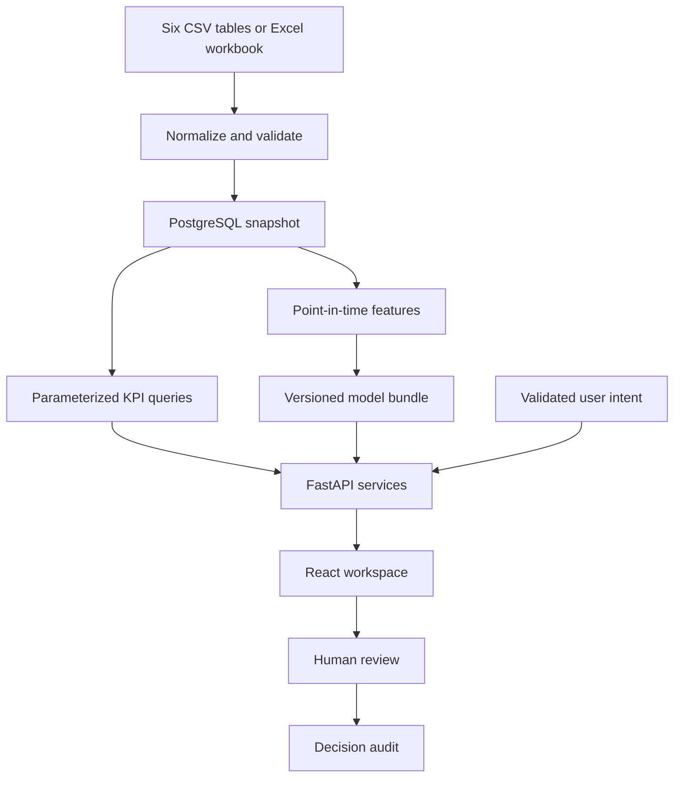

# Architecture

DecisionPilot AI follows the six-table retail and services model in the End-to-End Project Plan. The English UI is the competition-facing workspace. Vietnam local business dates and integer VND are used across the dataset.

| Layer | Design |
|---|---|
| Data | Six date-indexed business tables, snapshot metadata and append-only decision/query history. The database runs in PostgreSQL in Compose and SQLite in the basic local setup. |
| Quality and lineage | Normalize fields, enforce unique keys, reconcile sales, attribution, customer history and stock movements, then load atomically. A SHA-256-derived dataset ID pins models and audit evidence to one data version. Daily sales and campaign views are computed transactionally. |
| Business metrics | SQLAlchemy expressions with fixed columns and bound parameters. Dates and optional dimensions are validated against the dataset. Days without transactions are retained when charting trends. Campaign summaries use campaign and date grain; inventory uses physical SKU-days. |
| Modeling | LightGBM learns lag and calendar patterns by target across scopes, with seasonal-naive and moving-average baselines. Isolation Forest and rolling statistical signals identify unusual metrics. Physical stock risk compares closing stock with recent sales over lead time. |
| Decision | Each dimension explains the full observed KPI delta independently. Scenario functions use forecast demand or historical attribution. Recommendations use current alerts, forecast or scenario evidence and record a human response. |
| Natural language | Gemini, OpenAI or local rules extract a constrained intent. Python routes that intent to the same analytics used by the UI. Numbers and answers are assembled from executed results. |
| HTTP and UI | FastAPI exposes typed requests, generated OpenAPI and a stable JSON contract. React Query handles API state. Vite proxies local calls; the containerized UI serves the production bundle through Nginx. |

## Modeling decisions

- A transaction row represents one order line and one order for this MVP. One campaign may receive attribution for an order on its transaction date. The source cannot represent a multi-line basket, refunds, taxes or cross-channel attribution.
- One pooled model per target covers the total business, SKUs and categories. Independent scopes do not necessarily reconcile to a business forecast. SKU demand means observed units sold and can be censored by stockouts.
- Recursive forecasts use lag windows ending before each predicted date, the day of week, quarter, month and predefined public-calendar flags. Realized future spend, discounts, inventory and labels are excluded.
- Baseline selection uses validation MAE, and LightGBM must beat the best baseline by more than 2%. Seven-day and 30-day rolling origins use holdout data strictly after validation. Prediction interval widths use validation residual quantiles and their actual test coverage is exposed.
- Price elasticity and campaign response exponent are assumptions. Stock availability is simulated daily with configurable receipts and lead time. A shipment ordered today arrives after the stated full lead-time days. The objective can retain the baseline.
- The forecast and anomaly artifacts are trusted local files generated by the training pipeline. Artifact IDs are checked against the active snapshot.

## Consistency and deployment

PostgreSQL reads use repeatable-read read-only transactions with a statement timeout. SQLite local reads use a query-only snapshot. Snapshot writes and feedback serialize on a PostgreSQL advisory lock or a SQLite immediate transaction. Feedback is idempotent for the most recent identical decision and includes the dataset ID. An import that races with another writer must present the latest snapshot ID.

The Compose services are PostgreSQL, FastAPI and Nginx. The default connection uses the service host and local credentials supplied by the environment. The local project starts with synthetic data and no external providers.
