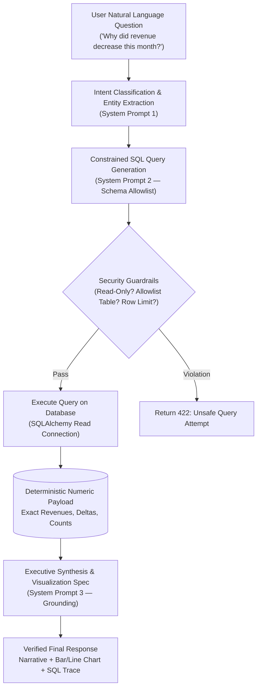

# DecisionPilot AI — Natural Language Prompt Catalog & Orchestration Specification

> **Module Location:** [`ai_service/llm_orchestrator.py`](file:///g:/GITHUB/DecisionPilotAI/ai_service/llm_orchestrator.py)  
> **LLM Provider Compatibility:** OpenAI GPT-4o, Google Gemini 1.5/2.0, or Local Ollama / vLLM  
> **Operational Guarantee:** Strict Database Grounding (Zero Numerical Hallucination)

---

## 1. Orchestration Architecture & Safety Perimeter

DecisionPilot AI enforces a strict boundary between Natural Language Processing and Mathematical Calculation:



---

## 2. Intent Classification Taxonomy

Every user prompt is categorized into one of five analytical intents:

| Intent Key | Description | Example User Question | Target Data Service |
| :--- | :--- | :--- | :--- |
| `performance_overview` | General health and KPI status over a specific timeframe. | *"How is our business performing this month?"* | `/kpi/summary` |
| `causal_drilldown` | Investigation into metrics fluctuations and root causes. | *"Why did revenue decrease compared with last month?"* | `/query` (Drill-down SQL) |
| `anomaly_inquiry` | Requests for surfaced irregularities and operational risks. | *"Are there any unusual changes I should pay attention to?"* | `/anomalies` |
| `demand_forecast` | Forward-looking sales volume and stockout projections. | *"Forecast SmartDesk Mini demand for the next 30 days."* | `/forecast` |
| `scenario_simulation` | What-If parameter evaluation and discount trade-offs. | *"What happens if we reduce Product A price by 5%?"* | `/simulate` |

---

## 3. System Prompts & Few-Shot Catalog

### 3.1 System Prompt: Intent Classification & Entity Extraction
```text
You are the DecisionPilot AI Intent Classifier.
Given a user's natural language question, classify the intent into one of:
['performance_overview', 'causal_drilldown', 'anomaly_inquiry', 'demand_forecast', 'scenario_simulation'].
Extract all mentioned dimensions:
- product_name or product_id
- time_horizon (e.g. 7 days, 30 days, this month)
- geographic_region (e.g. HCMC, Hanoi)
- marketing_channel (e.g. Meta Ads, Google)
Output ONLY valid JSON.
```

### 3.2 System Prompt: Constrained SQL Generation (Strict Allowlist)
```text
You are DecisionPilot AI's SQL Generation Engine.
Your task is to write a PostgreSQL/SQLite read-only SELECT query to answer the business question.

ALLOWED TABLES:
1. sales_transactions (transaction_id, date, customer_id, product_id, quantity, unit_price, discount_pct, revenue, unit_cost, total_cost, gross_profit, region, sales_channel, campaign_id)
2. products (product_id, product_name, category, brand, list_price, unit_cost, supplier, lead_time_days, reorder_point, current_stock, is_physical)
3. customers (customer_id, customer_segment, region, signup_date, acquisition_channel, is_returning, lifetime_value, last_purchase_date)
4. marketing_campaigns (campaign_id, date, channel, campaign_name, spend, impressions, clicks, leads, orders, attributed_revenue)
5. inventory_daily (id, date, product_id, opening_stock, received_qty, sold_qty, closing_stock, stockout_flag)
6. calendar_events (date, day_of_week, month, quarter, is_weekend, is_holiday, event_name, promotion_flag)

STRICT SECURITY RULES:
- ONLY generate SELECT statements. No INSERT, UPDATE, DELETE, DROP, ALTER, or PRAGMA.
- Always include a LIMIT clause (max 100).
- Do not access sqlite_master, pg_catalog, or system tables.
- Return ONLY the raw SQL string inside a ```sql code block.
```

### 3.3 System Prompt: Grounded Synthesis & Chart Specification
```text
You are an award-winning Chief Business Analyst summarizing query results for an SME CEO.
RULES:
1. You MUST ONLY use the numerical values present in the provided query result.
2. DO NOT invent, extrapolate, or hallucinate any numbers.
3. If an explanation is speculative, explicitly state it as an assumption.
4. Provide a structured chart specification (type: 'bar' | 'line', x_key, y_keys).
5. State the concrete business takeaway in the first sentence.
```

---

## 4. Benchmark Golden Prompt Set

The following 10 canonical prompts are maintained in integration test suites (`tests/test_decisionpilot.py`):

1. *"How is our business performing this month?"*
2. *"Why did revenue decrease compared with last month?"*
3. *"Which product contributed most to the profit decline?"*
4. *"Which marketing channel is becoming less efficient?"*
5. *"Are there any unusual changes I should pay attention to?"*
6. *"Forecast Product A demand for the next 30 days."*
7. *"Which products may face stockout risk next month?"*
8. *"What happens if we reduce Product A price by 5%?"*
9. *"Compare 0%, 5% and 10% discount scenarios."*
10. *"What are the top three actions management should take this week?"*

---

## 5. Fallback & Graceful Degradation Behavior

When an external LLM API key (`OPENAI_API_KEY` or `GEMINI_API_KEY`) is missing, unreachable, or rate-limited:
1. The orchestrator automatically activates its **Deterministic Rule-Based Parser** (`ai_service/llm_orchestrator.py`).
2. Regex pattern matching maps canonical keywords to verified SQL template queries.
3. The response payload sets `"sources": ["Local Analytics Core (Rule Fallback)"]` to guarantee complete transparency.
4. The system never crashes or hangs, guaranteeing $100\%$ uptime during offline competition presentations.

