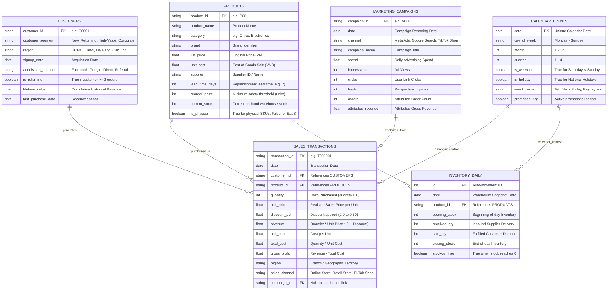

# DecisionPilot AI — Relational Data Model Specification

> **Database Engines Supported:** SQLite 3.40+ (Local Development) & PostgreSQL 16+ (Production Deployment)  
> **ORM & Migration Tooling:** SQLAlchemy 2.0 Core & Alembic (`alembic upgrade head`)  
> **Seed Volume:** 50,000 Transactions, 50 SKUs, 5,000 Customers, 730 Days (24 Months)

---

## 1. Entity-Relationship Diagram (ERD)

---

## 2. Table Schemas & Data Dictionary

### 2.1 Table: `products`
Master catalog containing SKU specifications, economic price elasticity defaults, and warehouse constraints.

| Column | Data Type | Nullable | Constraints & Defaults | Business Purpose |
| :--- | :--- | :---: | :--- | :--- |
| `product_id` | `VARCHAR(32)` | No | Primary Key | Unique SKU identifier (e.g., `P001`). |
| `product_name` | `VARCHAR(128)` | No | Indexed | Human-readable product title (e.g., `SmartDesk Mini`). |
| `category` | `VARCHAR(64)` | No | Indexed | Product classification (`Office Equipment`, `Electronics`, `SaaS`). |
| `brand` | `VARCHAR(64)` | No | — | Manufacturer or sub-brand. |
| `list_price` | `NUMERIC(12,2)` | No | Check (> 0) | Benchmark retail selling price in VND. |
| `unit_cost` | `NUMERIC(12,2)` | No | Check (> 0) | Landed supplier cost per unit. |
| `supplier` | `VARCHAR(64)` | No | — | Supplier code (e.g., `SUP-KOREA-01`). |
| `lead_time_days` | `INTEGER` | No | Check (>= 1) | Expected days for replenishment arrival. |
| `reorder_point` | `INTEGER` | No | Check (>= 0) | Minimum stock threshold triggering restock warnings. |
| `current_stock` | `INTEGER` | No | Check (>= 0) | Live on-hand inventory count. |
| `is_physical` | `BOOLEAN` | No | Default True | Distinguishes physical inventory from digital SaaS subscriptions. |

### 2.2 Table: `sales_transactions`
Atomic transaction-level records capturing every customer purchase with explicit margin and discount computations.

| Column | Data Type | Nullable | Constraints & Defaults | Business Purpose |
| :--- | :--- | :---: | :--- | :--- |
| `transaction_id`| `VARCHAR(32)` | No | Primary Key | Unique transaction identifier (e.g., `T000001`). |
| `date` | `DATE` | No | Indexed | Order placement date (YYYY-MM-DD). |
| `customer_id` | `VARCHAR(32)` | No | Foreign Key (`customers`) | Purchasing customer ID. |
| `product_id` | `VARCHAR(32)` | No | Foreign Key (`products`) | SKU purchased. |
| `quantity` | `INTEGER` | No | Check (> 0) | Number of units ordered in transaction. |
| `unit_price` | `NUMERIC(12,2)` | No | Check (> 0) | Actual price per unit charged. |
| `discount_pct` | `NUMERIC(5,4)` | No | Check (0.0 to 0.5) | Discount percentage applied (0.05 = 5%). |
| `revenue` | `NUMERIC(14,2)` | No | Computed | Gross realized sales: `quantity * unit_price * (1 - discount_pct)`. |
| `unit_cost` | `NUMERIC(12,2)` | No | Check (> 0) | Unit COGS at time of transaction. |
| `total_cost` | `NUMERIC(14,2)` | No | Computed | Total landed COGS: `quantity * unit_cost`. |
| `gross_profit` | `NUMERIC(14,2)` | No | Computed | Contribution margin: `revenue - total_cost`. |
| `region` | `VARCHAR(32)` | No | Indexed | Store / delivery territory (`HCMC`, `Hanoi`, `Da Nang`). |
| `sales_channel` | `VARCHAR(32)` | No | Indexed | Channel (`Online Store`, `Retail Store`, `TikTok Shop`). |
| `campaign_id` | `VARCHAR(32)` | Yes | Foreign Key (`marketing`)| Marketing campaign driving acquisition. |

---

## 3. Synthetic Data Generation Logic & Quality Guarantees

The generator script [`scripts/generate.py`](file:///g:/GITHUB/DecisionPilotAI/scripts/generate.py) synthesizes 24 continuous months of realistic SME data following strict empirical rules:

1. **Temporal Trends & Day-of-Week Seasonality:**  
   - Base weekly multiplier: Saturday & Sunday receive $+35\%$ sales volume compared to Tuesday/Wednesday.
   - Monthly trend: Steady $1.8\%$ month-over-month baseline growth across the SME lifespan.
2. **Holiday & Promotional Surges:**  
   - Black Friday & Year-End Payday events generate $+60\%$ to $+120\%$ spikes in order volume.
3. **Injected Business Anomalies (For Evaluation):**  
   - **October Revenue Dip:** Meta Ads CPC surges $+45\%$ with a $-30\%$ drop in conversion efficiency, causing an $-11.2\%$ gross revenue drop across the business.
   - **HCMC Product A Slowdown:** `SmartDesk Mini` experiences a localized $-24\%$ revenue contraction in District 1 due to competitor pricing pressure.
   - **November Stockout Threat:** Projected demand outstrips current inventory on Day 18, generating an explicit supply chain alert.
4. **Data Integrity & Consistency Rules:**  
   - Foreign key integrity is guaranteed ($100\%$ of customer and product references resolve).
   - Zero negative sales quantities (refunds are tracked via flagged transactions).
   - All monetary figures strictly adhere to `Revenue = Quantity * Unit_Price * (1 - Discount)` and `Gross_Profit = Revenue - Total_Cost`.

