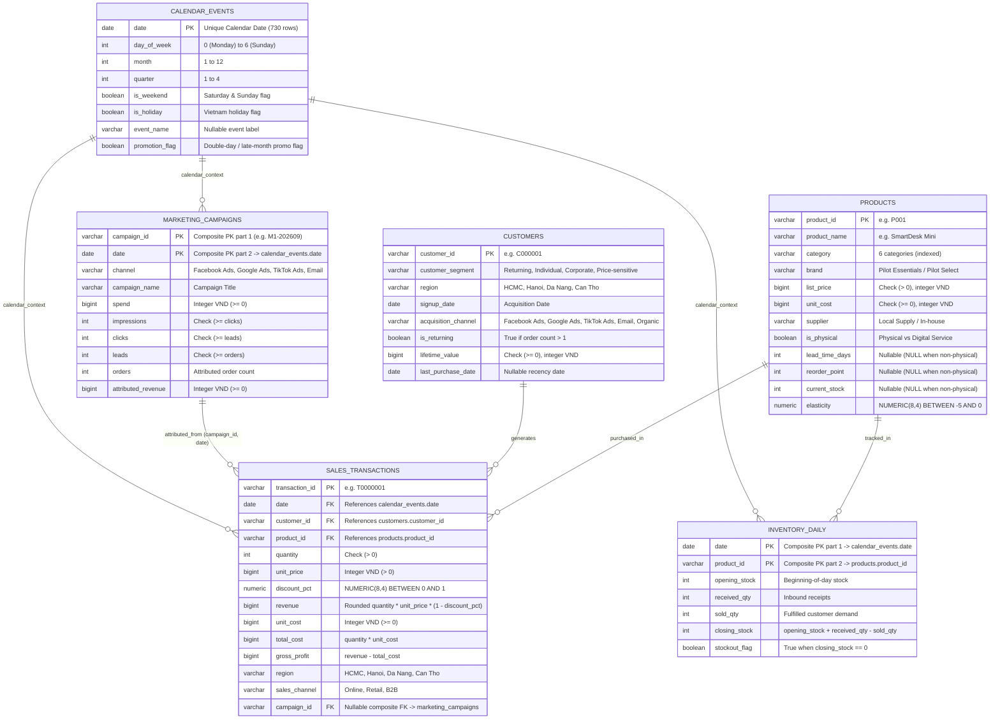

# DecisionPilot AI — Relational Data Model Specification

> **Database Engines Supported:** SQLite 3.45+ (Local Development) & PostgreSQL 16 (Docker & CI)  
> **ORM & Migration Tooling:** SQLAlchemy 2.0 Core & Alembic (`0001_initial`, `0002_decision_integrity`)  
> **Bundled Snapshot (`f32e87e3a5744333ff98d3bf`):** 50,000 Transactions, 50 SKUs, 10,000 Customers, 730 Days (`2024-10-01` to `2026-09-30`)

---

## 1. Entity-Relationship Diagram (ERD)

---

## 2. System Persistence Tables (`backend/app/db.py` & `alembic/`)

In addition to the 6 validated business tables above, the platform maintains 3 system tables:

1. `dataset_metadata`: Stores active single-workspace snapshot JSON metadata (`dataset_id`, row counts, bounds, provenance, injected test manifest).
2. `simulation_runs`: Persists full counterfactual scenario requests, baseline/alternative projections, sensitivity bands, and `dataset_id` keyed by SHA-256 `simulation_id`.
3. `audit_events`: Append-only event stream recording `dataset_loaded`, `query`, `scenario_feedback`, and `recommendation_feedback` with server-generated UTC timestamps. Protected against ordinary updates and deletes by database triggers created in migration [`0002_decision_integrity.py`](../backend/alembic/versions/0002_decision_integrity.py).

---

## 3. Core Table Details & Physical Constraints

- **`products` (50 rows):** Contains **34 physical SKUs** (`is_physical = true`, non-null `lead_time_days >= 1`, `reorder_point >= 0`, `current_stock >= 0`) and **16 digital/service SKUs** (`SaaS Service`, `Business Service`, `is_physical = false` with `NULL` inventory columns). `elasticity` defaults range in `[-5, 0]` (`SmartDesk Mini` `P001` = `-1.1`, `AirPure S` `P002` = `-1.4`).
- **`sales_transactions` (50,000 rows):** Monetary columns use exact integer `BIGINT` (`VND`). Database constraints enforce `total_cost = quantity * unit_cost` and `gross_profit = revenue - total_cost`. Only `Online` transactions may attach a composite `(campaign_id, date)` marketing attribution key.
- **`marketing_campaigns` (2,920 rows):** `4` channels (`Facebook Ads`, `Google Ads`, `TikTok Ads`, `Email`) $\times$ `730` days with composite PK `(campaign_id, date)` and funnel invariant `impressions >= clicks >= leads >= orders >= 0`.
- **`inventory_daily` (24,820 rows):** `34` physical SKUs $\times$ `730` days with composite PK `(date, product_id)` verifying day-to-day continuity (`next_opening = prev_closing`) and exact stock reconciliation.

---

## 4. Synthetic Data Generator & Evaluation Shocks (`scripts/generate.py`)

[`scripts/generate.py`](../scripts/generate.py) (`seed=42`, `end=2026-09-30`, currency `VND`) synthesizes seasonality, weekend/holiday/double-day traffic multipliers, and dated test anomalies (recorded in `metadata.json` solely for offline evaluation scoring):

1. **July 2026 Early Demand Shock (`early_shock`, 6 days from `end - 70d`):** Demand traffic scaled `0.75x`.
2. **FocusCam Pro (`P003`) Supply Interruption (`interruption` to `restore_supply - 1d`):** Replenishment paused from `early_shock - 10d` through `early_shock + 27d` (`stockout_event`).
3. **September 2026 Macro Contraction (`shock_start`, last 28 days):** Demand traffic `0.59x`, HCMC `P002`/`P003` SKU weights `0.26x`, returning customer share `44% -> 20%`.
4. **September 2026 Facebook Ads Efficiency Drop (last 28 days):** Facebook Ads spend `1.85x`, online attribution weight drops `25% -> 5.5%`, plus `+24` non-converting leads/day.
5. **Final-Period Stock & Margin Events:** `SmartDesk Mini` (`P001`) replenishment paused for the last 12 days (`stockout_risk`), and final 4 promotional days apply extra discounting (`margin`).

*(See [`DATA_DICTIONARY.md`](DATA_DICTIONARY.md) for the complete column-by-column contract used by CSV ZIP and XLSX snapshot uploads.)*
