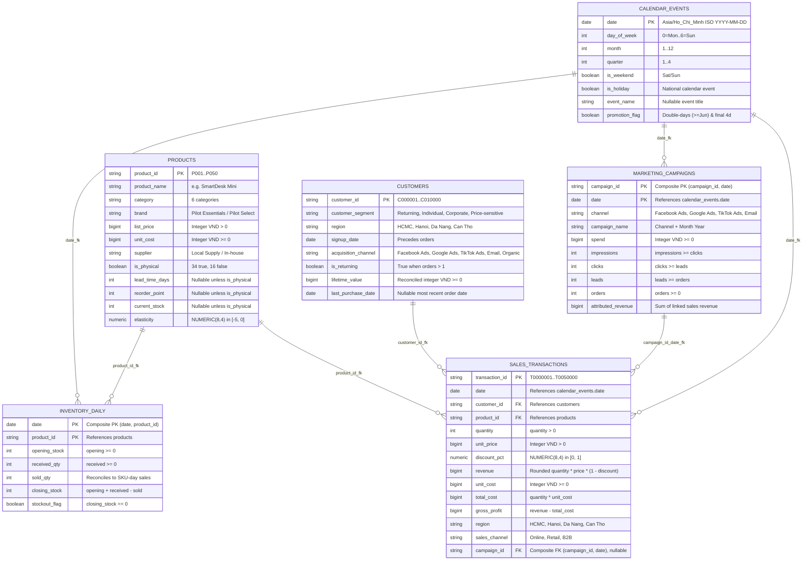

# DecisionPilot AI — Relational Data Model Specification

> **Database Engines Supported:** SQLite 3 (Local `data/local.sqlite`) & PostgreSQL 16 (Docker Compose / CI)  
> **ORM & Migrations:** SQLAlchemy 2.0.44 Core & Alembic 1.17.2 (`alembic upgrade head`)  
> **Bundled Snapshot Volume (`f32e87e3a5744333ff98d3bf`):** 50,000 Transactions, 50 SKUs (`34` physical / `16` digital service), 10,000 Customers, 2,920 Campaign-Days, 24,820 Inventory-Days across 730 Calendar Days

---

## 1. Entity-Relationship Diagram (ERD) ([`backend/app/db.py`](../backend/app/db.py))

### Runtime System & Governance Tables
In addition to the 6 business tables above, `backend/app/db.py` persists three system tables:
- `dataset_metadata` (`id`, `payload` JSON): stores active snapshot SHA-256 `dataset_id`, row counts, date range, and validation/injection manifest.
- `simulation_runs` (`id` SHA-256 `64`-char hex PK, `dataset_id`, `created_at`, `payload` JSON): stores immutable request + computed outcome bundles so `/scenarios/feedback` cites exact verified outputs.
- `audit_events` (`id`, `occurred_at`, `kind`, `subject`, `payload` JSON): append-protected history covering `query`, `dataset_loaded`, `recommendation_feedback`, and `scenario_feedback` (guarded by database triggers created in Alembic revision `0002_decision_integrity`).

---

## 2. Schema Constraints & Integrity Invariants (`backend/app/db.py`)

All integer currency columns use `BIGINT` (`VND`), and database `CheckConstraint` rules enforce accounting consistency:

- **`products` (`valid_product_price`, `valid_product_inventory`):** Enforces `list_price > 0`, `unit_cost >= 0`, `elasticity BETWEEN -5 AND 0`; physical SKUs require non-null `lead_time_days >= 1`, `reorder_point >= 0`, `current_stock >= 0`, whereas non-physical service SKUs enforce `NULL` for all three inventory fields.
- **`sales_transactions` (`valid_transaction`):** Enforces `quantity > 0`, `unit_price > 0`, `discount_pct BETWEEN 0 AND 1`, `total_cost = quantity * unit_cost`, `gross_profit = revenue - total_cost`, plus composite foreign key `["campaign_id", "date"] -> marketing_campaigns`.
- **`marketing_campaigns` (`valid_funnel`):** Enforces monotonic daily funnel counts `impressions >= clicks >= leads >= orders >= 0`, `spend >= 0`, `attributed_revenue >= 0`.
- **`inventory_daily` (`valid_inventory_movement`):** Composite PK `(date, product_id)`; enforces `opening_stock + received_qty - sold_qty = closing_stock` and `stockout_flag = (closing_stock = 0)`.

---

## 3. Synthetic Data Generation & Injected Events ([`scripts/generate.py`](../scripts/generate.py))

Using `seed=42`, `months=24`, `transactions=50_000`, `sku_count=50`, `customer_count=10_000`, ending `2026-09-30` (`start = 2024-10-01`):

1. **Statutory Holidays & Commercial Calendar:**
   - **5 Vietnam Holidays:** `1/1` (`New Year`), `4/30` (`Reunification Day`), `5/1` (`Labour Day`), `9/2` (`National Day`), and `12/25` (`Year-end shopping`) receive a `1.24x` demand multiplier.
   - **Promotions:** Double-day promos (`month == day` for months `6`–`12`, i.e., `6.6`..`12.12`) plus the final 4 days of history (`2026-09-27`–`2026-09-30`).
   - **Seasonality & Weekends:** Cosine annual curve plus weekend `1.20x` vs weekday `0.96x` weights.
2. **Dated Evaluation Shocks Recorded in Snapshot Manifest (`injected_events`):**
   - **Early Demand Shock (`early_shock`, 6 days starting `end - 70d`, July 2026):** Overall demand traffic `0.75x`.
   - **Macro Revenue & Channel Shock (`shock_start`, last 28 days `end - 27d..end`, Sept 2026):** Traffic `0.59x`, HCMC SKU `P002`/`P003` weights `0.26x`, returning customer probability `44% -> 20%`.
   - **Facebook Spend / ROAS / Conversion Shock (last 28 days, Sept 2026):** Facebook Ads spend `1.85x`, online FB attribution share drops `25% -> 5.5%`, with `+24` additional non-converting daily leads.
   - **FocusCam Pro (`P003`) Supply Interruption:** Replenishment suspended between `early_shock - 10d` and `early_shock + 27d` (`stockout_event`).
   - **SmartDesk Mini (`P001`) Replenishment Pause (last 12 days, `end - 11d..end`):** Tests `stockout_risk` forward warning rules.
   - **Late Promotion Margin Shift (final 4 days `end - 3d..end`):** Extra promotional discounting compressing daily margin (`margin`).

For column-by-column business definitions and KPI formulas, see [`DATA_DICTIONARY.md`](./DATA_DICTIONARY.md).
