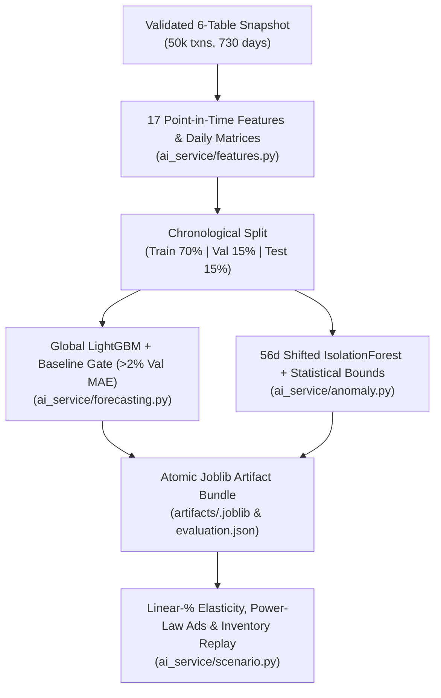

# DecisionPilot AI — Machine Learning Pipeline & Data Science Specification

> **Module Location:** [`ai_service/`](../ai_service/)  
> **Key Libraries:** LightGBM 4.6.0, scikit-learn 1.7.2, NumPy 2.2.6, Pandas 2.3.3, Joblib 1.5.2  
> **Artifacts Path:** [`artifacts/`](../artifacts/) (`dp-1.1` / `f32e87e3a5744333ff98d3bf`)

---

## 1. Machine Learning Architecture Overview



---

## 2. Exact 17 Point-in-Time Features (`ai_service/features.py`)

Forecast models train on daily histories normalized per series by `scale = max(train_mean, 1.0)`. All 17 features strictly use observations at $\le t - 1$:

| Feature (`FEATURES`) | Category | Definition / Formula |
| :--- | :---: | :--- |
| `lag_1`, `lag_7`, `lag_14`, `lag_28` | Lag | Scaled target observation 1, 7, 14, and 28 days prior. |
| `mean_7`, `std_7` | Rolling 7d | 7-day trailing mean and standard deviation. |
| `mean_14`, `std_14` | Rolling 14d | 14-day trailing mean and standard deviation. |
| `mean_28`, `std_28` | Rolling 28d | 28-day trailing mean and standard deviation. |
| `growth_7` | Momentum | `(lag_1 - lag_7) / max(lag_7, 0.1)`, clipped to `[-3, 3]`. |
| `weekday`, `month`, `quarter` | Calendar | Day index (`0..6`), calendar month (`1..12`), quarter (`1..4`). |
| `weekend`, `holiday` | Indicator | Binary flags for weekend (`weekday >= 5`) and Vietnam holidays. |
| `scale` | Scale | `log1p(train_mean)` enabling one global scaled GBDT across business, category & SKU grains. |

### Chronological Anti-Leakage Partition
- **Train Split (70%):** `2024-10-01` to `2026-02-22`.
- **Validation Split (15%):** `2026-02-23` to `2026-06-12` *(subdivided into independent selection and calibration segments when `validation_len >= 2 * horizon`)*.
- **Holdout Test Split (15%):** `2026-06-13` to `2026-09-30` *(112 test days; rolling origins stride `7d` or `14d`)*.

---

## 3. Demand Forecasting Model & Baseline Gate (`ai_service/forecasting.py`)

### 3.1 Hyperparameter Configuration (`dp-1.1`)
Trained across `revenue`, `orders`, and `demand` on commodity CPU (`n_jobs=2`, single-threaded booster prediction):

```python
LGBMRegressor(
    n_estimators=125,
    learning_rate=0.045,
    num_leaves=23,
    min_child_samples=28,
    random_state=42,
    verbosity=-1,
    n_jobs=2,
)
```

### 3.2 Strict >2% Validation Gate & Empirical Intervals
For every `(target, scope, horizon)` slice (`7d` and `30d` horizons):
- Candidate `LightGBM` competes against `moving_average` (14-day trailing mean) and `seasonal_naive` (7-day repeating weekly lag).
- `LightGBM` is selected **only when** $\text{MAE}_{\text{val}}(\text{LGBM}) < 0.98 \times \min(\text{MAE}_{\text{val}}(\text{moving\_average}), \text{MAE}_{\text{val}}(\text{seasonal\_naive}))$.
- Empirical `90%` intervals calibrate absolute validation residuals separately over lead days `1–7` and `8–30`.

### 3.3 Measured Holdout Results (`artifacts/MODEL_EVALUATION.md`)

| Target | Scope | Horizon | Selected Model | Test MAE | Test WAPE | 90% Band Coverage |
| :--- | :---: | :---: | :---: | :---: | :---: | :---: |
| `revenue` | `all` | 7d | `moving_average` | 30,671,734.57 ₫ | 21.84% | 91.96% |
| `revenue` | `all` | 30d | `moving_average` | 34,584,971.67 ₫ | 24.14% | 83.81% |
| `orders` | `all` | 30d | `moving_average` | 14.98 | 23.22% | 83.81% |
| `demand` | `all` | 30d | `moving_average` | 17.74 | 23.46% | 80.00% |
| `demand` | `sku:P001` | 30d | **`lightgbm`** | **2.68 units** | **41.87%** | **92.86%** |

*(Notice: because LightGBM does not beat `moving_average` by `>2%` on smooth aggregate revenue during validation, the baseline is transparently served at business scale while `lightgbm` is promoted on `sku:P001`.)*

---

## 4. Hybrid Anomaly Detection Engine (`ai_service/anomaly.py`)

Each monitored daily signal uses a **56-day trailing baseline excluding the most recent 7 days** (`values.shift(7).rolling(56, min_periods=28)`) so ongoing regime shifts do not contaminate their own baseline:

```python
model = IsolationForest(
    n_estimators=120,
    contamination=0.065,
    random_state=42,
    n_jobs=1,
)
```

Alert flagging combines three statistical & domain layers:
1. **Directional Hybrid Flag:** `IsolationForest` decision score `< 0` paired with minimum relative deviation & robust Z-score thresholds (`relative >= 0.09..0.35`, `|robust_z| >= 1.25..2.5` depending on metric).
2. **Sustained Revenue Contraction (`revenue` only):** Compares complete 7-day rolling weekly average against the shifted 56-day weekly reference (`weekly < baseline * 0.85` and robust gap `>= 2.5`).
3. **Physical Stockout Rule (`inventory_risk`):** Flags physical SKUs whose closing stock falls below `28d trailing daily sell rate * lead_time_days` (`18.75%` precision / `25.00%` recall on test; disclosed as limited).

*(On synthetic holdout labels: `facebook_spend` achieves **100.00% precision, 82.14% recall, 90.20% F1**; `revenue` achieves **86.67% precision, 38.24% recall**.)*

---

## 5. Microeconomic What-If Engine (`ai_service/scenario.py`)

Scenario simulations compute conditional projections (never claimed as randomized causal effects):

1. **Price & Discount Scenario:**
   $$Q_{\text{sim}} = Q_0 \times \max\left(0,\; 1 + \varepsilon \cdot \left(\frac{P_{\text{new}}}{P_{\text{base}}} - 1\right)\right), \quad Q_{\text{fulfilled}} = \min\left(Q_{\text{sim}}, \text{Stock On Hand}\right)$$
   *(Evaluated at baseline 90d realized price and catalog/overridden elasticity $\varepsilon \in [-5, 0]$, e.g., `-1.1` for `P001`, plus $\varepsilon \pm 0.3$ sensitivity sweeps.)*
2. **Marketing Budget Scenario (Diminishing Returns):**
   $$\text{Attributed Revenue}_{\text{sim}} = \text{Attributed Revenue}_{\text{base}} \times (1 + \Delta \text{Budget})^{\alpha}$$
   *(Default exponent $\alpha = 0.65 \in [0.2, 0.95]$ across `Facebook Ads`, `Google Ads`, `TikTok Ads`, or `Email`, plus $\alpha \pm 0.15$ sensitivity sweeps.)*
3. **Inventory Safety Buffer Scenario:** Simulates daily ending stock trajectories across lead-time replenishment quantities, surfacing days to depletion and unfulfilled shortage units.
