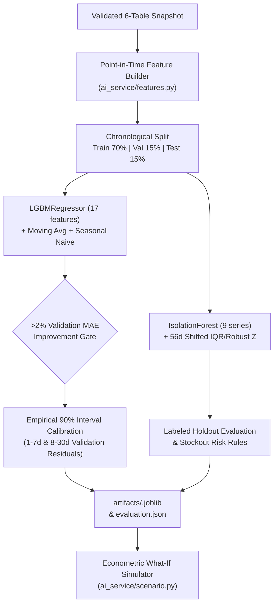

# DecisionPilot AI — Machine Learning Pipeline & Econometric Specification

> **Modules:** [`ai_service/features.py`](../ai_service/features.py), [`ai_service/forecasting.py`](../ai_service/forecasting.py), [`ai_service/anomaly.py`](../ai_service/anomaly.py), [`ai_service/scenario.py`](../ai_service/scenario.py)  
> **Key Libraries:** LightGBM `4.6.0`, scikit-learn `1.7.2`, Pandas `2.3.3`, NumPy `2.2.6`, Joblib `1.5.2`  
> **Active Bundle (`dp-1.1`):** [`artifacts/f32e87e3a5744333ff98d3bf.joblib`](../artifacts/f32e87e3a5744333ff98d3bf.joblib) & [`artifacts/MODEL_EVALUATION.md`](../artifacts/MODEL_EVALUATION.md)

---

## 1. End-to-End ML Architecture



---

## 2. Exact 17 Forecast Features (`ai_service/features.py`)

`lag_features()` constructs 17 strictly causal features scaled by series mean (`scale = max(mean_train, 1)`), using only observations up to index $t-1$ (minimum 28-day lookback):

| Index | Feature Name | Definition & Leakage Safeguard |
| :---: | :--- | :--- |
| `1–4` | `lag_1`, `lag_7`, `lag_14`, `lag_28` | Scaled demand/revenue/order lags at `t-1`, `t-7`, `t-14`, `t-28`. |
| `5–10` | `mean_7`, `std_7`, `mean_14`, `std_14`, `mean_28`, `std_28` | Rolling mean and population std over trailing `7`, `14`, and `28` days (normalized by `scale`). |
| `11` | `growth_7` | `clip((lag_1 - lag_7) / max(lag_7, 0.1), -3, 3)` short-term momentum ratio. |
| `12–16` | `weekday`, `month`, `quarter`, `weekend`, `holiday` | Known calendar covariates (`holiday` resolved from `calendar_events` or `HOLIDAYS = {(1,1),(4,30),(5,1),(9,2),(12,25)}`). |
| `17` | `scale` | `np.log1p(scale)` allowing pooled learning across business-wide, category, and SKU volumes. |

---

## 3. Forecasting Training, Baseline Gate & Interval Calibration (`ai_service/forecasting.py`)

### 3.1 Hyperparameters & Recursive Rollout
One pooled `LGBMRegressor` is fit per target (`revenue`, `orders`, `demand`) on `2024-10-01`–`2026-02-22` (`train_end = 70%`):
```python
LGBMRegressor(
    n_estimators=125,
    learning_rate=0.045,
    num_leaves=23,
    min_child_samples=28,
    random_state=42,
    verbosity=-1,
    n_jobs=2,
)
```
Multi-step predictions (`horizon` $\in \{7, 30\}$) roll recursively day-by-day, feeding non-negative predictions `max(0, y_hat)` back into `window` alongside two baselines:
- `seasonal_naive`: repeats `history[:, -7 + lead % 7]`
- `moving_average`: constant trailing 14-day mean `history[:, -14:].mean(axis=1)`

### 3.2 The >2% Validation Selection Gate & Empirical 90% Bands
When `validation_end - train_end >= 2 * horizon`, validation splits into disjoint `selection_range` and `calibration_range`:
1. **Model Selection:** LightGBM is chosen for `(target, scope, horizon)` only if `val_mae["lightgbm"] < 0.98 * val_mae[best_baseline]`.
2. **Calibration:** Absolute errors on `calibration_range` compute two empirical quantile radii (`NOMINAL = 0.90`, order statistic rank `ceil((N + 1) * 0.90)`): one for lead days `1–7` and a wider band for lead days `8–30`.

### 3.3 Verified 30-Day Holdout Metrics (`2026-06-13` to `2026-09-30`, `dp-1.1`)

| Target | Scope | Selected Model | Test MAE | Test WAPE | 90% Coverage | Note |
| :--- | :---: | :---: | :---: | :---: | :---: | :--- |
| `revenue` | `all` | `moving_average` | 34,584,971.67 ₫ | 24.14% | 83.81% | LightGBM (`22.96%` test WAPE) did not clear `>2%` gate on validation (`15.59%` vs `16.49%`). |
| `orders` | `all` | `moving_average` | 14.98 | 23.22% | 83.81% | Baselines generalize robustly across smooth aggregate traffic. |
| `demand` | `all` | `moving_average` | 17.74 | 23.46% | 80.00% | Aggregate units follow `moving_average` stability. |
| `demand` | `sku:P001` | **`lightgbm`** | **2.68** | **41.87%** | **92.86%** | Beats MA (`43.28%` WAPE) & Seasonal Naive (`54.54%` WAPE). |

*(7-day horizon `revenue | all` selects `moving_average` with `21.84%` test WAPE and `91.96%` empirical interval coverage).*

---

## 4. Hybrid Anomaly Detection Engine (`ai_service/anomaly.py`)

To prevent an active crisis from distorting its own baseline, daily metrics compare today's value against a **56-day trailing reference shifted back 7 days (`shift(7).rolling(56, min_periods=28)`)**:
- `robust_z = (actual - median) / ((q3 - q1) / 1.349)` with relative spread floor `0.03 * |median| + 1e-8`.
- `IsolationForest(n_estimators=120, contamination=0.065, random_state=42)` trained on training-period `(robust_z, z)` pairs across 9 monitored signals.
- Direction-aware flagging requires minimum relative magnitude (`0.35` for ROAS/conversion, `0.09` for margin, `0.20` for spend/revenue) combined with `|robust| >= threshold` or `(isolation_score < 0 and |robust| >= ml_threshold)`.
- **Sustained Contraction Signal (Added in `dp-1.1`):** Flags 7-day rolling weekly `revenue < 0.85 * baseline` and robust decline $\ge 2.5$.
- **Physical Inventory Check (`inventory_risk`):** Flags physical SKU-days where `closing_stock < trailing_28d_rate * lead_time_days`.

| Signal | Precision | Recall | F1-Score | FPR |
| :--- | :---: | :---: | :---: | :---: |
| `facebook_spend` (`hybrid`) | **100.00%** | **82.14%** | **90.20%** | **0.00%** |
| `revenue` (`hybrid`) | 86.67% | 38.24% | 53.06% | 2.63% |
| `facebook_conversion` (`hybrid`) | 75.00% | 75.00% | 75.00% | 8.54% |
| `facebook_roas` (`hybrid`) | 68.00% | 60.71% | 64.15% | 9.76% |
| `margin` (`hybrid`) | 50.00% | 75.00% | 60.00% | 2.83% |
| `stockout_risk` (`business_rule`) | 18.75% | 25.00% | 21.43% | 13.27% |

---

## 5. Counterfactual What-If Calculators (`ai_service/scenario.py`)

1. **Price Elasticity (`price_scenario`):** Linear in percentage change from 90-day weighted realized unit price $P_0$:
   $$Q_{\text{demand}} = Q_{\text{forecast}} \cdot \max\left(0,\; 1 + e \cdot \left(\frac{P_{\text{new}}}{P_0} - 1\right)\right), \qquad Q_{\text{sold}} = \min(Q_{\text{demand}},\; \text{stock})$$
   Evaluates sensitivity across $(e - 0.30, e, e + 0.30)$.
2. **Marketing Budget (`marketing_scenario`):** Power-law response over trailing 28 observed channel days prorated to horizon `7` or `30`:
   $$\text{uplift} = (1 + \Delta \text{Spend})^\alpha, \qquad \alpha \in [0.20, 0.95] \text{ (default } 0.65\text{)}$$
   Sensitivity sweeps $\alpha \pm 0.15$.
3. **Inventory Replenishment (`inventory_scenario`):** Steps daily over forecast demand, crediting `incoming_stock` + `order_qty` at `arrival_day` and counting `lost_units`, `stockout_days`, and `below_safety_days` against `reorder_point`.
4. **7-Day Conditional Replay (`artifacts/scenario_backtest.json`):** Weekly observed `P001` units improved from `24.24%` baseline WAPE to **`23.99%` WAPE**; `P003` stock depletion checks matched **`15/15` weeks**; weekly Facebook Ads attributed revenue recorded `33.00%` WAPE vs `25.44%` baseline (disclosed explicitly on UI).
