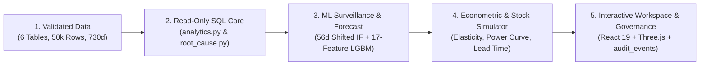

# DecisionPilot AI — Research & Innovation Overview

> **Competition Track:** AI for Business Innovation 2026 — LIKELION & K-TECH College  
> **Project Title:** AI-Powered Business Data Analysis, Forecasting and Decision Support System for SMEs  
> **Author & Project Lead:** Nguyễn Trí Bảo Thắng  
> **Domain:** Applied Artificial Intelligence, Decision Intelligence, Econometric Decision Support

---

## 1. Abstract

Small and Medium Enterprises (SMEs) represent the majority of businesses in Vietnam and across regional markets, yet routinely operate inside a **Decision Bottleneck**: operational transactions, marketing spend, and warehouse balances accumulate daily without unified diagnostic analytics, statistically controlled anomaly monitoring, demand forecasting, or pre-execution scenario evaluation.

**DecisionPilot AI** implements a closed-loop decision intelligence architecture spanning six relational workspaces and a constrained natural-language copilot: **Ask → Understand → Predict → Simulate → Decide**. Across our reproducible 24-month, 50,000-transaction synthetic enterprise benchmark (`dataset_id: f32e87e3a5744333ff98d3bf`, model bundle `dp-1.1`), the system achieves **46/46 (100%)** execution and numerical accuracy on bilingual VI/EN query benchmarks (`1,432.2 ms` median latency), **100.00% precision / 90.20% F1** on anomalous Facebook spend detection (`0.00%` FPR), **21.84% (7d) / 24.14% (30d) aggregate revenue WAPE** under a strict `>2%` baseline-gating protocol with **92.86% calibrated 90%-interval coverage** on flagship SKU `P001` (`SmartDesk Mini`), and **23.99% WAPE** on 7-day conditional scenario replay—executing entirely on CPU hardware without requiring cloud GPUs.

---

## 2. Problem Background & Architecture Philosophy

### 2.1 Why Static BI and Free-Form LLM Chatbots Fall Short
- **Traditional Dashboards** visualize past totals without attributing multi-dimensional drivers (`product`, `category`, `region`, `channel`) or integrating forecast uncertainty with stock lead-time bounds.
- **Unconstrained Text-to-SQL Chatbots** hallucinate numbers, leak schemas, or emit fragile SQL queries prone to injection or semantic drift.

DecisionPilot AI eliminates hallucinated arithmetic by enforcing strict domain typing (`Intent` with `extra="forbid"`) bound to pre-audited SQLAlchemy Core queries on `READ ONLY` transactions, pairing empirical machine learning directly with transparent econometric formulas.

---

## 3. System Methodology & Validation Protocol

### 3.1 Anti-Leakage Chronological Evaluation
To prevent temporal autocorrelation leakage:
- **Train Split (`70%`):** `2024-10-01` to `2026-02-22` — scales and fits pooled `LGBMRegressor` models plus `IsolationForest` anomaly models.
- **Validation Split (`15%`):** `2026-02-23` to `2026-06-12` — split into disjoint selection and residual calibration ranges when sufficient history exists; enforces the **`>2%` validation MAE improvement gate** before promoting LightGBM over `moving_average` or `seasonal_naive`.
- **Holdout Test Split (`15%`):** `2026-06-13` to `2026-09-30` — evaluated on unseen rolling origins with disclosed overlapping-origin and stockout-censoring notes.

---

## 4. Empirical Holdout Results (`artifacts/MODEL_EVALUATION.md`)

1. **Demand & Revenue Forecasting (`dp-1.1`):**
   - Enterprise-wide (`revenue | all`): `moving_average` wins validation selection cleanly (`34,584,971.67 ₫` 30d MAE, **24.14% WAPE**, `83.81%` empirical 90%-interval coverage; 7d achieves **21.84% WAPE** and **91.96% coverage**), preventing unnecessary model complexity when smooth series favor averaging.
   - Per-SKU Flagship (`demand | sku:P001`): **LightGBM** beats both baselines on validation (`2.68` units 30d MAE, **41.87% WAPE** vs. `43.28%` Moving Average and `54.54%` Seasonal Naive) while achieving **`92.86%`** empirical coverage.
2. **Anomaly Surveillance & Attribution:**
   - Using a **56-day trailing window shifted 7 days prior**, hybrid `IsolationForest` + IQR + robust Z-score detects Facebook spend spikes at **100.00% precision / 82.14% recall / 90.20% F1 (`0.00%` FPR)** and revenue contractions at **86.67% precision** (`2.63%` FPR).
3. **Scenario Simulation & Conditional Replay:**
   - 7-day holdout replay yields **23.99% WAPE** on weekly `P001` observed units (improving over `24.24%` baseline) and **15/15** weekly match on `P003` depletion checks (`artifacts/scenario_backtest.json`).
4. **Constrained Natural Language Copilot (`artifacts/query_benchmark.json`):**
   - **46/46 (100%)** benchmark accuracy across English, Vietnamese, and adversarial/out-of-scope refusal prompts.

---

## 5. Practical Value & Responsible AI Design

- **Commodity Hardware Accessibility:** Trained bundles (`artifacts/f32e87e3a5744333ff98d3bf.joblib`) fit comfortably in CPU containers (`python:3.12-slim`) with local fallback rules requiring zero paid API calls when `LLM_PROVIDER=none`.
- **Mandatory Human Governance:** Every recommendation acceptance/rejection and scenario decision is verified by an operator and appended to `audit_events` (`accepted` / `rejected`), never triggering autonomous billing, price changes, or purchase orders.
