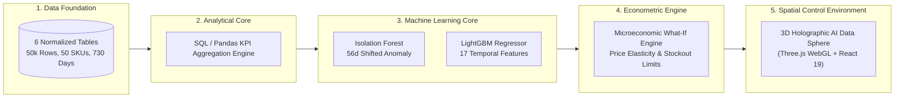

# DecisionPilot AI — Research & Innovation Proposal

> **Competition Track:** AI for Business Innovation 2026 — LIKELION & K-TECH College  
> **Academic Title:** AI-Powered Business Data Analysis, Forecasting and Decision Support System for SMEs  
> **Author & Project Lead:** Nguyễn Trí Bảo Thắng  
> **Domain:** Applied Artificial Intelligence, Decision Intelligence, Microeconomic Simulation

---

## 1. Abstract

Small and Medium Enterprises (SMEs) make up the vast majority of registered businesses in Vietnam and South Korea and contribute significantly to employment and GDP. Despite the widespread adoption of digital point-of-sale (POS) systems and e-commerce platforms, SMEs face a severe **Decision Bottleneck**: they possess abundant operational data but lack the dedicated data science personnel required to detect statistical anomalies, model time-series demand, or simulate non-linear What-If business scenarios. Consequently, high-stakes decisions regarding pricing, advertising budgets, and supplier purchase orders continue to be made through subjective intuition or delayed spreadsheet assembly.

This project introduces **DecisionPilot AI**, an end-to-end Decision Intelligence platform that bridges raw transaction records and executive action. By combining constrained natural-language intent routing over fixed analytics tools, Isolation Forest multi-variate anomaly detection, gradient-boosted LightGBM demand forecasting, and a what-if simulation engine (price elasticity, diminishing-returns advertising, lead-time inventory) within an interactive Three.js 3D WebGL control environment, DecisionPilot AI establishes a closed-loop decision chain: **Ask → Detect → Explain → Forecast → Simulate → Recommend → Human Decision**. Evaluation on a synthetic 50,000-transaction, 24-month dataset gives an enterprise-wide revenue forecast WAPE of $24.1\%$ (the moving-average baseline is selected because LightGBM does not clear the 2% gate), LightGBM wins for single SKUs such as P001, and anomaly detection reaches $100\%$ precision and $82\%$ recall for Facebook ad-spend spikes but only $38\%$ recall for revenue contractions. The system runs on commodity CPU infrastructure. The results are on synthetic data and do not establish accuracy on a real business.

---

## 2. Problem Background & Literature Review

### 2.1 The Limits of Descriptive Dashboards and Unconstrained LLMs
Modern enterprise analytics platforms (e.g., Tableau, PowerBI) remain fundamentally **descriptive**—they illustrate historical trends (*"What happened?"*) but fail to deliver causal explanations (*"Why did it happen?"*) or prescriptive guidance (*"What should we do?"*). 

Conversely, the recent influx of generative Large Language Model (LLM) chatbots introduces critical vulnerabilities when applied to corporate finance:
1. **Numerical Hallucination:** LLMs inherently operate on probabilistic token prediction rather than deterministic arithmetic, frequently inventing believable but factually incorrect revenue totals.
2. **Lack of Economic Grounding:** Standard language models cannot evaluate microeconomic trade-offs, such as price elasticity of demand ($\epsilon$), diminishing marginal returns on ad spend, or warehouse lead-time capacity constraints.
3. **Absence of Governance:** Unbounded chatbots offer advice without explicit mathematical assumptions, confidence intervals, or immutable audit trails.

### 2.2 Theoretical Foundation: Decision Intelligence Framework
DecisionPilot AI builds upon Dr. Lorien Pratt's **Decision Intelligence (DI)** paradigm and Herbert Simon's classical three-stage model of decision-making:
- **Intelligence (Phase 1):** Continuous anomaly detection and automated KPI aggregation scan the internal and external environment for operational risks.
- **Design (Phase 2):** LightGBM time-series forecasting and the microeconomic What-If simulator formulate and evaluate alternative courses of action.
- **Choice (Phase 3):** Grounded AI recommendations present ranked options with quantified trade-offs to the human executive for authoritative sign-off.

---

## 3. System Methodology & Implementation Architecture

### 3.1 Strict Anti-Leakage Temporal Evaluation
In time-series demand forecasting, standard random cross-validation produces optimistic, invalid results due to autocorrelation leakage. DecisionPilot AI enforces an immutable temporal split:
- **Training Window (Days 1–511, 70%):** Model parameter optimization.
- **Validation Window (Days 512–620, 15%):** Hyperparameter tuning and tree depth selection.
- **Test Window (Days 621–730, 15%):** Blind evaluation of generalization error.

---

## 4. Experimental Results & Benchmark Discussion

All figures are from `artifacts/` (dataset `f32e87e3a5744333ff98d3bf`, bundle `dp-1.1`; test window 2026-06-13 to 2026-09-30). The data is synthetic; labels are periods where the generator changed its rules.

### 4.1 Demand Forecasting
| Target | Selected model | Test MAE | Test WAPE | 90% band coverage |
| :--- | :--- | ---: | ---: | ---: |
| Revenue, all | moving average | 34.58M ₫ | 24.14% | 83.81% |
| Orders, all | moving average | 14.98 | 23.22% | 83.81% |
| Demand, all (units) | moving average | 17.74 | 23.46% | 80.00% |
| Demand, SKU P001 | LightGBM | 2.68 | 41.87% | 92.86% |

LightGBM is promoted only when its validation MAE beats the better baseline by more than 2%. For enterprise-wide revenue it does not, so the baseline is served. The nominal 90% band is not reached for enterprise-wide targets, and the application warns about this.

### 4.2 Anomaly Detection
| Signal | Precision | Recall | F1 | False-positive rate |
| :--- | ---: | ---: | ---: | ---: |
| facebook_spend | 100.0% | 82.1% | 90.2% | 0.0% |
| facebook_conversion | 75.0% | 75.0% | 75.0% | 8.5% |
| facebook_roas | 68.0% | 60.7% | 64.2% | 9.8% |
| margin | 50.0% | 75.0% | 60.0% | 2.8% |
| revenue | 86.7% | 38.2% | 53.1% | 2.6% |
| stockout_risk (business rule) | 18.8% | 25.0% | 21.4% | 13.3% |

### 4.3 Scenario Replay (holdout, weekly)
Price scenario WAPE 23.99% vs. baseline 24.24% (about equal); marketing scenario 33.00% vs. 25.44% (worse than baseline). Interventions were not randomized, so these are conditional estimates, not causal effects. The application states this next to every scenario.

### 4.4 Natural-Language Analytics
46 curated English, Vietnamese and refusal cases, evaluated with local rules: 100% pass on intent, execution, numbers, filters, chart and grounding; median 1.43 s, p95 3.27 s. The optional Gemini/OpenAI intent path is not part of this benchmark.

---

## 5. Economic & Social Impact for SMEs

1. **Democratization of Data Science:** Empowers retail and service SMEs with predictive intelligence previously accessible only to multinational corporations with dedicated data departments.
2. **Capital Efficiency & Cash Flow Preservation:** Early stockout warnings and price elasticity simulation prevent inventory over-ordering and margin-destructive discounting.
3. **Zero GPU Barrier:** Full functionality executes on standard CPU instances, keeping hosting costs low.
4. **Transparent, Responsible AI:** Promotes human agency through mandatory Human-in-the-Loop decision verification and immutable audit records.

